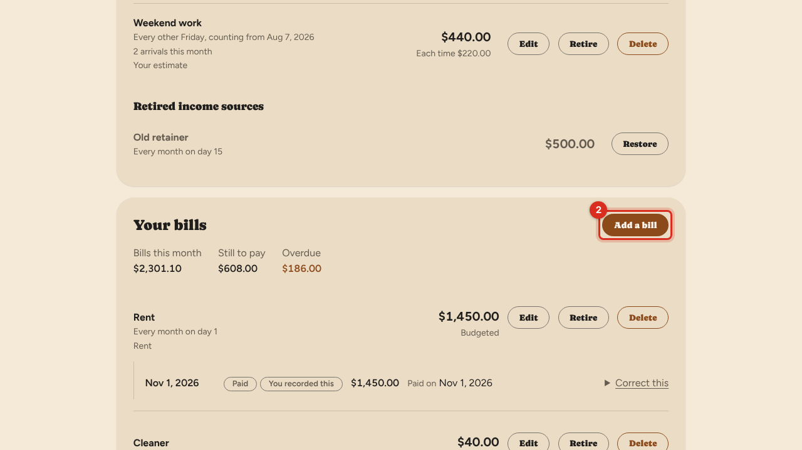
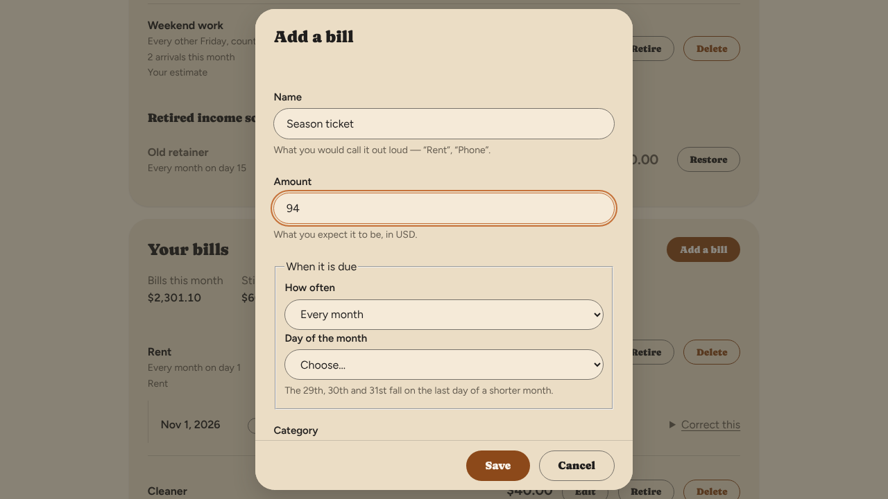
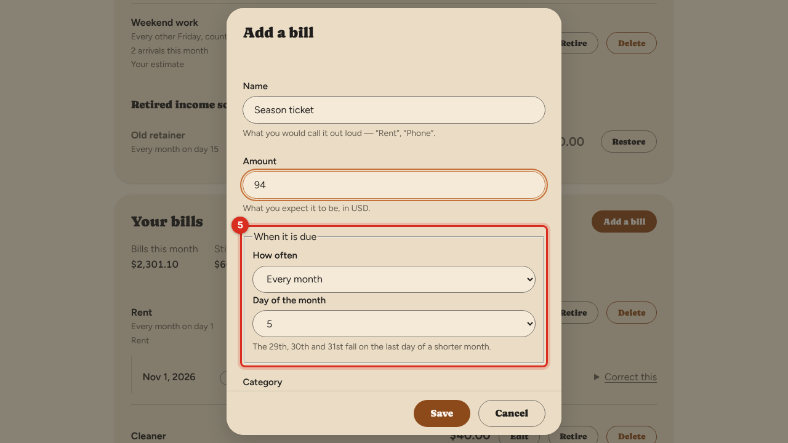
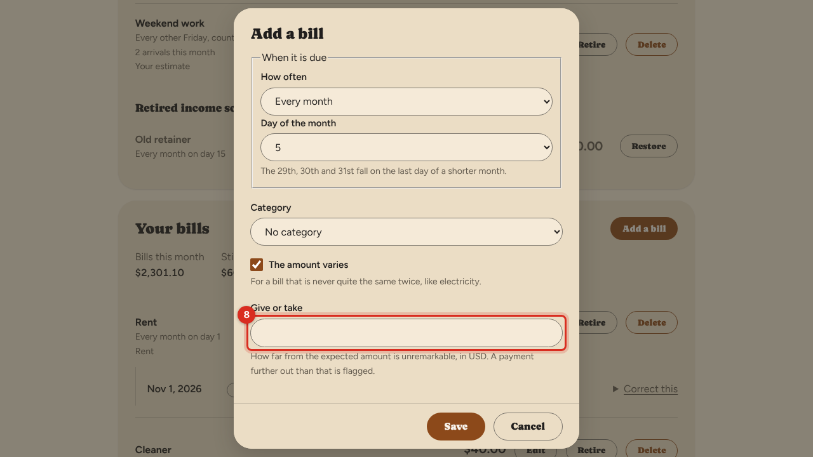
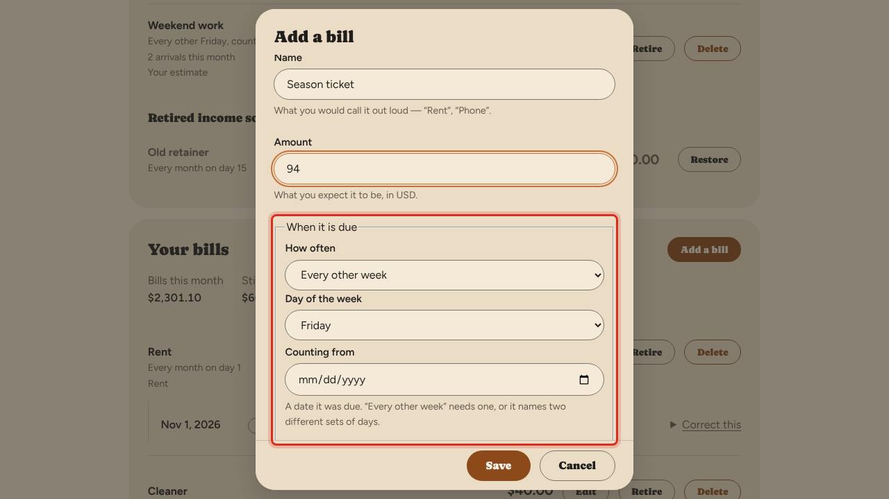
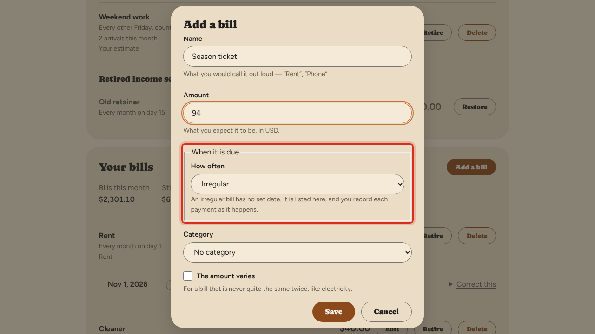
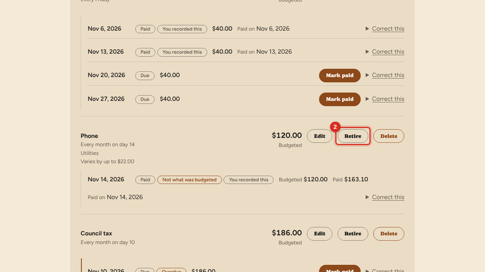
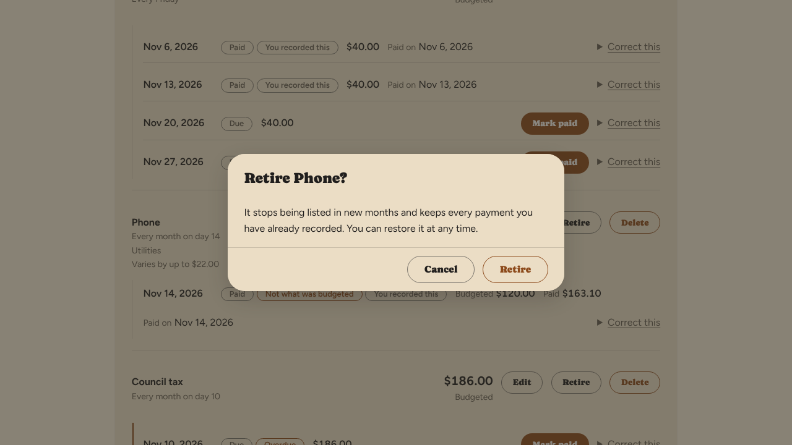
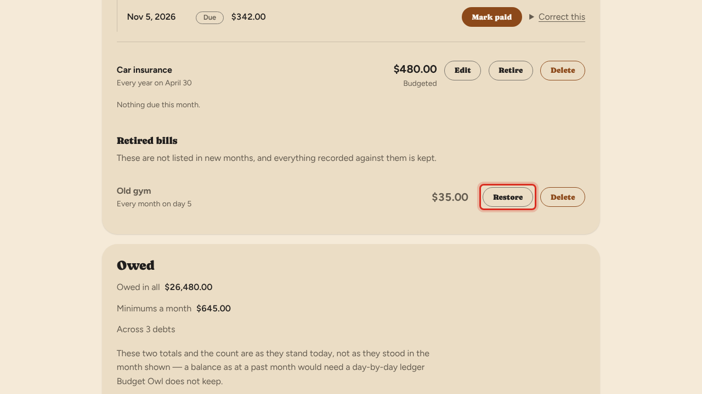
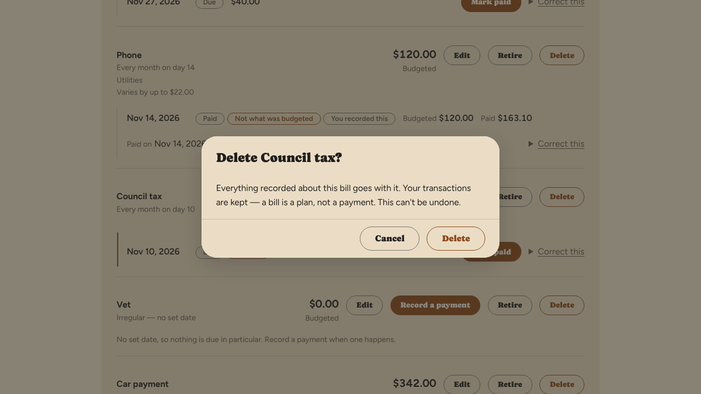

# Add a bill

A bill is something that leaves on a date — rent, a phone contract, a season ticket. Add it once
and Budget Owl lists it in every month it falls in, before it's due, so nothing catches you out.

**A bill is a plan, not a payment.** Adding one doesn't move any money and doesn't create a
transaction. It tells Budget Owl what you expect to go out, so the page can say what's left.

## Before you start

- You need to be an **owner** or a **member** of your household. A **viewer** can see every bill
  and every amount, but can't add or change one.

## Steps

1. Select **Bills** in the menu across the top.

2. Select **Add a bill**, at the top of **Your bills**.

   

3. Enter a **Name**.

   

   What you'd call it out loud — "Rent", "Phone".

4. Enter the **Amount** you expect it to be.

   Type it as digits — `94` or `94.00`. The hint under the box names the currency you're typing
   in.

5. Choose **How often** it's due, under **When it is due**.

   

   The boxes underneath change to match what you picked — a monthly bill asks for a day of the
   month, a weekly one asks for a day of the week. [The five kinds](#the-five-kinds-of-schedule)
   are below.

6. Choose a **Category** if you want one.

   Optional. It's there so your bills and your transactions use the same words.

7. Tick **The amount varies** if it's never quite the same twice.

   

8. Enter how far from that amount is normal, in **Give or take**.

   Electricity at "about $120, give or take $22" isn't flagged at $134, and is at $300. Leave the
   box unticked and anything other than the budgeted amount is flagged.

9. Select **Save**.

   The window closes and your bill appears in **Your bills**, with a row for each date it falls on
   this month.

## The five kinds of schedule

**Every month** — pick the **Day of the month**. The 29th, 30th and 31st fall on the last day of a
shorter month, so a bill due on the 31st is due on the 28th in February.

**Every year** — pick the **Month** and the **Day of the month**. In every other month the bill is
still listed and says **Nothing due this month.**

**Every week** — pick the **Day of the week**. That's four or five dates in a month, and you tick
each one off separately.

**Every other week** — pick the **Day of the week** _and_ a **Counting from** date.

Counting from is a date it really was due. Without it, "every other Friday" names two different
sets of Fridays and nothing says which one is yours.

**Irregular** — no set date at all.

The vet, the dentist, the car. The bill is listed with no dates of its own, and you record each
payment when one happens — see
[Mark a bill paid](mark-a-bill-paid.md#a-bill-with-no-set-date).

## Changing a bill

Select **Edit** on the bill to change its name, its amount, its schedule, its category or how much
it's allowed to vary.

Changing the schedule changes which dates the bill falls on, so the rows under it change too.
Anything you've already recorded against a date stays with that date.

## Retiring a bill you've stopped paying

1. Select **Retire** on the bill.

2. Select **Retire** in the window that opens.

   

   The bill moves to **Retired bills** at the foot of the list. It stops appearing in new months
   and stops counting towards their totals, and **everything you recorded against it is kept**.

3. Select **Restore** to bring it back.

   

   This is the one to use when you cancel a subscription. Last year's payments stay where they
   are, and next month stops asking about it.

## Deleting a bill

**Delete** removes the bill and everything recorded against it, and can't be undone.

**Your transactions are never touched.** A bill is a plan; the money that actually moved is a
transaction, and it stays in your records whatever you do to the bill.

If you might ever want the history, retire it instead.

## Things that can go wrong

**"Counting from" won't let me save.**
Every other week needs a date you know the bill was due on. Any one of the right Fridays will do —
Budget Owl counts outwards from it.

**The bill doesn't appear in this month.**
Check the month at the top of the page, and check the schedule. A yearly bill, or a weekly one you
added at the end of the month, is listed with **Nothing due this month.** rather than hidden.

**There's no Add a bill button.**
Your role is **Viewer**. Ask an owner or a member of your household to add it.

## Related

- [Mark a bill paid](mark-a-bill-paid.md)
- [See what's left this month](see-whats-left-this-month.md)
- [Set up an envelope](set-up-an-envelope.md) — for spending with no fixed date
