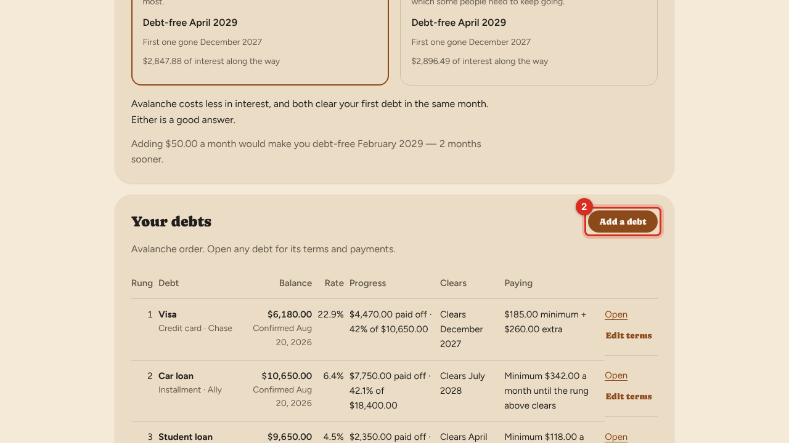
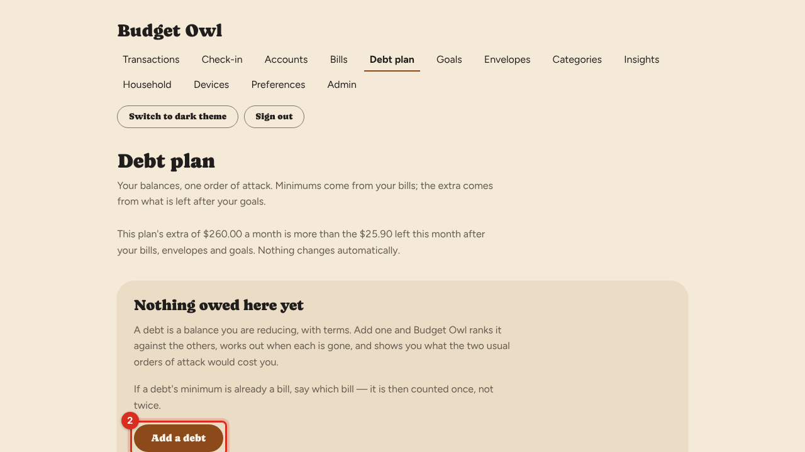
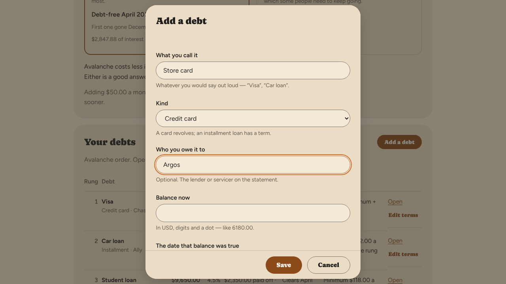
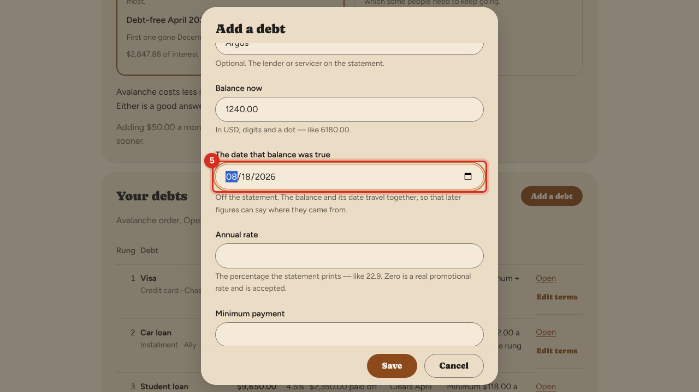
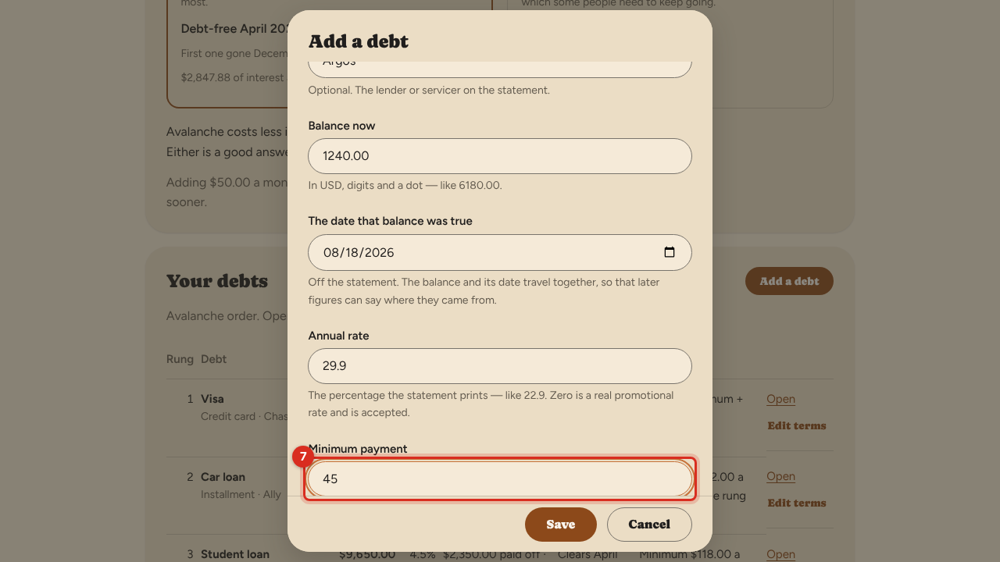
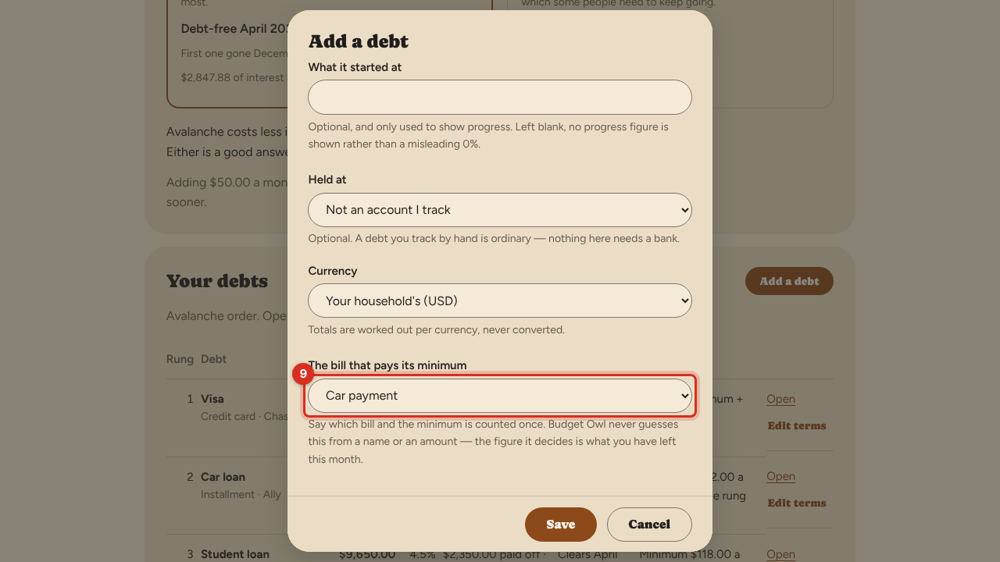
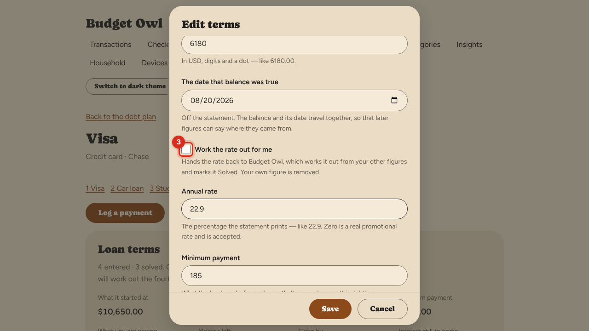

# Add a debt

Tell Budget Owl what you owe — a card, a car loan, a student loan — and it works out when each one
is gone and which to attack first. Everything comes off your own statement; nothing here needs a
bank connection.

## Before you start

- You need to be an **owner** or a **member**. A **viewer** sees every debt and every figure, and
  can't add one.
- Have the statement in front of you. You need the balance, the date that balance was true, the
  annual rate and the minimum payment.

## Steps

1. Select **Debt plan** in the menu across the top.

2. Select **Add a debt**.

   

   If this is your first one, the page says **Nothing owed here yet** and the button is in the
   middle of it instead.

   

3. Enter a name in **What you call it**.

   

   Whatever you'd say out loud — "Visa", "Car loan". **Kind** starts on **Credit card**; change it
   to **Installment** for anything with a term, like a car or a student loan. **Who you owe it to**
   is optional, and it's the lender's name off the statement.

4. Enter the balance in **Balance now**.

   Digits and a dot — `1240.00`. No minus sign: this is what you owe, and Budget Owl already knows
   which way it points.

5. Set **The date that balance was true**.

   

   This is the date on the statement, not today. The balance and its date travel together so that
   every later figure can say where it came from — see
   [Confirm what you owe](confirm-what-you-owe.md).

6. Enter the **Annual rate**.

   The percentage the statement prints — `29.9`, not `0.299`. Zero is a real rate on a promotional
   card and is accepted.

7. Enter the **Minimum payment**.

   

   What the lender asks for each month. This never changes this debt's own forecast — it's the
   floor your plan pays while it attacks something else.

8. Fill in **What it started at**, **Held at** and **Currency**, or leave them.

   All three are optional. **What it started at** is only used to show how far you've come; left
   blank, no progress figure appears rather than a misleading 0%. **Held at** links the debt to one
   of your accounts; **Not an account I track** is the ordinary answer.

9. Choose **The bill that pays its minimum**.

   

   **This is the one to get right.** If the minimum already goes out as a bill — a car payment, say
   — name that bill here and it is counted once instead of twice. Budget Owl never guesses this from
   a name or an amount, because the figure it decides is
   [what you have left this month](see-whats-left-this-month.md). If no bill covers it, leave
   **No bill covers it**.

10. Select **Save**.

    You'll see **Debt added.** and the debt in **Your debts**, with its rung, when it clears and
    what it's paying.

## What you'll see

The new debt takes its place in the ladder straight away, and every date on the page is worked out
again. A debt whose minimum is more than the whole plan can cover still appears — Budget Owl ranks
it and says what it can, rather than refusing the figures you gave it.

## Changing a debt's terms later

Select **Edit terms**, on the debt's row in **Your debts** or at the top of its own page. It's the
same window, with one extra box.

Tick **Work the rate out for me** and Budget Owl works the rate out from your other figures and
marks it **Solved**. Your own figure is removed. Untick it to go back to entering one yourself.

## Things that can go wrong

**"I don't know the rate."**
Leave **Work the rate out for me** ticked when you edit the debt, and give Budget Owl the payment
you're making and the date it's due to be gone instead. It works the rate out from those. An
installment loan statement often prints a payment and a term but never names the rate.

**"The balance it shows isn't the one on my statement."**
Budget Owl estimates between statements, and says so on the debt. Put the real figure in with
**Confirm the balance** — [Confirm what you owe](confirm-what-you-owe.md).

**"My minimum is counted twice."**
The debt and the bill don't know about each other until you say so. Select **Edit terms** and set
**The bill that pays its minimum**.

**"There's no Add a debt button."**
Your role is **Viewer**. You can read the whole plan, and an owner or member adds the debts.

## Related

- [Choose how to clear your debts](choose-how-to-clear-your-debts.md)
- [Log a payment against a debt](log-a-debt-payment.md)
- [Confirm what you owe](confirm-what-you-owe.md)
- [See what's left this month](see-whats-left-this-month.md)
