# Add an account

Tell Budget Owl where your money sits — a current account, a savings pot, a credit card, cash in
a tin. You do this once for each account you have, and everything you record later belongs to one
of them.

## Before you start

- You need to be an **owner** or a **member** of your household. A **viewer** can read the
  accounts but not add or change one — see [What the roles mean](manage-members.md#what-the-three-roles-mean).
- Have the account's current balance to hand, or the balance on the day you want Budget Owl to
  start from.

## Steps

1. Select **Accounts** in the menu across the top.

   You'll see the **Accounts** screen, with **Your accounts** listing the ones you already have.

2. Select **Add an account**.

   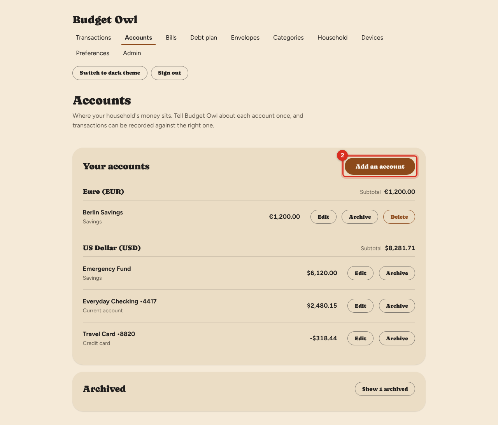

   If this is your first account, the screen explains what an account is and the button says
   **Add your first account** instead. It does the same thing.

   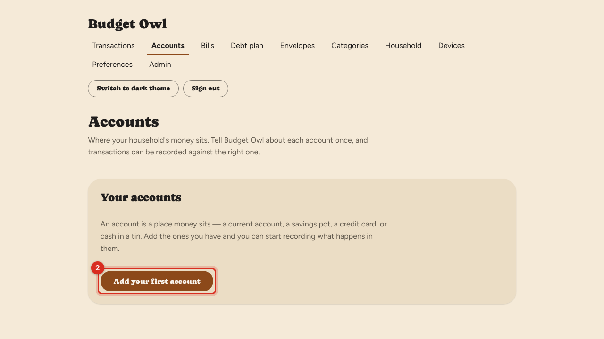

   Either way, a window called **Add an account** opens.

3. Enter a name in **Name**.

   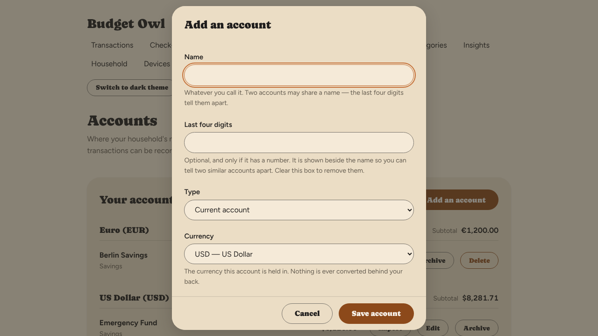

   Whatever you call it in your head — "Everyday Checking", "Holiday Fund". Two accounts are
   allowed to share a name.

4. Enter the last four digits of the account or card number in **Last four digits**.

   This is optional. It is shown beside the name, like **Travel Card •8820**, so you can tell two
   accounts at the same bank apart. Leave it empty if you would rather not have it on screen.

5. Choose the **Type**: **Current account**, **Savings**, **Credit card**, **Cash** or
   **Investment**.

   The type is a label for you. You can change it later at any time.

6. Choose the **Currency**.

   It starts as your household's currency. Each account keeps its own, and nothing is ever
   converted behind your back.

7. Scroll down inside the window and enter the **Opening balance**.

   This is what the account held when you started tracking it. **An account you owe money on
   starts with a minus** — a credit card with 420.50 outstanding opens at **-420.50**. Use digits
   and a dot, with no currency symbol.

   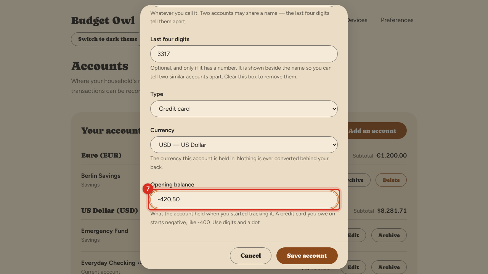

8. Select **Save account**.

   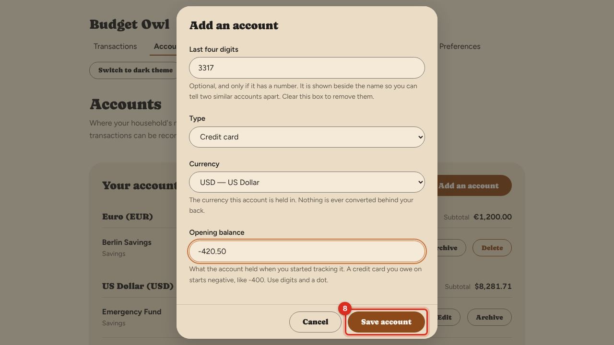

   The window closes and you'll see **Account added.**

   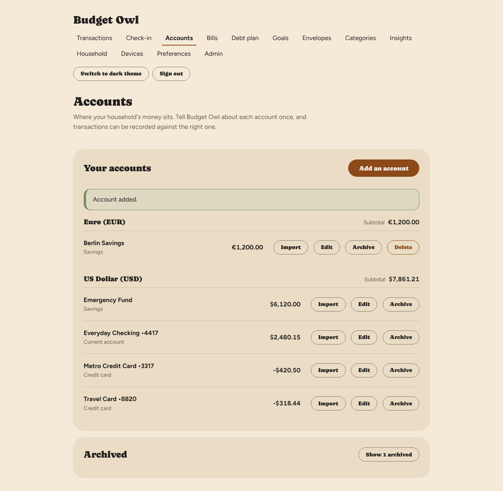

## What you'll see

Your new account appears in the list with its balance beside it. A balance you owe is shown with
a minus in front of it, like **-$420.50**.

**If all your accounts are in one currency**, the list is one plain list with no headings and no
subtotal.

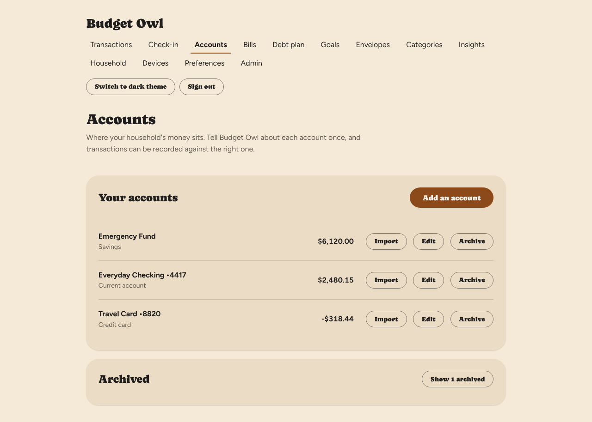

**As soon as you have a second currency**, the accounts are grouped under a heading for each one
— **Euro (EUR)**, **US Dollar (USD)** — and each group gets its own **Subtotal**. Adding an
account changes that subtotal: the card above brought the **US Dollar (USD)** subtotal down from
$8,281.71 to $7,861.21.

**There is no total across all your currencies, and that is deliberate.** Adding dollars to euros
needs an exchange rate and a date, and the answer would be an estimate dressed up as a fact. Each
currency is counted on its own.

## What the opening balance really means

It is the balance on the day you want Budget Owl to start from — usually today, and usually the
balance your bank shows you right now.

- A current account with 1,641.75 in it opens at **1641.75**.
- A credit card you owe 420.50 on opens at **-420.50**. Money you owe is a minus, every time.
- A brand-new account with nothing in it yet opens at **0**.

Get it wrong and every balance after it is wrong by the same amount, which is why it is worth a
second look. If you do get it wrong, you can correct it — see below. Correcting it moves the
balance by the difference and changes nothing else you have recorded.

## Change an account

1. Select **Edit** beside the account.

   The **Edit account** window opens, filled in with what the account says now.

   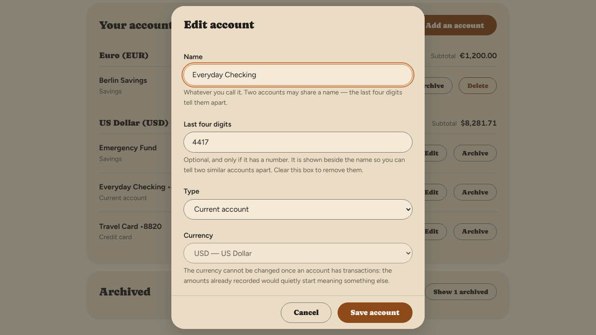

2. Change what you need to.

   To remove the last four digits, clear that box. To change them, type the new four.

3. Select **Save account**.

   You'll see **Account saved.** and the list updates.

   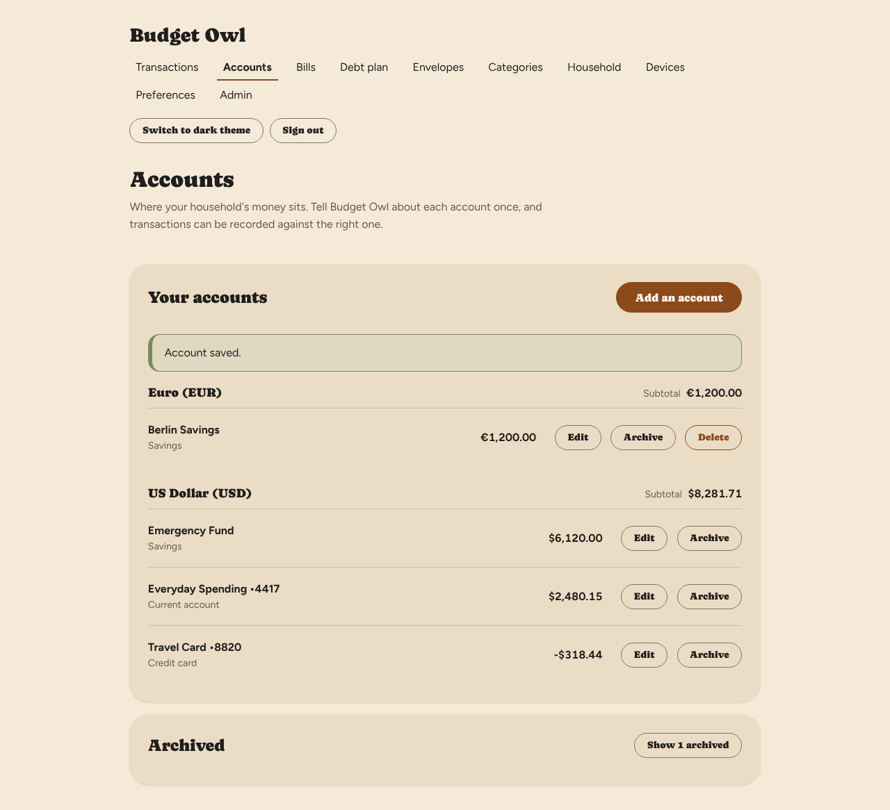

## When the currency cannot be changed

Once an account has transactions recorded against it, its **Currency** is greyed out and cannot
be opened. The reason is printed under it: *The currency cannot be changed once an account has
transactions: the amounts already recorded would quietly start meaning something else.*

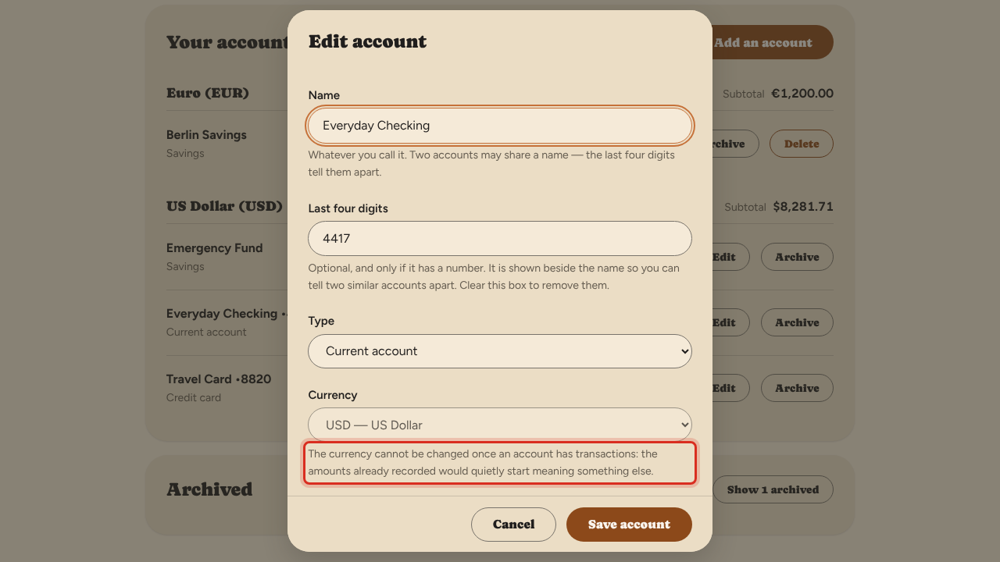

Before the first transaction you can change it freely. After that, the way to fix a wrong
currency is to add a new account in the right one and [archive the old one](archive-or-delete-an-account.md).

## Things that can go wrong

**I cannot see Add an account, Edit or Archive.**
Your role in the household is **Viewer**, which can read everything here and change nothing. The
screen shows the accounts and their balances with no buttons beside them. Ask an owner to make
you a member — see [See who is in your household](manage-members.md).

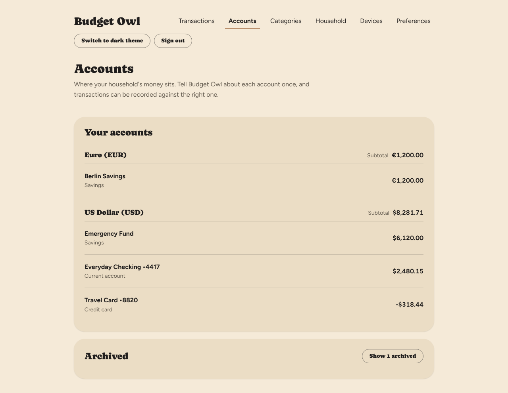

**I cannot find the Opening balance box.**
It is the last field in the window, below **Currency**. Scroll down inside the window — **Cancel**
and **Save account** stay pinned at the bottom while the fields scroll underneath them.

**My credit card balance looks wrong — it is a minus.**
That is right. A card you owe money on holds a negative balance, and it brings the subtotal for
that currency down, which is what you owe doing its job.

**The balance is out by the same amount on every account.**
Check the opening balance of the account the difference came from. Select **Edit**, correct
**Opening balance**, and select **Save account**.

## Related

- [Archive or delete an account](archive-or-delete-an-account.md) — retiring one you have closed
- [Your display currency and language](your-display-settings.md) — the currency your totals appear in
- [See who is in your household](manage-members.md) — who is allowed to change accounts
