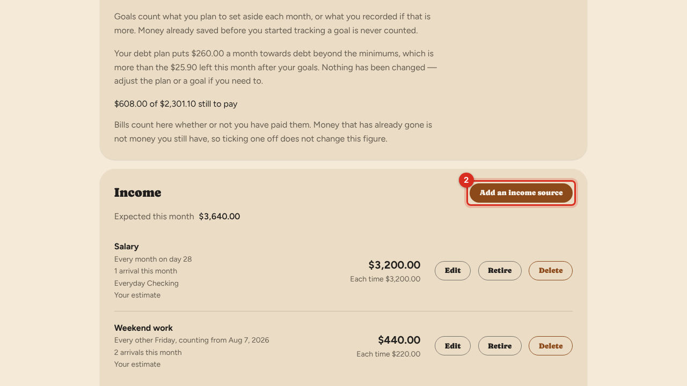
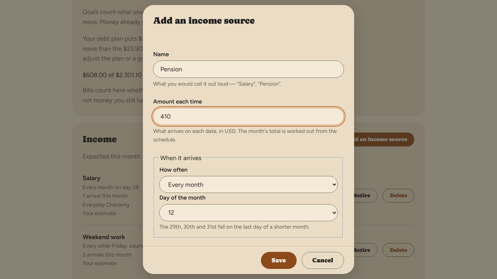
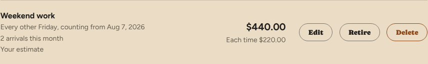
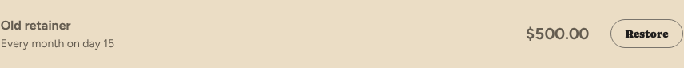

# Add your income

An income source is money arriving on a schedule — a salary, a pension, a regular payment from a
tenant. Add one and Budget Owl can say what's left once the predictable things are accounted for.

Like a bill, an income source is a **plan**. It doesn't create a transaction and nobody ticks it
off: you notice your pay arrived, you don't record that it did.

## Before you start

- You need to be an **owner** or a **member** of your household. A **viewer** can see every income
  source and every amount, but can't add or change one.

## Steps

1. Select **Bills** in the menu across the top.

2. Select **Add an income source**, at the top of **Income**.

   

3. Enter a **Name**.

   

   What you'd call it out loud — "Salary", "Pension".

4. Enter the **Amount each time**.

   This is what arrives **on each date**, not what you get in a month. Budget Owl works the
   month's total out from the schedule.

5. Choose **How often** it arrives.

   The section is headed **When it arrives**. The choices are the same five a bill has, and the
   boxes underneath change to match what you picked:
   [the five kinds of schedule](add-a-bill.md#the-five-kinds-of-schedule).

6. Choose the **Account it lands in** if you want to.

   Optional, and it only labels the income source. Nothing is added to the account's balance — a
   plan isn't a payment.

7. Select **Save**.

   The window closes and your income source appears in the list, with what it comes to this
   month. **Expected this month**, above the list, is every source added together.

## What you'll see

Each source tells you four things: when it arrives, **how many arrivals the month has**, what the
month comes to, and what arrives **each time**.

That arrivals line is the point of listing income this way. Something arriving every other Friday
lands twice in most months and three times in some, and that's $220.00 more to work with in the
months that have three — the real month, not an average spread flat. **Your estimate** underneath
is a reminder that the figure is the one you typed, not one Budget Owl worked out from your bank.

## Changing your mind

Select **Edit** to change a name, an amount, a schedule or the account.

**Retire** a source that's ended. It moves to **Retired income sources** at the foot of the card,
stops counting towards what's expected in new months, and can be brought back with **Restore**.

**Delete** removes the income source and what it contributed to any month's figures. Your
transactions are kept. This can't be undone — if the money really did arrive for a while, retire
it instead, so past months still add up.

## Things that can go wrong

**The month's total isn't twelve times the amount I typed.**
It isn't meant to be. **Amount each time** is one arrival; the total is however many arrivals the
month has. Check the arrivals line under the name.

**"Every other week" asks for a date.**
It needs one. Give it a date the money really arrived on, and Budget Owl counts outwards from it.

**My income arrived but nothing changed.**
Nothing is supposed to. An income source is what you expect; what actually arrived is a
[transaction](record-a-transaction.md). Budget Owl keeps them apart on purpose.

**There's no Add an income source button.**
Your role is **Viewer**. Ask an owner or a member of your household to add it.

## Related

- [See what's left this month](see-whats-left-this-month.md)
- [Add a bill](add-a-bill.md)
- [Record a transaction](record-a-transaction.md)
