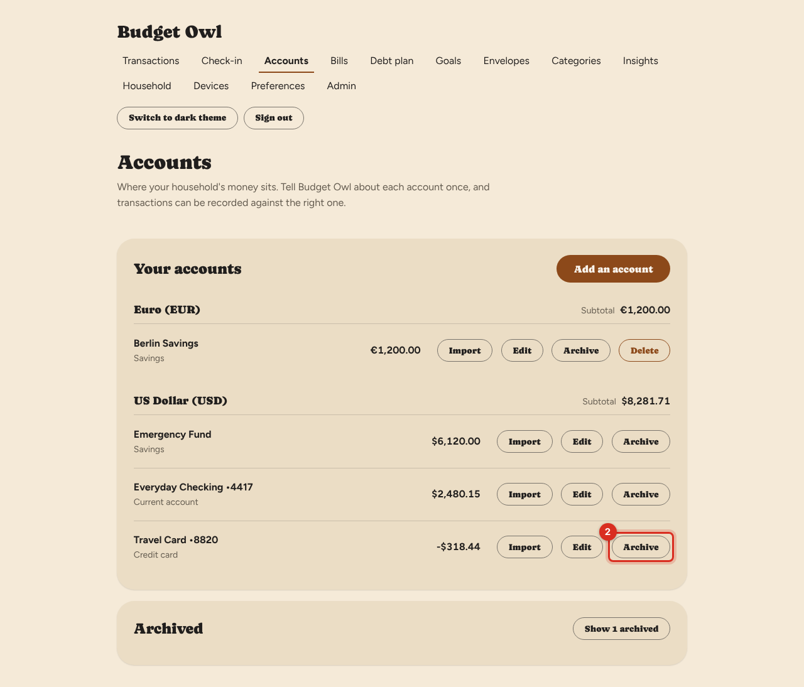
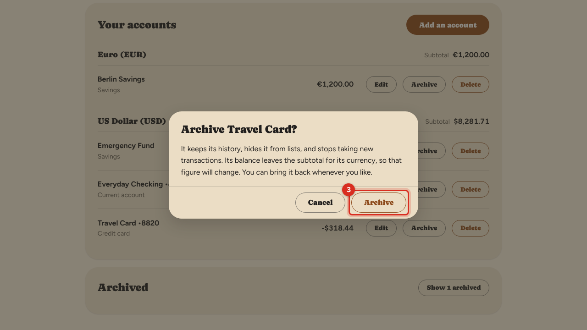
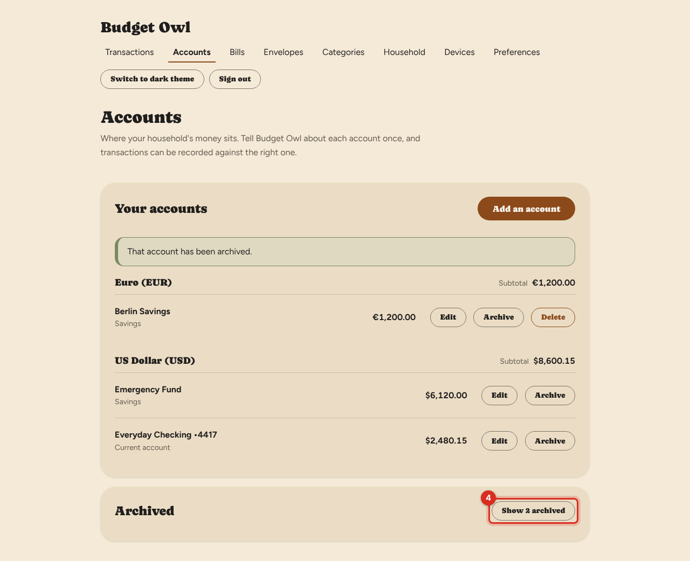
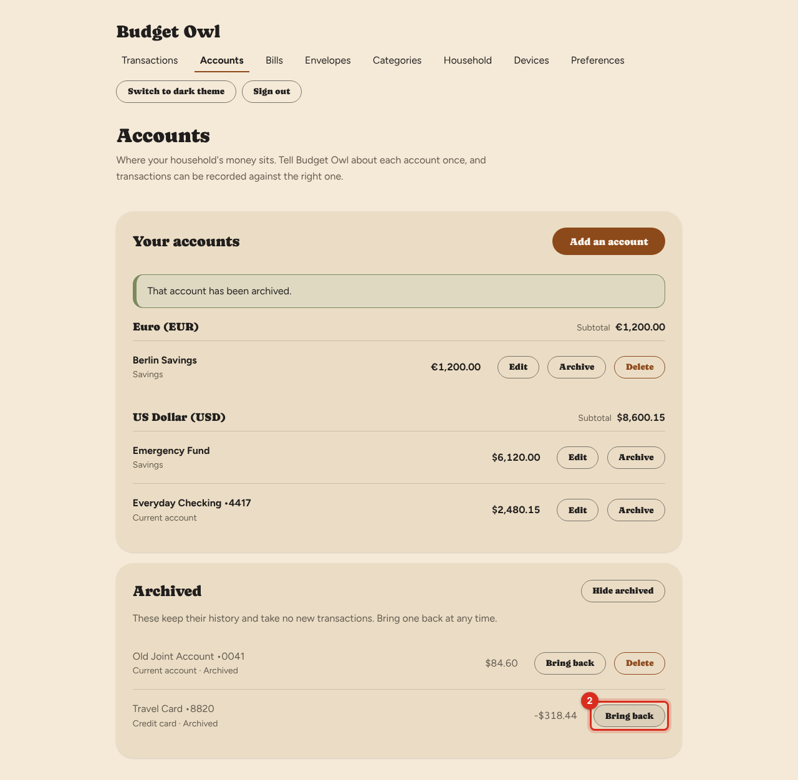
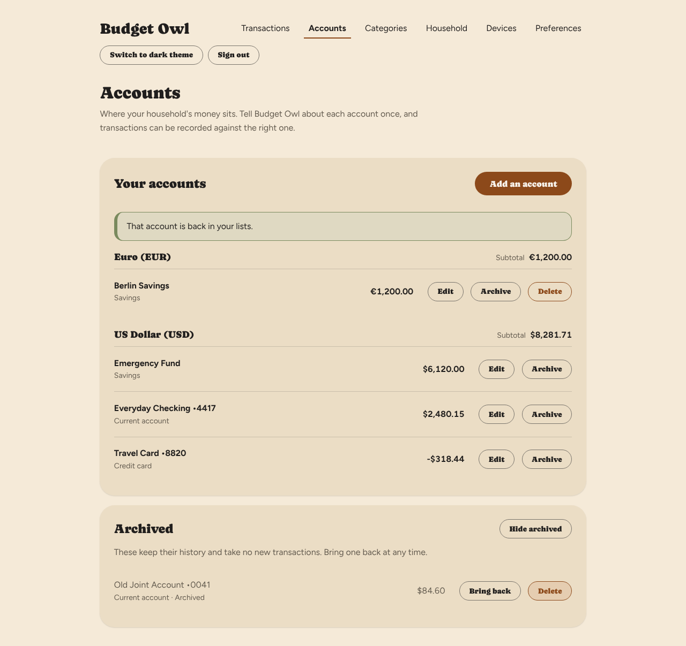
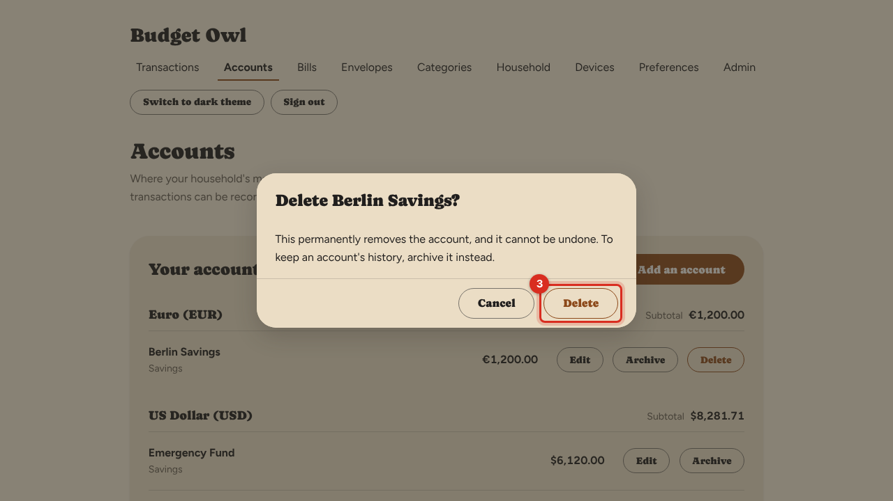
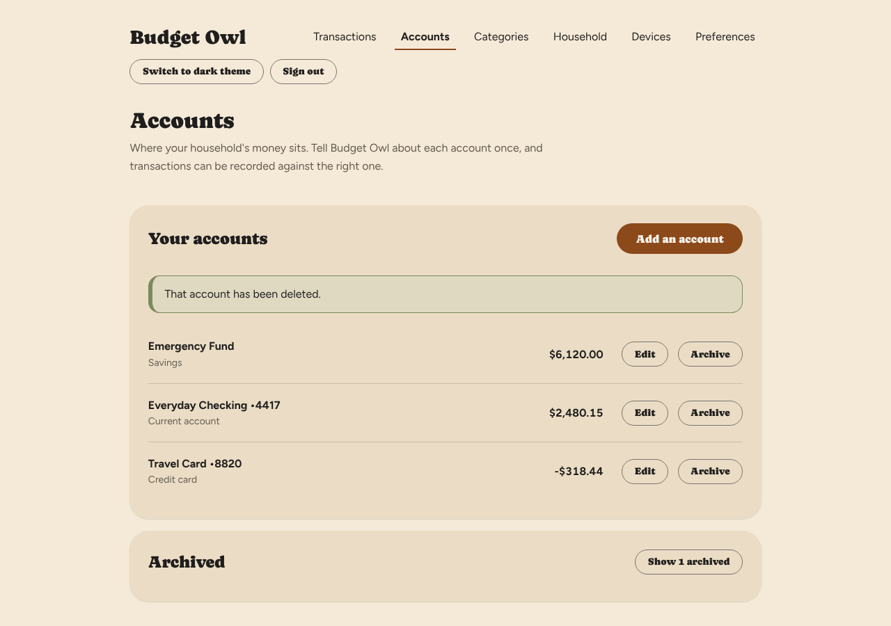
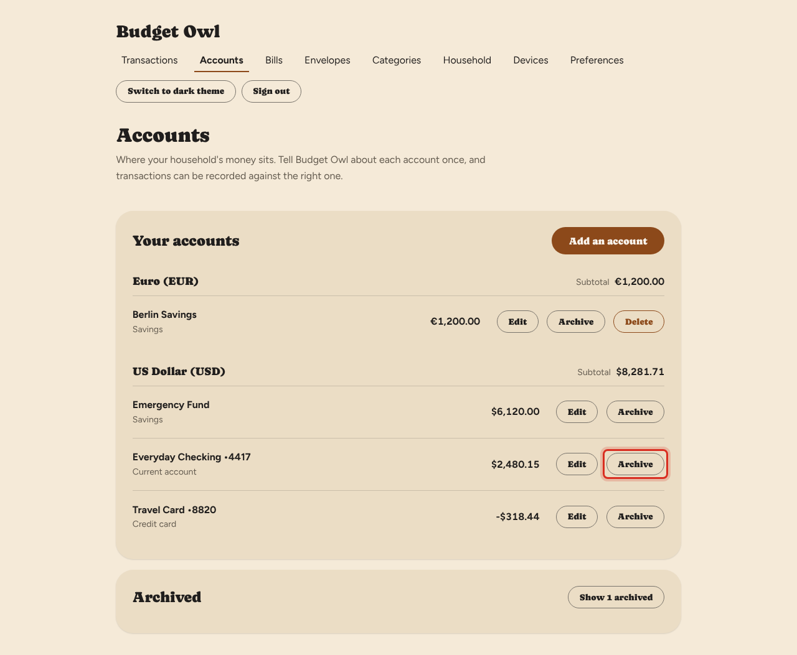
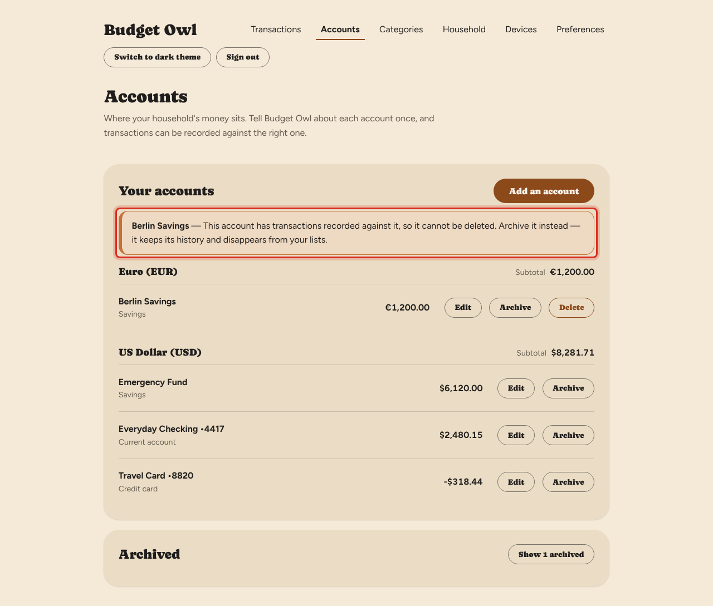

# Archive or delete an account

When you stop using an account, you have two ways to get it off your screen. **Archiving** puts
it away and keeps everything recorded in it. **Deleting** removes it for good, and Budget Owl
only allows that while the account has nothing recorded in it.

## Which one you want

| | **Archive** | **Delete** |
|---|---|---|
| What happens to its history | kept | gone, permanently |
| Shows in **Your accounts** | no | no — it is gone |
| Takes new transactions | no | — |
| Can you change your mind | yes, **Bring back** | no |
| When you can do it | any time | only while the account has no transactions |

Archiving is the normal way to retire an account you have closed. Choose delete only for an
account you added by mistake.

## Before you start

You need to be an **owner** or a **member** of your household. A **viewer** sees the accounts
with no buttons beside them.

## Archive an account

1. Select **Accounts** in the menu across the top.

2. Select **Archive** beside the account.

   

3. Read what the window tells you, then select **Archive**.

   It says: *It keeps its history, hides it from lists, and stops taking new transactions. You
   can bring it back whenever you like.* To change your mind, select **Cancel** — nothing
   happens.

   

4. You'll see **That account has been archived.**

   The account leaves **Your accounts** and is counted in the **Archived** section at the bottom,
   which now says **Show 2 archived**.

   

**The subtotal for that currency changes.** Archiving the card took **-$318.44** out of the list,
so the **US Dollar (USD)** subtotal went up from $8,281.71 to $8,600.15. Nothing was deleted —
the account is just no longer part of what you are looking at.

## Bring an archived account back

1. Select **Show 2 archived** at the bottom of the **Accounts** screen.

   The section opens and lists the archived accounts, greyed out and marked **Archived**, each
   with its balance.

2. Select **Bring back** beside the one you want.

   

   You are not asked to confirm — nothing is lost either way.

3. You'll see **That account is back in your lists.**

   It reappears under **Your accounts**, in its currency group, with the balance it had.

   

To close the section again, select **Hide archived**.

## Delete an account

Deleting is permanent. If there is any chance you will want the account's history, archive it
instead.

1. Select **Accounts** in the menu across the top.

2. Select **Delete** beside the account.

   Archived accounts have a **Delete** button too, in the **Archived** section.

3. Read the window, then select **Delete**.

   It says: *This permanently removes the account, and it cannot be undone. To keep an account's
   history, archive it instead.* To change your mind, select **Cancel**.

   

4. You'll see **That account has been deleted.**

   The row is gone from the list, and the subtotal for its currency changes to match.

   

## When there is no Delete button

An account that has transactions recorded against it shows only **Edit** and **Archive**. The
**Delete** button is not there, because deleting it would take your records with it.

Archive it instead. You keep every transaction, and the account stops appearing in your lists.

## Things that can go wrong

**I selected Delete and got a message instead of the account disappearing.**
The account has transactions in it, so Budget Owl will not delete it. You'll see: *This account
has transactions recorded against it, so it cannot be deleted. Archive it instead — it keeps its
history and disappears from your lists.* Nothing was changed. The message appears at the top of
the list and does not name the account — it is about the one you just tried.

**I archived the wrong account.**
Select **Show 1 archived**, then **Bring back** beside it. It returns exactly as it was.

**I deleted an account and want it back.**
Deleting cannot be undone. Add the account again with [Add an account](add-an-account.md) — it
will be a new, empty account, and anything recorded in the old one is gone.

**The Archived section is not on my screen.**
It only appears once you have at least one archived account.

**I have no Archive or Delete buttons anywhere.**
Your role is **Viewer**, which can read the accounts and change nothing. See
[See who is in your household](manage-members.md).

## Related

- [Add an account](add-an-account.md) — adding one, and correcting one
- [See who is in your household](manage-members.md) — what Owner, Member and Viewer can do
