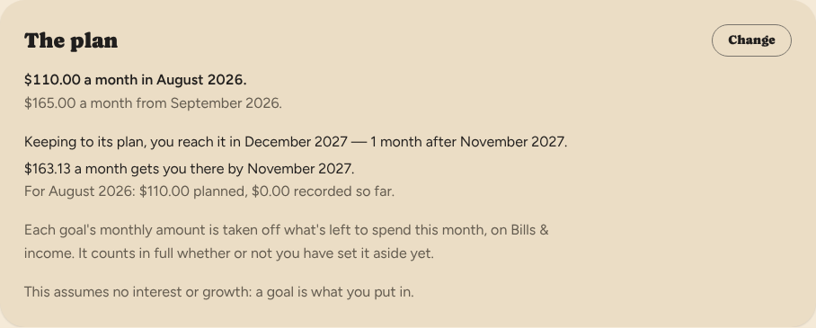
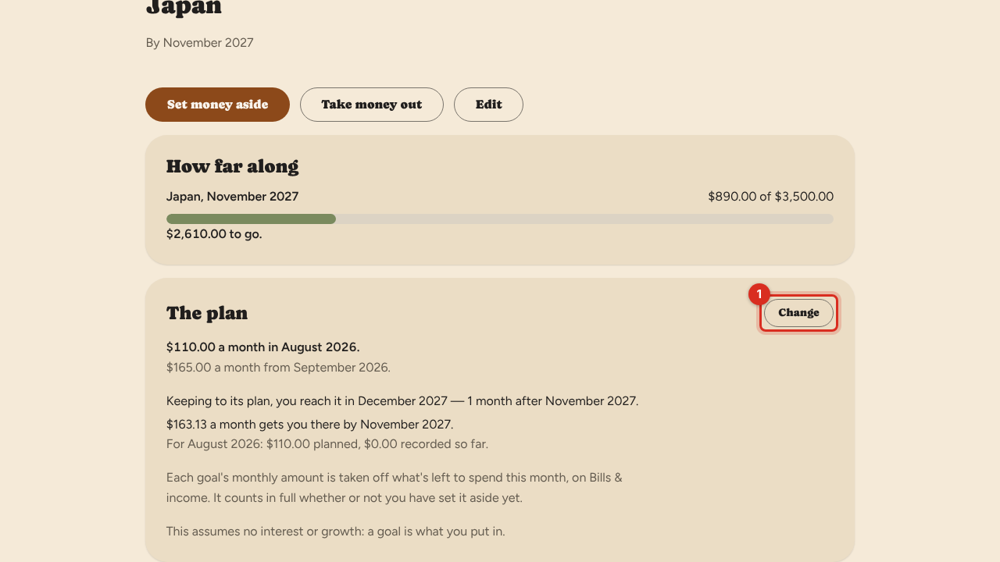
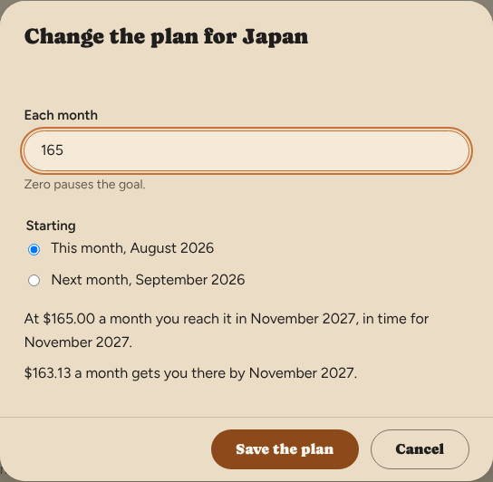
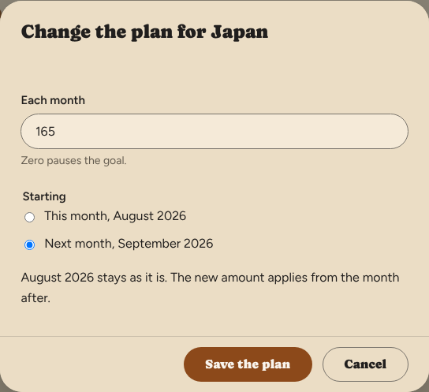

# Change what you set aside each month

Put more towards a goal, put less, or pause it, starting this month or next. Budget Owl shows you
when the new amount gets you there before you save it.

## Before you start

You need a goal. See [Save towards a goal](save-towards-a-goal.md). Your role needs to be **Owner**
or **Member**.

## Steps

1. Select **Goals** in the menu across the top, then select **Open →** on the goal.

2. Find **The plan** card.

   

   The first line is what you're putting aside this month: **$110.00 a month in August 2026**. A
   change you've already scheduled sits underneath it: **$165.00 a month from September 2026**.
   Then you'll see when the plan gets you there, and what you'd need each month to make your target
   month.

3. Select **Change**.

   

   The **Change the plan** window opens with the amount you're putting aside now.

4. Enter the new amount in **Each month**.

   

   As you type, the window says when that amount gets you there. Here, $165.00 a month reaches
   Japan in November 2027, in time for November 2027. Enter **0** to pause the goal.

5. Under **Starting**, choose **This month** or **Next month**.

   

   **This month** changes the amount from now. **Next month** leaves this month as it is, and the
   window says so: _"August 2026 stays as it is. The new amount applies from the month after."_

6. Select **Save the plan**.

   You'll see _"The plan is changed from"_ and the month you chose. **The plan** card shows the new
   amount.

## What you'll see

**The new amount replaces any later change.** If you'd already scheduled $165.00 from September
and you now save $150.00 from this month, the $150.00 carries on from here. The $165.00 isn't kept.

**What's left this month changes too**, if you chose **This month**. Each goal's monthly amount
comes off what's left to spend on the **Bills & income** page. Putting more aside leaves less to
spend. See [See what's left this month](see-whats-left-this-month.md).

**"Keeping to its plan" means every scheduled change counts.** If a goal's plan changes in a later
month, the sentence about when you'll get there allows for that change. It says _"Keeping to its
plan, you reach it in December 2027"_, not one monthly amount. On the **Goals** page, every goal is
described this way.

## Things that can go wrong

**"The plan can only change from this month on."**
A past month can't be re-planned. To correct a month that's gone, record or remove what you set
aside then, from the goal's **History**. See [Save towards a goal](save-towards-a-goal.md).

**"This goal is archived."**
An archived goal has no plan to change. Select **Restore** on its page first.

**"There's no Change button."**
Either your role is **Viewer**, or the goal is archived.

**"The window doesn't say when I'll get there."**
Your server works it out as you type. If it can't, the window says _"The figures could not be
worked out just now. You can still save."_ The goal's page shows the answer once the plan is saved.

## Related

- [Save towards a goal](save-towards-a-goal.md)
- [See what's left this month](see-whats-left-this-month.md)
