# Choose how people sign in to your server

Decide whether anyone who can reach your server may create an account, whether people sign in
with an email address and a password, and whether they can sign in through a sign-in provider you
already run. It is all in the **Signing in** block on the **Admin** screen.

None of this changes what anybody can see once they are signed in. Who sees your household's
money is decided by [who is in your household](manage-members.md), not here.

## Before you start

You need to be the person who looks after this server — the one who created the very first
account on it. If you have no **Admin** link, see
[See who can sign in to your server](see-who-can-sign-in.md).

Everything below starts the same way: select **Admin**, then scroll to **Signing in**.

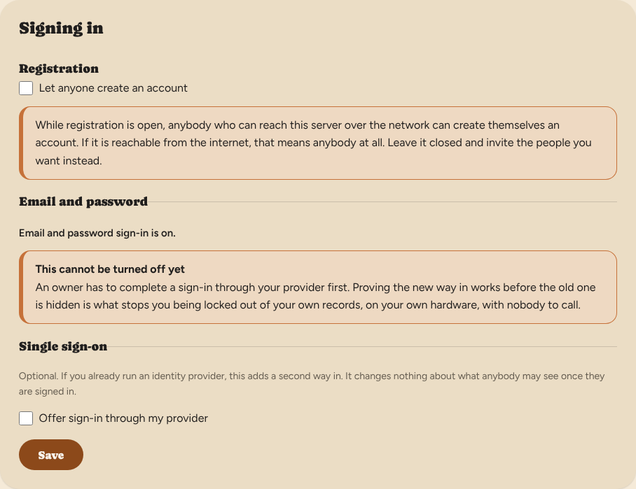

Each group is a set of choices. Nothing takes effect until you select **Save**, and **Save**
sends all three groups at once.

## Let anyone create an account

Normally a new person gets into Budget Owl because you invited them. Opening registration drops
that requirement: anybody who can reach your server can make themselves an account without asking
you.

**Read the warning on the screen before you do this.** In its words: _While registration is open,
anybody who can reach this server over the network can create themselves an account. If it is
reachable from the internet, that means anybody at all._ A new account sees none of your money
until somebody invites it into a household — but it is an account on your server, it is there
until you deal with it, and the **Accounts** list has no button for dealing with it.

1. Go to **Admin**.

2. Under **Registration**, tick **Let anyone create an account**.

   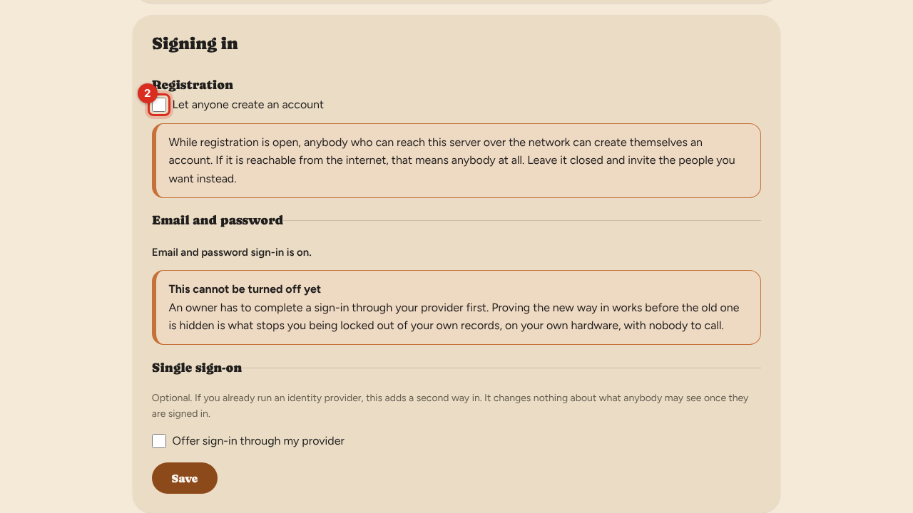

   A line appears under the warning: **Saving now will open registration.**

   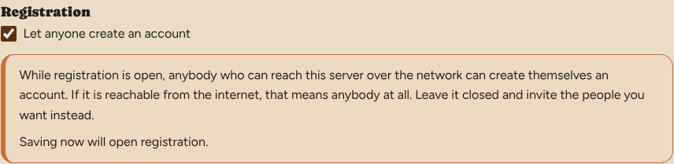

3. Select **Save**.

   **Saved.** appears at the top of the **Signing in** block.

   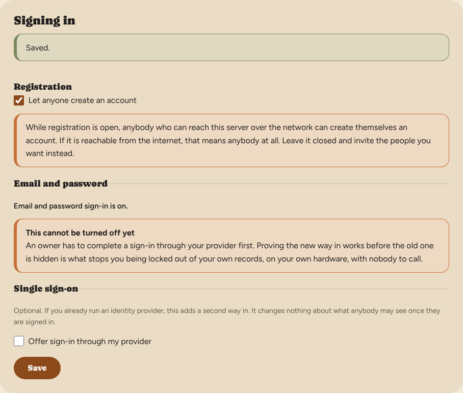

To close registration again, clear the tick and select **Save**. Accounts that were created while
it was open stay.

## Email and password sign-in

This is how everybody signs in to a new server, and it never goes away: in the screen's words,
_Email and password is a permanent part of Budget Owl._ Once another way in is working you can
stop offering it, and you can always offer it again.

### Why there is no switch yet

On a server with no sign-in provider set up, the **Email and password** group has no tick box at
all. It states what is true — **Email and password sign-in is on.** — and then why you cannot
change it.

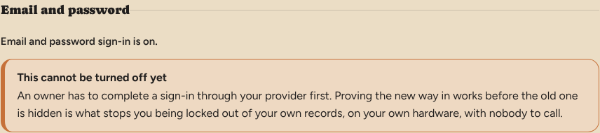

This is a guard, not a fault. Budget Owl will not let you put away the way in that works until
somebody has come in through the new one and proved it works. Otherwise a provider that is not
quite configured leaves nobody able to reach their own records, on hardware in their own house,
with nobody to ring.

To get the switch, [set up single sign-on](#use-your-own-sign-in-provider) and have an owner of
your household sign in through it once.

### Stop offering email and password sign-in

1. Go to **Admin**.

2. Under **Email and password**, clear **Offer sign-in with an email address and a password**.

   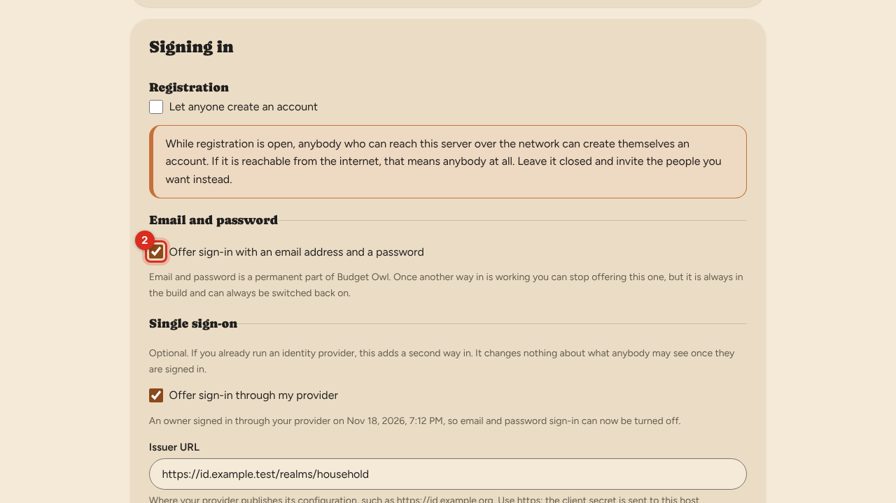

   A panel appears naming the command that switches it back on from the server itself.

   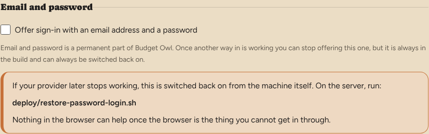

3. Select **Save**.

   **Saved.** appears, and the sign-in page stops offering an email address and a password.

**Write that command down somewhere that is not Budget Owl.** If your provider stops working
afterwards, the sign-in page has nothing left to offer and no screen can help you — see
[Nobody can sign in](../installing.md#nobody-can-sign-in).

## Use your own sign-in provider

If you already run something your household signs in to, Budget Owl can use it as a second way
in. You will need three things from that provider before you start: the address it publishes its
configuration at, the identifier it issued for Budget Owl, and the secret that goes with that
identifier.

1. Go to **Admin**.

2. Under **Single sign-on**, tick **Offer sign-in through my provider**.

   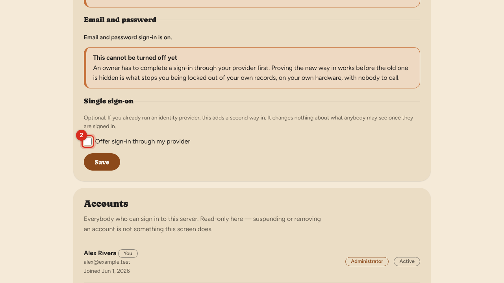

   Four more settings appear.

   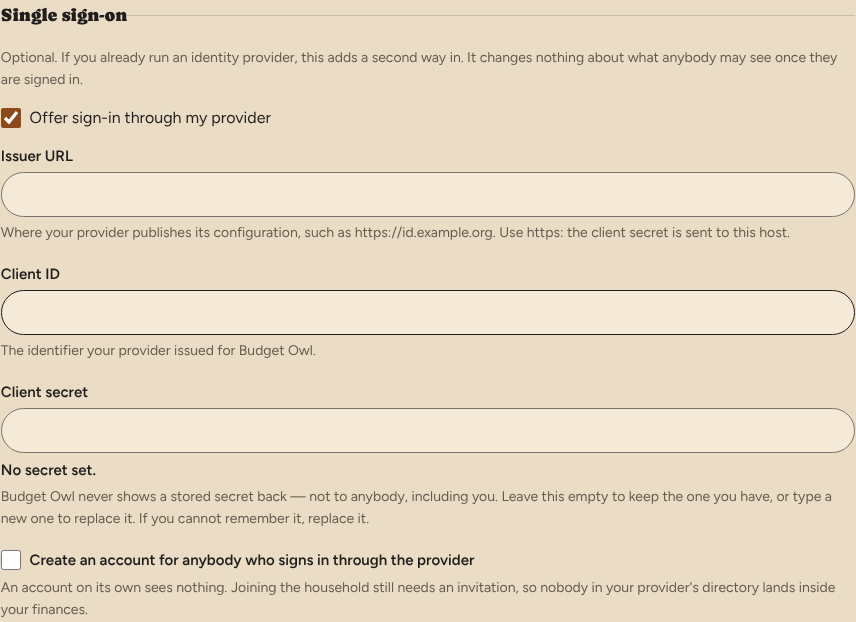

3. Enter the address your provider publishes its configuration at in **Issuer URL**.

   Use `https`. The screen says why: your client secret is sent to this address.

4. Enter the identifier your provider issued for Budget Owl in **Client ID**.

5. Enter the secret that goes with it in **Client secret**.

   What you type is hidden as dots. The line underneath still says **No secret set.** until you
   save — it describes what is stored, not what you have typed.

6. Decide whether to tick **Create an account for anybody who signs in through the provider**.

   Ticked, anybody your provider recognises gets an account here the first time they sign in.
   That account sees nothing on its own — joining your household still needs an invitation.
   Unticked, people need an account here already.

   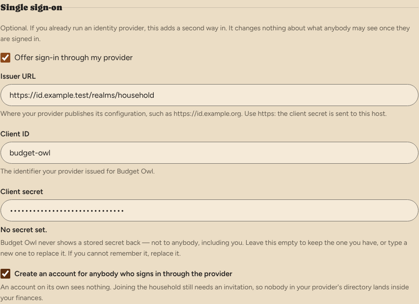

7. Select **Save**.

   **Saved.** appears, the **Client secret** box is empty again, and the line under it now reads
   **A secret is set.**

   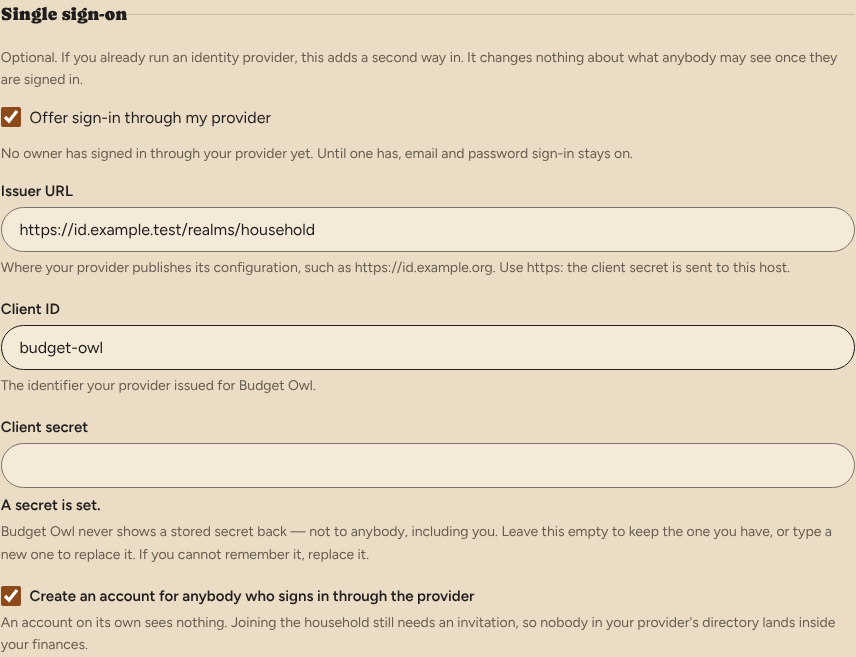

Under the tick box, Budget Owl tracks whether anyone has actually arrived this way:

- **No owner has signed in through your provider yet. Until one has, email and password sign-in
  stays on.**
- Once one has: **An owner signed in through your provider on …, so email and password sign-in
  can now be turned off.**

## The client secret, and why the box is always empty

**Budget Owl never shows a stored client secret back — not to anybody, including you.** The box
is empty every time you open the screen and empty again after every save. All the screen will
ever tell you is **A secret is set.** or **No secret set.**

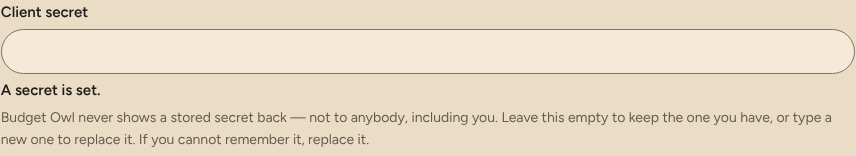

This is deliberate. A secret that gets filled back into a web page ends up in a browser's cache,
in the screenshot somebody takes of the screen, and in the bug report they attach it to. Budget
Owl would rather not be able to show it to you at all.

So:

- **Leave the box empty** to keep the secret you already have. Saving the screen with an empty
  box changes nothing about it.
- **Type a new one** to replace it.
- **If you cannot remember what it is, replace it.** Checking is not something you can do.

### Replacing the secret turns email and password sign-in back on

This is the one thing on this screen most likely to look like a fault. It is not.

1. Type the new secret in **Client secret**.

2. Select **Save**.

   **Saved.** appears — and the **Email and password** group changes. It now reads **Email and
   password sign-in is on.**, with **This cannot be turned off yet** beneath it, and the line
   under the single sign-on tick box goes back to **No owner has signed in through your provider
   yet.**

   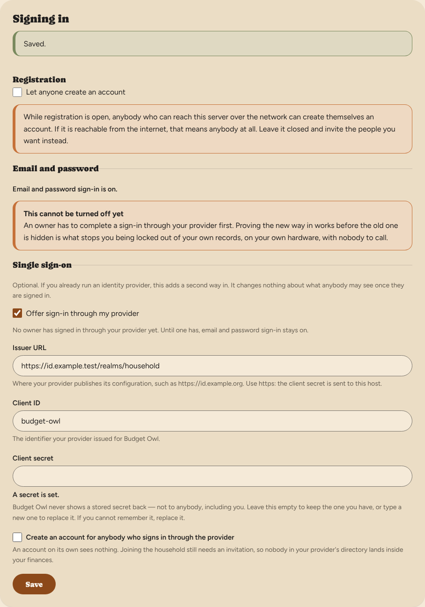

Why: the secret is half of what proves Budget Owl is allowed to talk to your provider. The moment
you change it, nobody has yet come in using the new one, so Budget Owl treats the provider as
unproven again and puts the familiar way in back. If the new secret has a typo in it, that choice
is the difference between an annoyance and nobody being able to sign in.

To hide email and password sign-in again, have an owner sign in through the provider once with
the new secret in place, then clear the switch and select **Save** as before.

Changing the **Issuer URL** or the **Client ID** does the same thing, for the same reason. Saving
the screen without changing any of the three leaves everything alone.

## Turn single sign-on off

1. Go to **Admin**.

2. Under **Single sign-on**, clear **Offer sign-in through my provider**.

   A panel warns you that email and password sign-in comes back on.

   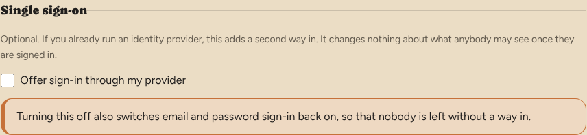

3. Select **Save**.

   A window asks **Turn off single sign-on?** and explains that your provider's details are
   cleared and anybody who signed in through it will need a password instead.

   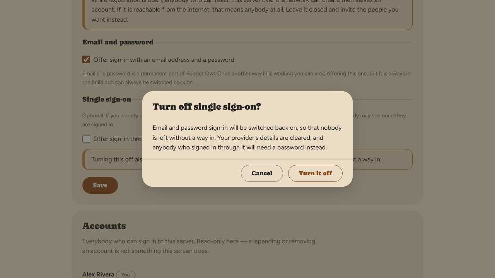

4. Select **Turn it off**.

   **Saved.** appears. The **Issuer URL**, **Client ID** and client secret are gone, and email and
   password sign-in is on again.

To change your mind, select **Cancel**. Nothing is sent and single sign-on stays on — but the
screen still shows the box cleared and the warning under it, so tick **Offer sign-in through my
provider** again before you leave the page.

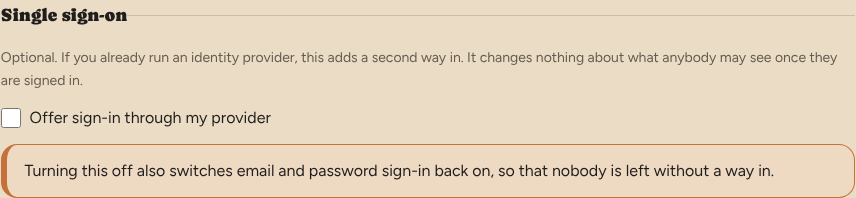

## Things that can go wrong

**Somebody else saved first.**
Two people had this screen open and the other one saved while you were typing. Nothing of yours
has been saved and nothing of yours has been lost — what you entered is still in the boxes, and
the notice lists which settings the other person changed.

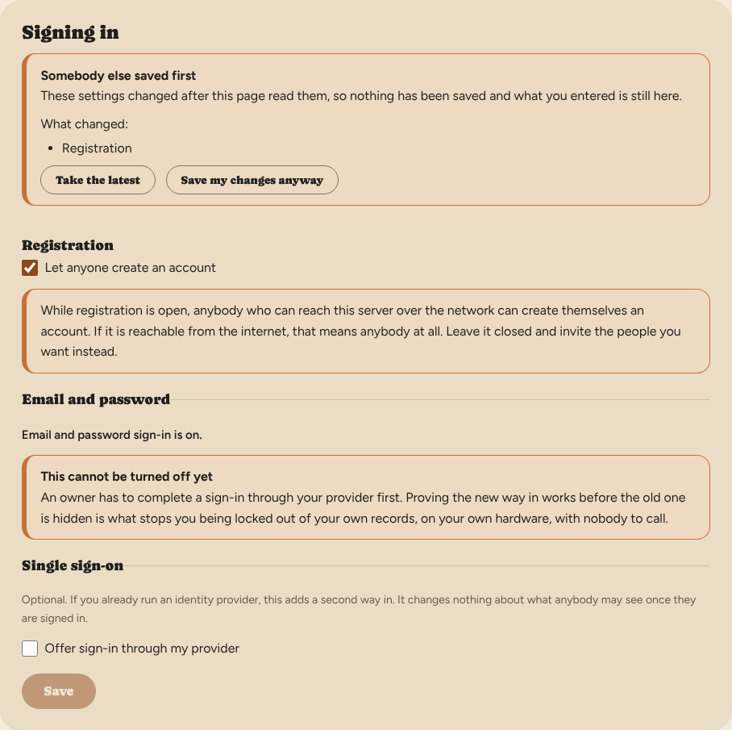

Select **Take the latest** to throw your changes away and start from what is now saved, or **Save
my changes anyway** to send yours on top. Read the list first: if the other person changed the
same setting you did, **Save my changes anyway** undoes their change.

**I selected Save and it said "Nothing had changed, so nothing was saved."**
Exactly what it says — every setting matched what was already stored, so nothing was sent.
Leaving the **Client secret** box empty is not a change.

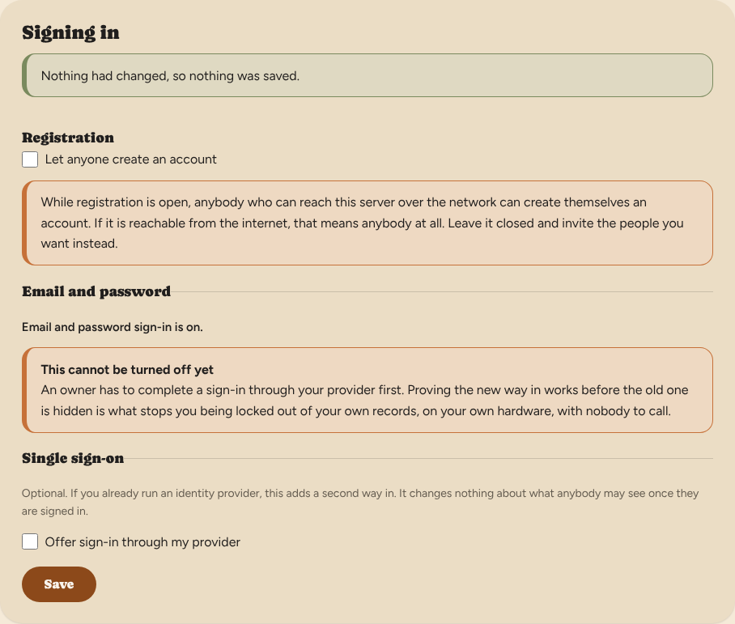

**Nobody can sign in.**
If you hid email and password sign-in and your provider has since stopped working, no screen can
help, because the screen is the thing you cannot reach. The fix runs on the machine — see
[Nobody can sign in](../installing.md#nobody-can-sign-in).

## Related

- [See who can sign in to your server](see-who-can-sign-in.md)
- [Invite someone to your household](invite-someone.md)
- [Sign in](sign-in.md)
- [Installing Budget Owl](../installing.md)
