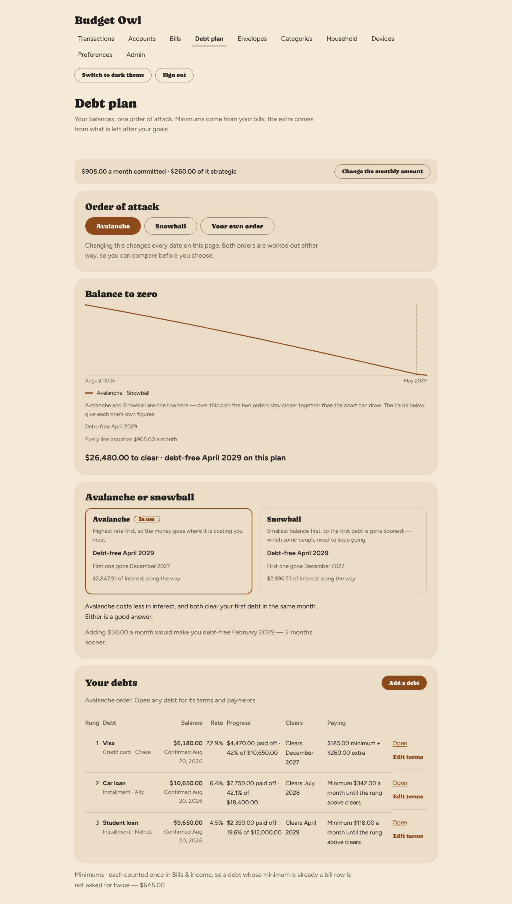
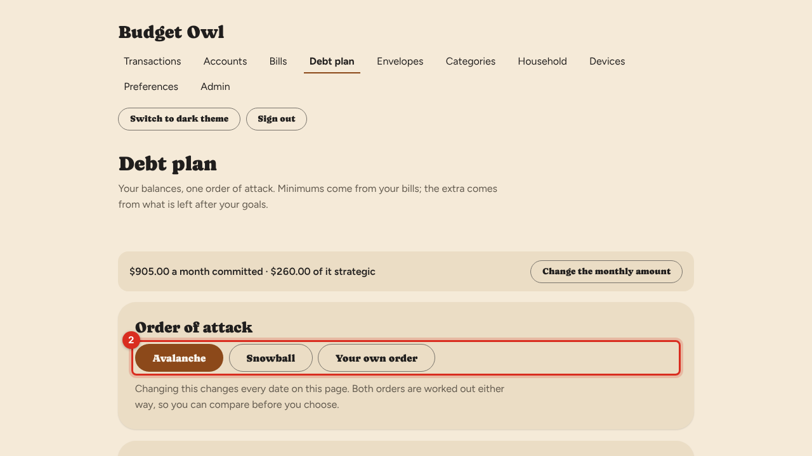
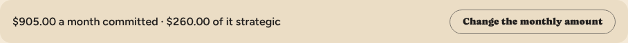
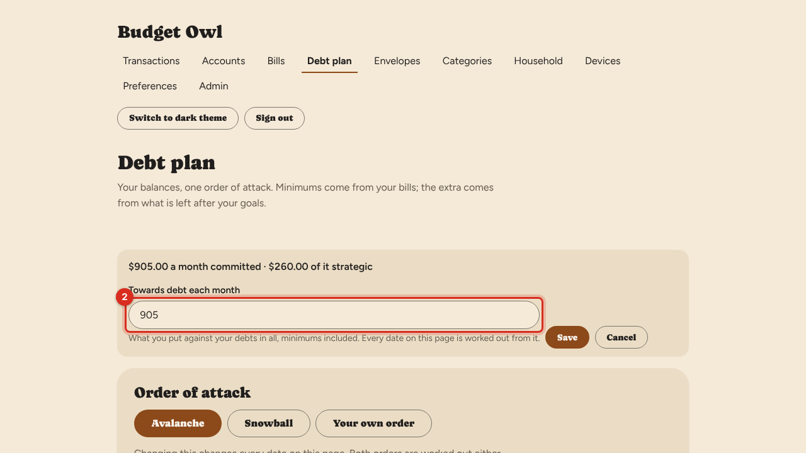
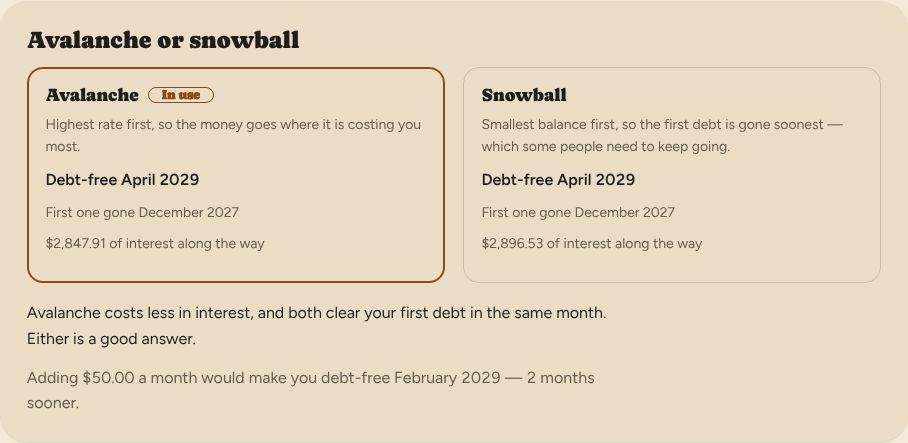
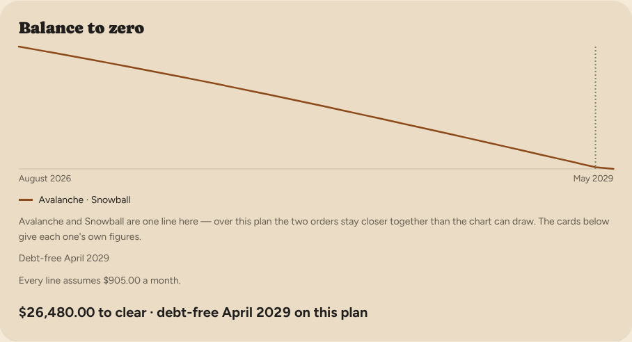
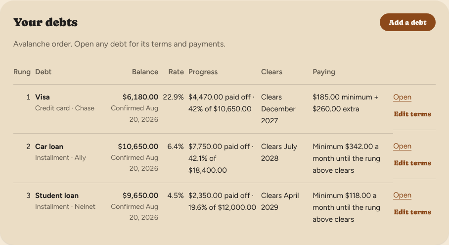

# Choose how to clear your debts

With more than one debt, the question isn't whether to pay them — it's which one to attack first.
The **Debt plan** page ranks them, works out when each is gone, and shows you what the two usual
answers would cost you, side by side.

## Before you start

You need at least one debt. If the page says **Nothing owed here yet**, start with
[Add a debt](add-a-debt.md).

Everyone in your household can read this page. Changing the order or the monthly amount needs
**Owner** or **Member**.

## Steps

1. Select **Debt plan** in the menu across the top.

   

2. Choose an order under **Order of attack**.

   

   - **Avalanche** — highest rate first, so the money goes where it's costing you most.
   - **Snowball** — smallest balance first, so the first debt is gone soonest.
   - **Your own order** — not finished yet. Budget Owl can hold an order you set yourself, but
     there is nothing on this page to set one with, so choosing it leaves your debts in the
     avalanche order for now.

   The choice saves as you make it, and every date on the page is worked out again. You'll see
   **Order of attack saved.**

## The figure everything is worked out from

The strip at the top says what you put towards debt in all — here **$905.00 a month committed** —
and how much of that is **strategic**: the part left over once every minimum is covered. That
$260.00 is what goes at whichever debt is on rung 1. Everything else is holding the rest steady.

To change it:

1. Select **Change the monthly amount**.

2. Enter the new figure in **Towards debt each month**.

   

   This is the total, minimums included — not the extra.

3. Select **Save**.

   Every date on the page moves.

## What the two cards are telling you

Budget Owl works out **both** orders every time, whichever one you've chosen, so the card is a
comparison and not a view of your choice. Each side gives you three figures:

- **Debt-free** — the month the last debt goes.
- **First one gone** — the month the first debt goes. This is snowball's whole argument: an early
  win some people need to keep going.
- **Interest along the way** — what the order costs you in total.

Then the sentence underneath compares them in words. For this household it reads: _"Avalanche costs
less in interest, and both clear your first debt in the same month. Either is a good answer."_ And
it means it — the two orders finish in **April 2029** either way, and the gap between $2,847.91 and
$2,896.53 is about $48 of interest spread over two and a half years.

**That is a real answer, not a missing one.** With these three balances the order barely matters, so
pick the one you'll actually stick to. With a different set of debts — one small balance at a
punishing rate, say — the two cards pull apart and the choice starts to count.

The line below is the one worth acting on: _"Adding $50.00 a month would make you debt-free February
2029 — 2 months sooner."_ What you put in moves the date far more than which order you put it in.

## The chart

**Balance to zero** draws what you owe, month by month, under each order. Here there's only one line
visible, and the card says why: _"Avalanche and Snowball are one line here — over this plan the two
orders stay closer together than the chart can draw."_ The cards below it still give each order its
own figures.

The dotted marker is the month you're clear. The headline under the chart is the same thing in
words: **$26,480.00 to clear · debt-free April 2029 on this plan**.

## Your debts, in order

One row per debt, in the order you chose. **Paying** is where the plan shows itself:

- Rung 1 reads **$185.00 minimum + $260.00 extra** — its minimum, plus all the spare money.
- The rungs below read **Minimum $342.00 a month until the rung above clears**. They're held steady
  on purpose. When rung 1 goes, its minimum _and_ the extra roll down to rung 2, which is why each
  one clears faster than the one before it suggests.

**Balance** says when it was last confirmed. **Progress** is only shown for a debt you told Budget
Owl what it started at. **Open** takes you to that debt's terms and payments.

## Counted once, not twice

The $645.00 of minimums here is the same money as the car payment on your **Bills** page. Budget Owl
counts it once, not twice — but only because you told it which bill pays which minimum. If a figure
looks doubled, that link is what's missing: [Add a debt](add-a-debt.md), step 9.

## If your role is Viewer

A **Viewer** sees the whole plan — both orders, every balance, every date — and has nothing to
click. The order of attack is reported as a sentence instead: **Your plan uses Avalanche.** There's
no **Add a debt**, no **Edit terms** and no way to change the monthly amount. **Open** still works.

## Things that can go wrong

**"No dates are shown anywhere."**
Your monthly amount is less than your minimums add up to, and the page says so. There's no order to
build out of that, so Budget Owl shows no dates rather than invented ones. Nothing here is a
judgement — the page works again the moment the amount covers the minimums.

**"One debt says it doesn't clear."**
Its payment is smaller than the interest that balance builds up each month, so the balance grows.
That's arithmetic, not a mistake you made. The rest of the plan still works, and that debt is
usually the one to move to rung 1.

**"The rate column says Rate not available."**
Budget Owl couldn't work a rate out from the figures it has, so it says so rather than printing 0%.
Select **Edit terms** and enter the rate from the statement.

**"The two orders look identical."**
For some sets of debts they nearly are. Read the interest figure on each card — that's where the
difference lives.

## Related

- [Add a debt](add-a-debt.md)
- [Log a payment against a debt](log-a-debt-payment.md)
- [Confirm what you owe](confirm-what-you-owe.md)
- [See what's left this month](see-whats-left-this-month.md)
