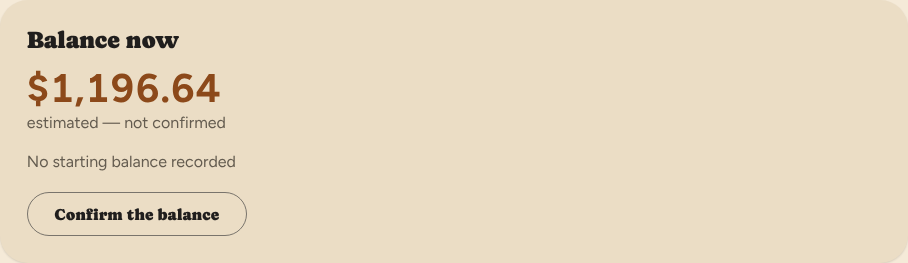
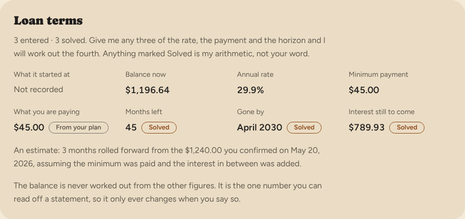
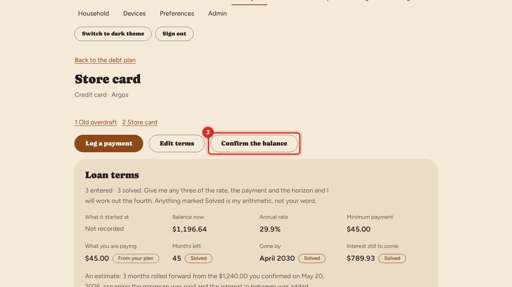
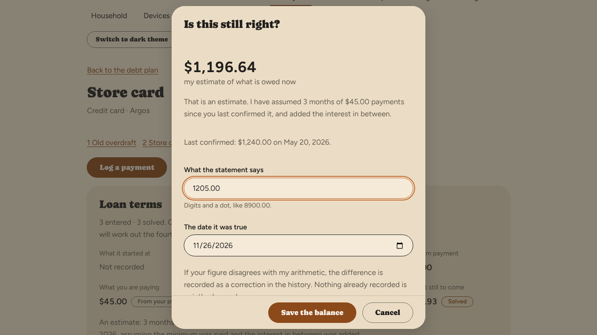
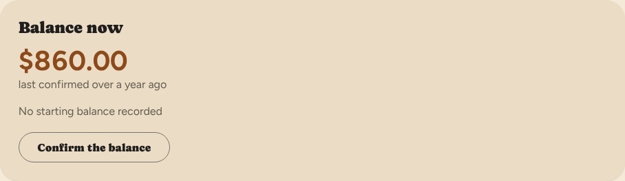
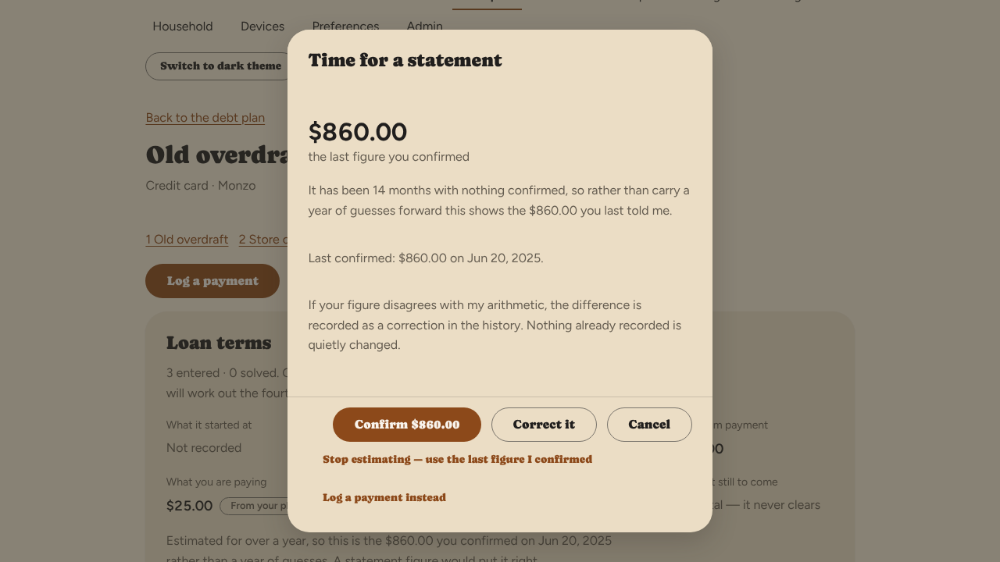
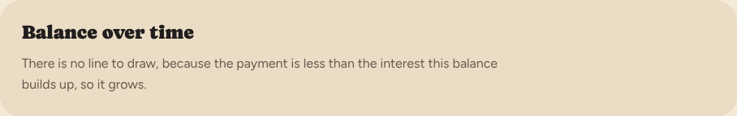

# Confirm what you owe

A debt's balance is a figure **you** give Budget Owl, off a statement. Between statements it
estimates, and it always tells you when a figure is an estimate rather than something you said. When
your next statement arrives, this is how you put the real number in.

## Before you start

- You need a debt whose balance says it's an estimate. A balance you confirmed recently just says
  **owed now**, and there's nothing to do.
- You need to be an **owner** or a **member**. A **viewer** sees the estimate and how it was worked
  out, and can't confirm it.

## How to tell an estimate from a figure you gave

The label under the figure is the whole story. **owed now** means you confirmed it. **estimated —
not confirmed** means Budget Owl rolled your last figure forward, and **last confirmed over a year
ago** means it stopped doing that.

The sentence explaining the estimate sits at the foot of **Loan terms**:

**An estimate is usually lower than the figure it started from**, not higher. Budget Owl assumes the
minimum was paid each month and adds the interest in between, so here $1,240.00 becomes $1,196.64.
It's an assumption, which is exactly why it asks.

## Steps

1. Select **Debt plan** in the menu across the top.

2. Select **Open** on the debt.

3. Select **Confirm the balance**.

   

   There's one on the **Balance now** card too. Either opens the same window.

4. Read what the estimate assumed.

   

   It tells you the months it assumed, the payment it assumed, and the figure and date you last
   confirmed.

5. Select **Confirm $1,196.64** if your statement agrees.

   The button names the figure, so there's no doubt which one you're agreeing to. A message tells
   you the balance is confirmed, and the label under it changes to **owed now**.

## When the statement says something else

6. Select **Correct it**.

7. Enter the figure in **What the statement says**.

   

8. Set **The date it was true**.

   The date off the statement, not today.

9. Select **Save the balance**.

   Your figure becomes the balance, and the difference between it and Budget Owl's arithmetic is
   written into **Payment history** as a **Statement correction**.

**Nothing already recorded is quietly changed.** A correction is a row of its own, so next month you
can still see what was assumed, what was true, and the gap between them. Budget Owl never edits
history to agree with the present.

## When it's been more than a year

Past twelve months, Budget Owl **stops estimating**. Rather than carry a year of guesses forward it
shows the last figure you actually gave it, and asks for a statement.

The window is the same one, with a different question: **Time for a statement**. It tells you how
long it's been and which figure you're looking at. Treat **Confirm** here with care — confirming a
fourteen-month-old figure says it's true today, which it probably isn't. **Correct it** is usually
the honest answer.

## The two quieter answers

Under the main buttons:

- **Stop estimating — use the last figure I confirmed** — puts the balance back to the number you
  last gave and dates it today. Use it when the estimate has wandered and you'd rather have a figure
  you recognise than one Budget Owl worked out.
- **Log a payment instead** — if what's actually missing is a payment nobody wrote down, this takes
  you straight to [logging it](log-a-debt-payment.md). The balance follows from the payments.

## When a debt has no forecast

A debt whose payment doesn't cover its monthly interest has no date to show, so Budget Owl writes a
sentence where the picture would be rather than drawing an empty box. It's arithmetic about that
balance at that rate, not a judgement — and it's a good reason to move that debt to the top of
[your plan](choose-how-to-clear-your-debts.md).

## Things that can go wrong

**"The estimate is lower than my last statement. Has it paid itself off?"**
No. Budget Owl assumes you kept paying the minimum, so the estimate falls a little each month. If
you haven't been paying it, the real balance will be higher — put the statement figure in.

**"I confirmed the wrong number."**
Select **Confirm the balance** again and use **Correct it**. Both figures stay in the history, so
nothing is lost.

**"There's no Confirm the balance button."**
Either the balance is already confirmed — the label reads **owed now** — or your role is **Viewer**.

## Related

- [Log a payment against a debt](log-a-debt-payment.md)
- [Choose how to clear your debts](choose-how-to-clear-your-debts.md)
- [Add a debt](add-a-debt.md)
