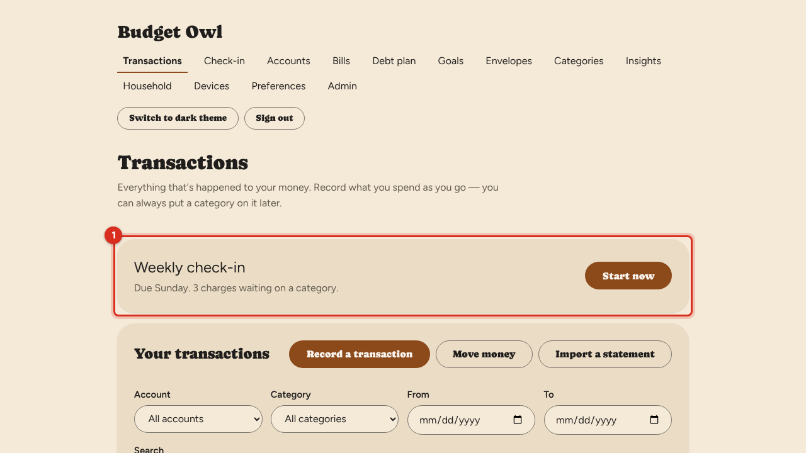
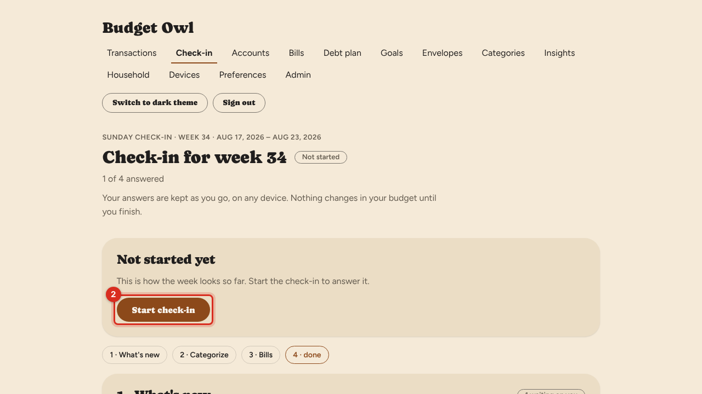
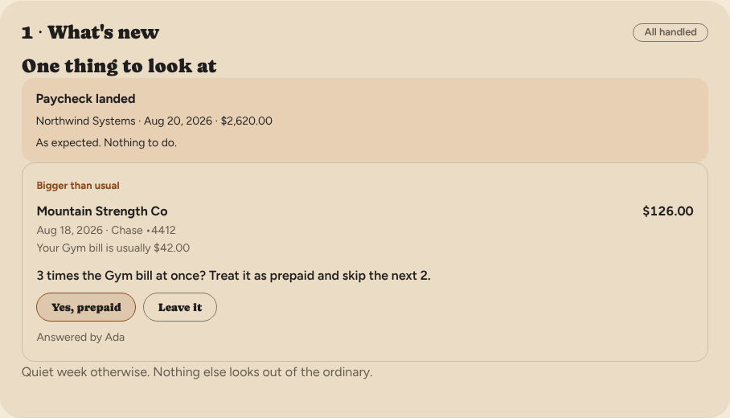
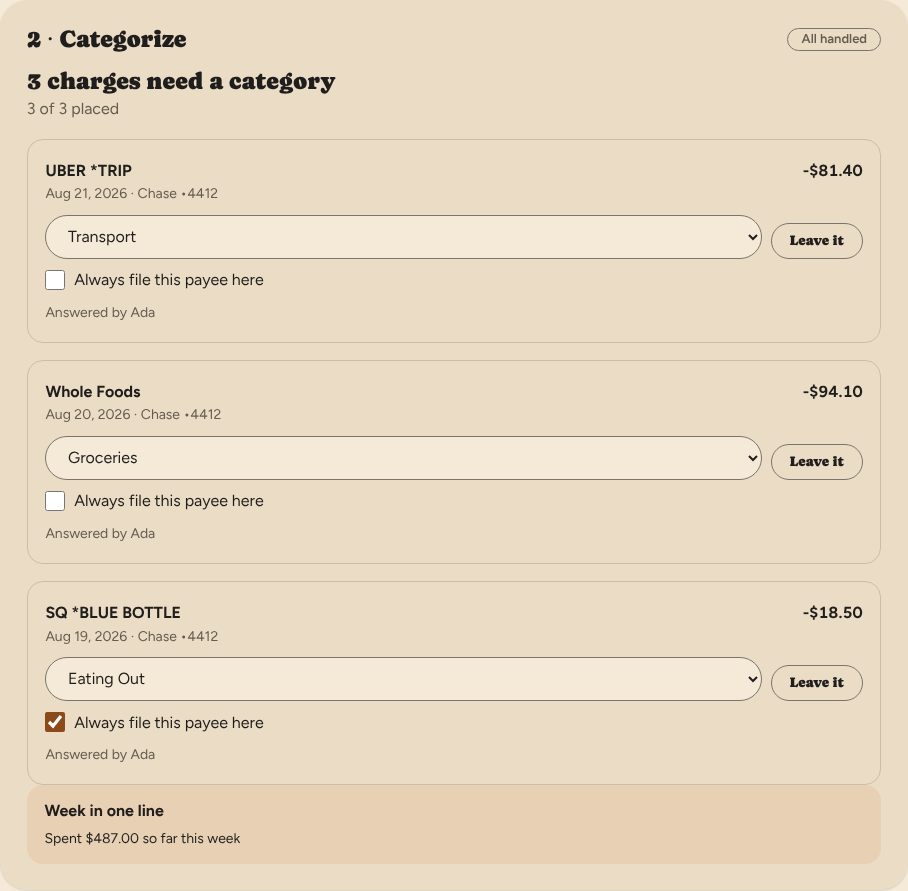
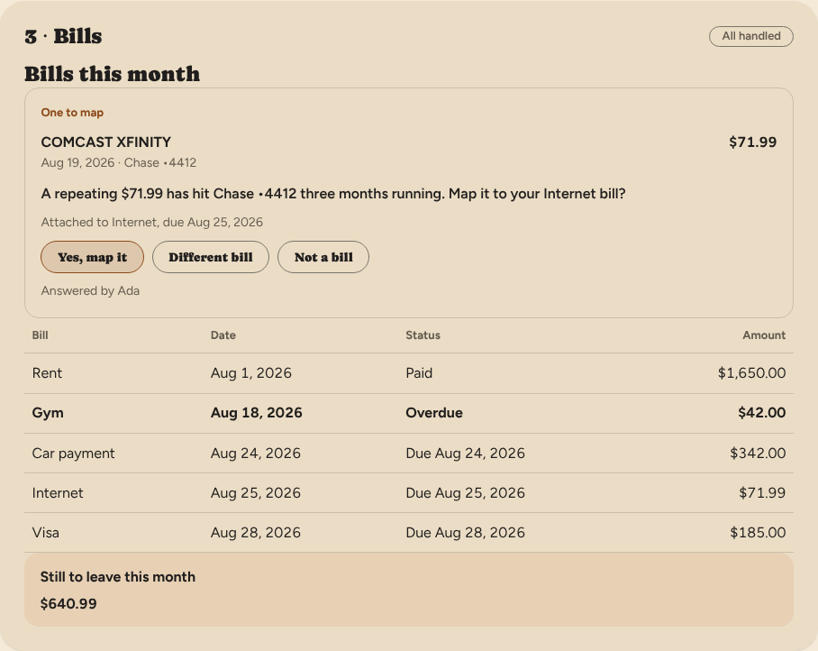
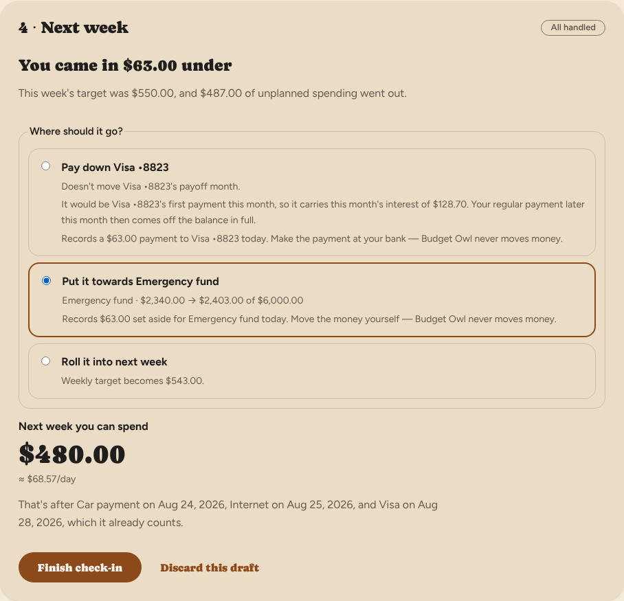
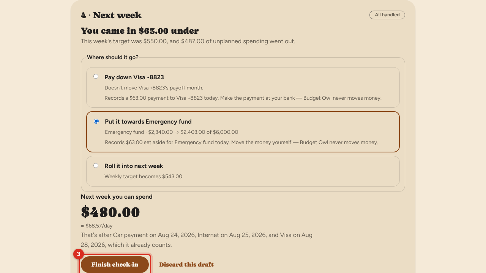
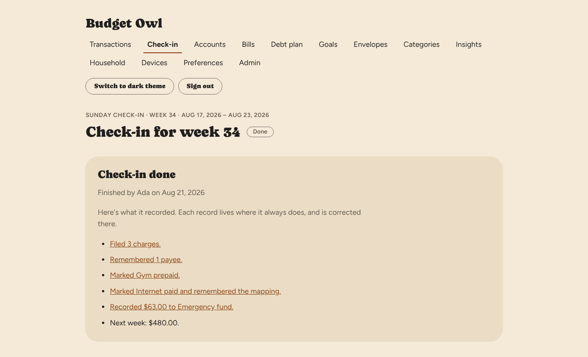
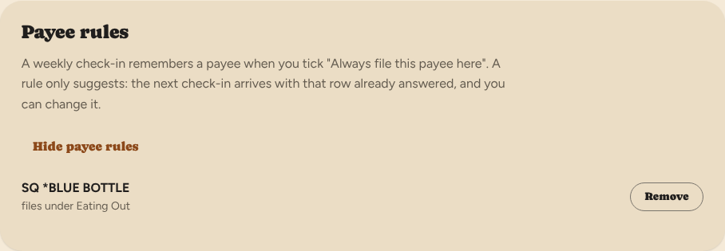

# Do your weekly check-in

Once a week, Budget Owl asks you a few short questions: anything odd that came in, which charges
need a category, which bills cleared, and where this week's leftover money should go. When you
finish, you see what you can spend next week.

## Before you start

Your role needs to be **Owner** or **Member** to answer a check-in. A **Viewer** sees every
question, every answer and every figure, but can't change anything.

Budget Owl never moves money. When the check-in records a payment to a debt or money set aside for
a goal, you still make that payment or move that money at your bank.

## Steps

1. Go to **Transactions**, and select **Start now** on the **Weekly check-in** card at the top.

   

   The card says how many charges are waiting on a category. You can also select **Check-in** in
   the menu across the top. If you've already started this week's check-in, the button says
   **Continue**.

2. Select **Start check-in**.

   

   The page now says **In progress**. Your answers are kept as you go, on any device, so you can
   stop and come back. Nothing changes in your budget until you finish.

3. In **What's new**, answer anything that looks out of the ordinary.

   

   Your paycheck is shown so you can see it landed. There's nothing to do about it. A charge
   bigger than usual is asked about: here, $126.00 from the gym is three times the usual $42.00.
   Select **Yes, prepaid** if you paid three months at once, and the next two months are skipped.
   Select **Leave it** if not.

4. In **Categorize**, choose a category for each charge.

   

   Tick **Always file this payee here** if that payee always belongs in that category. Next week,
   a charge from them arrives already answered and marked **Your rule**, and you can still change
   it. The **Week in one line** box updates as you answer.

5. In **Bills**, answer the charge Budget Owl thinks is a bill.

   

   Select **Yes, map it** to mark that bill paid with this charge, and to remember that this
   payee pays it. Select **Different bill** to choose another bill, or **Not a bill** if it isn't
   one. The table under it shows this month's bills and what's still to leave.

6. In **Next week**, choose where this week's leftover money goes.

   

   Nothing is chosen for you. Each choice says what it does: paying down a debt says whether it
   moves the month you'll be clear of it, a goal shows its new total, and **Roll it into next
   week** shows next week's bigger figure. **Next week you can spend** changes as you choose.

   Interest on a debt is charged once a month, on the first payment dated in that month. If the
   leftover would be the debt's first payment this month, the choice says so: here, _"It would be
   Visa •8823's first payment this month, so it carries this month's interest of $128.70."_ The
   debt's balance can then read higher than before, because $63.00 is less than the month's
   interest. Your regular payment later in the month comes off the balance in full, so the month
   still costs one month's interest, and paying the extra never pushes the payoff month later.

7. Select **Finish check-in**.

   

   On a phone, the check-in shows one step at a time. Select **Next** at the foot of each step,
   and **Done for the week** on the last one.

## What you'll see

**Check-in done**, with a list of everything it recorded. Select a line to go to where that
record lives. A finished check-in can't be changed: to correct something, change it there, for
example the category on **Transactions** or the amount in the goal's history.

Anything you didn't answer is left exactly as it was. A charge you skipped stays without a
category, and a bill you didn't answer stays due.

## Remove a payee you told it to remember

1. Go to **Categories**, and select **Show payee rules** near the foot of the page.

   

2. Select **Remove** beside the payee.

   You'll see _"The rule was removed."_ The next check-in asks about that payee again.

A bill Budget Owl remembers a payee for shows **Mapped** under its name on **Bills**, with an
**Unmap** button that does the same for bills.

## Things that can go wrong

- **"Something changed while you were answering, so nothing was recorded."** Someone else changed
  the ledger, a bill or a goal after you answered. Nothing was saved. The items that need another
  look are marked with what changed. Answer them again and select **Finish check-in**.
- **"Someone else answered this first."** Another member of your household answered the same
  question. Their answer is shown, with their name under it.
- **"There's an unfinished check-in for 2026-W33."** Only one check-in can be in progress at a
  time. Select **Open it** to finish that one, or **Discard it** to throw its answers away.
- **"Choose where this week's surplus goes before you finish."** Pick one of the choices in
  **Next week**. **Roll it into next week** always works.
- **The figure is below zero.** This month's plan has already spent more than it has. The
  check-in shows it as it is rather than pretending you have nothing to spend.

## Related

- [Give a transaction a category](give-a-transaction-a-category.md)
- [Mark a bill paid](mark-a-bill-paid.md)
- [Save towards a goal](save-towards-a-goal.md)
- [Log a payment against a debt](log-a-debt-payment.md)
- [See what's left this month](see-whats-left-this-month.md)
