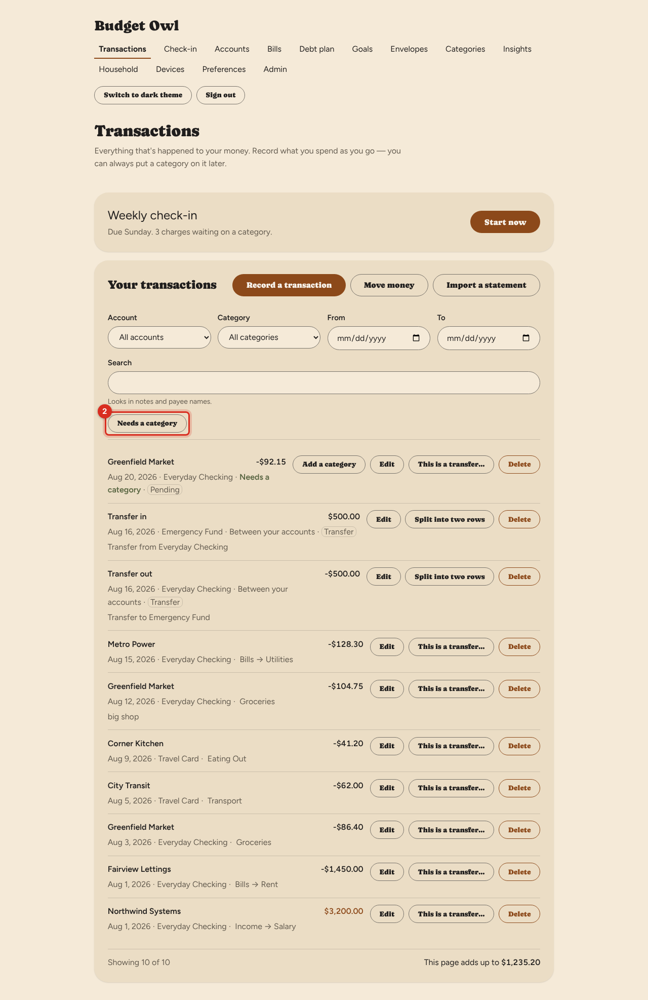
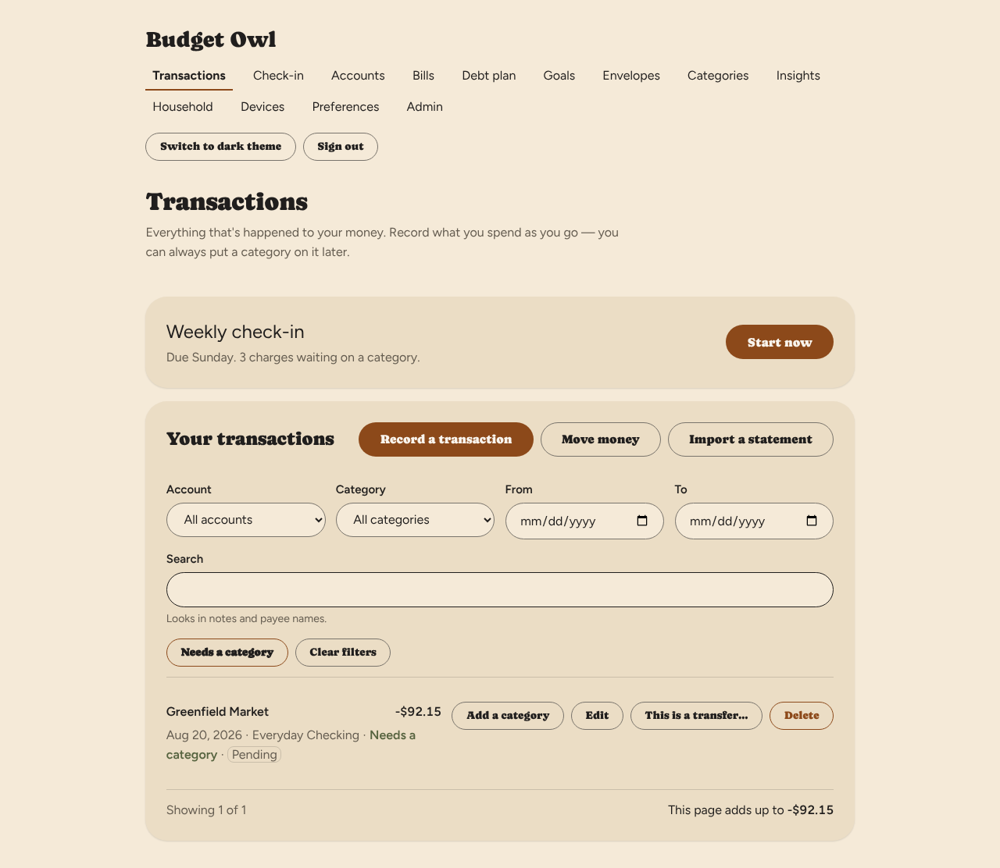
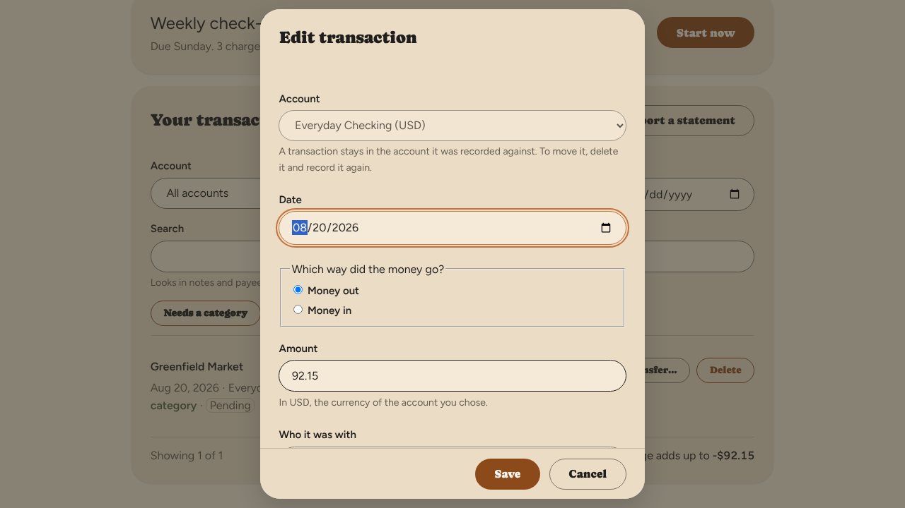

# Give a transaction a category

You can record a transaction without saying what it was for, and sometimes you should — getting it
written down matters more than getting it filed. This is how you come back and finish the job.

## Before you start

You need to be an **owner** or a **member** of your household.

## Steps

1. Select **Transactions** in the menu across the top.

2. Select **Needs a category**.

   

   A transaction without one is marked **Needs a category** in the list, so you can spot them as
   you scroll. This button hides everything else.

3. Look at what's left.

   

   This is your to-do list. Transfers between your own accounts never appear here — moving money
   from current to savings isn't spending, so there's nothing to file it under.

4. Select **Add a category** on the first one.

   

   The **Edit transaction** window opens.

5. Choose a **Category**.

   Sub-categories are shown as **Bills → Utilities**, so you can tell a "Phone" under **Bills**
   from a "Phone" under **Shopping**.

   Nothing suitable? Select **Categories** in the menu and add one — see
   [Organise your categories](organise-your-categories.md). Your transaction is still waiting when
   you come back.

6. Select **Save**.

   The transaction drops off the list, because it no longer needs a category. Keep going until the
   list is empty.

7. Select **Clear filters** when you're done, to see everything again.

## Doing it a different way

You don't have to use the filter. **Edit** on any transaction in the list does the same thing, and
if you're only fixing one, that's quicker.

## If something doesn't work

**The list is empty and you expected transactions in it.** Everything already has a category —
which is the point. Select **Clear filters** to see the full list again.

**A category you want isn't in the list.** It may be archived. Archived categories stay on your old
transactions but aren't offered for new ones. Restore it on the **Categories** screen.
