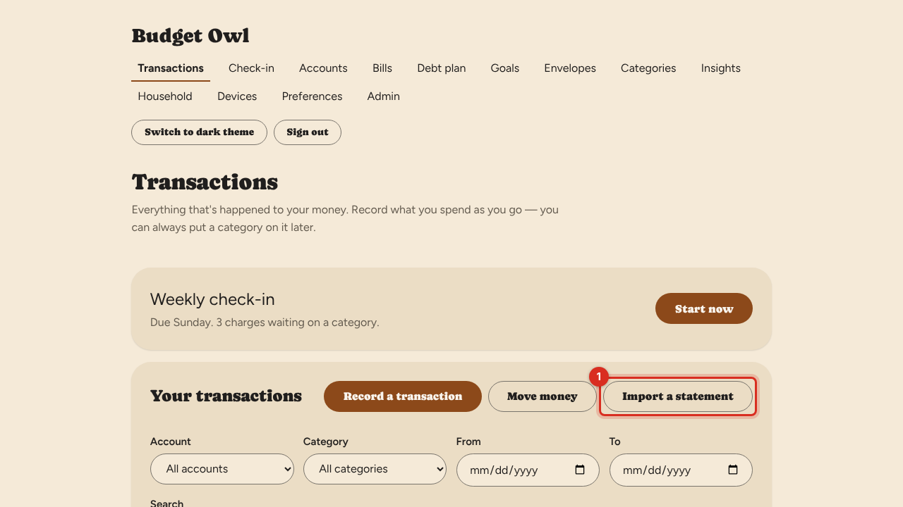
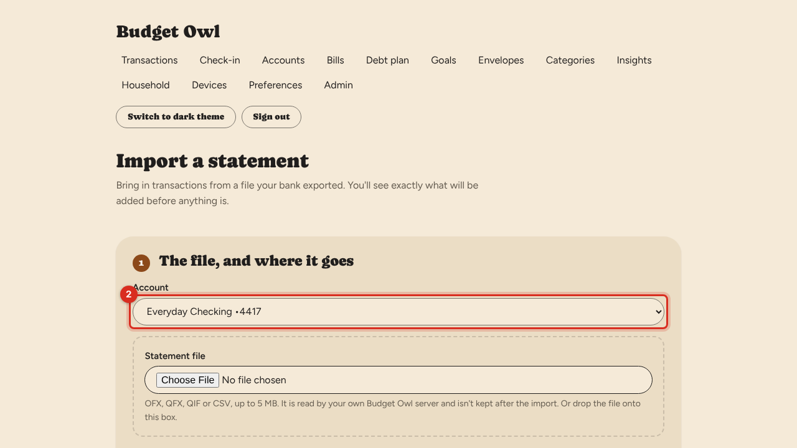
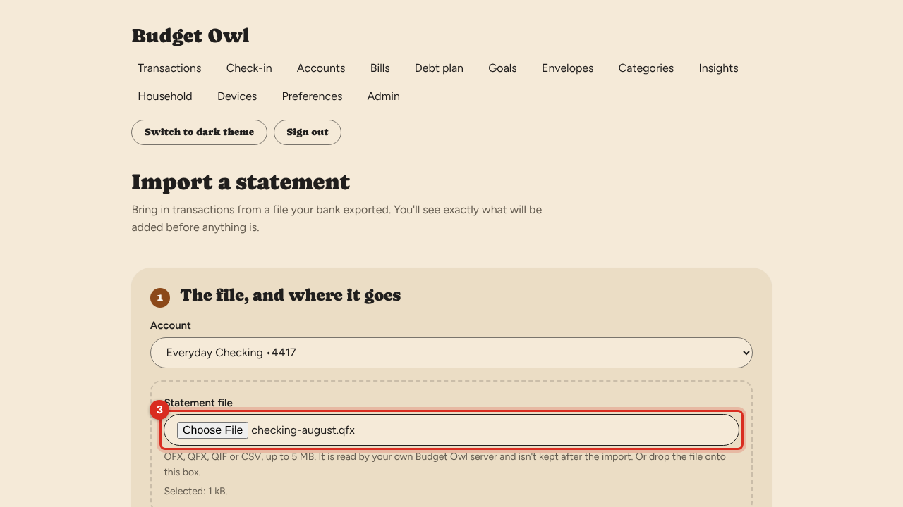
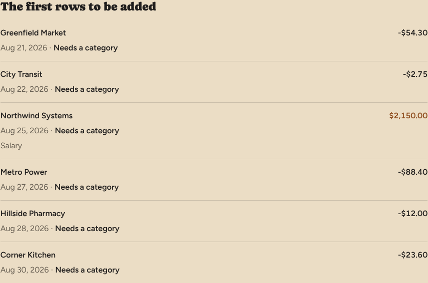
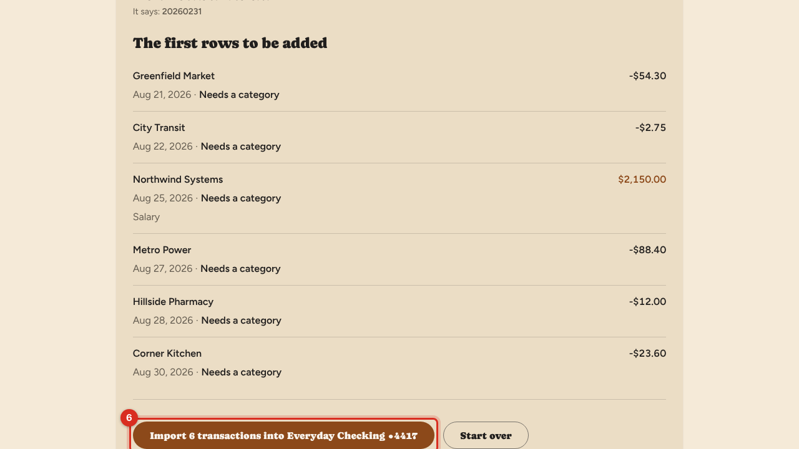
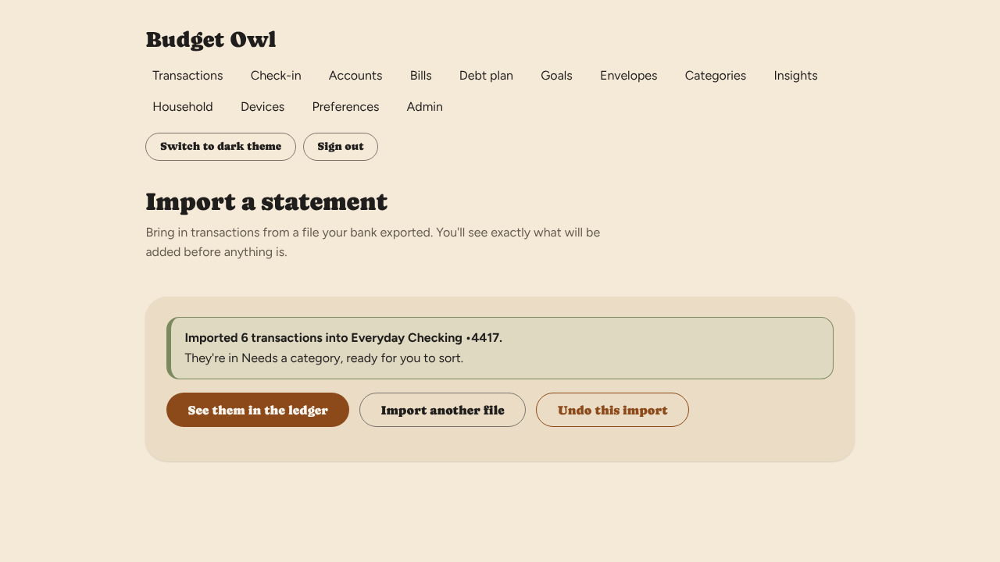
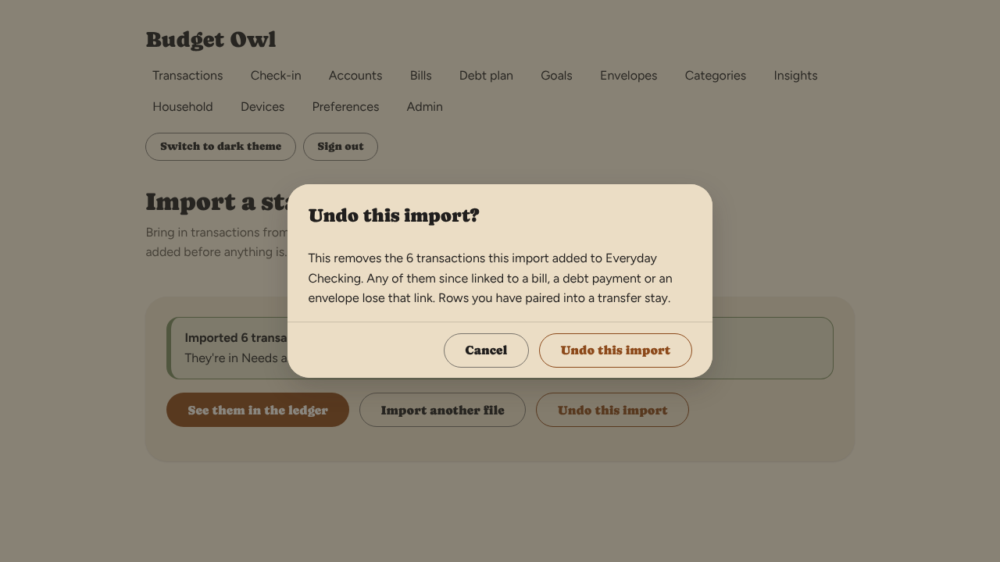
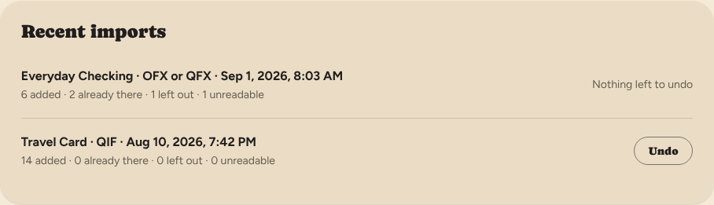
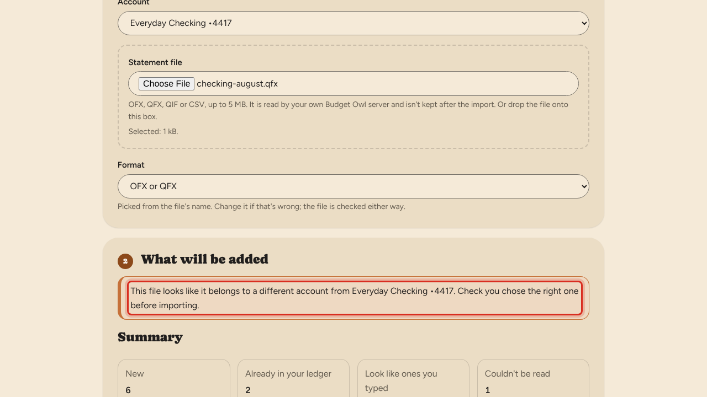

# Import a bank statement

Instead of typing in every transaction, you can export a statement from your bank's website and
bring it into Budget Owl. You see exactly what will be added, and what will be left out, before
anything is.

**The file is read by your own Budget Owl server and isn't kept.** Once the import is done, the
transactions are in your ledger and the file itself is gone. Its name isn't kept either.

## Before you start

- You need the account the statement belongs to — see [Add an account](add-an-account.md). An
  account you've archived can't take an import.
- You need to be an **owner** or a **member**. A **viewer** can't import — see
  [What the roles mean](manage-members.md#what-the-three-roles-mean).
- You need the statement as a file. Budget Owl reads **OFX**, **QFX**, **QIF** and **CSV**, up to
  5 MB and 10,000 transactions.

### Getting the file from your bank

Sign in to your bank's website, open the account, and look for **Download**, **Export** or
**Download transactions**. Choose a date range, then a format:

- **OFX** or **QFX** (sometimes called "Quicken", "Microsoft Money" or "Web Connect") is the best
  choice when it's offered. It carries the bank's own reference for each transaction and the
  balance the bank has on record, so Budget Owl can check its figures against the bank's.
- **QIF** is an older Quicken format. It works, but has no references and no balance.
- **CSV** ("spreadsheet", "Excel" or "comma-separated") works from almost any bank. Every bank lays
  it out differently, so you'll be asked which column is which the first time.

A PDF statement can't be imported. Nor can a file that's zipped or password-protected: unzip it
first, or download it again without a password.

## Steps

1. Select **Import a statement** at the top of **Transactions**, beside **Move money**.

   

   You can also select **Import** on an account's row on the **Accounts** screen, which starts the
   import with that account already chosen.

2. Choose the account the statement belongs to, in **Account**.

   

   Accounts show their last four digits, like **Everyday Checking •4417**, so you can tell two
   cards at one bank apart.

3. Select **Choose File** under **Statement file**, and pick the file you downloaded. You can also
   drop the file onto the dashed box.

   

   **Format** fills itself in from the file's name. If it guessed wrong, change it.

4. Select **Preview the import**.

   Nothing is added yet. Budget Owl reads the file and shows you what _would_ be added, in a new
   section called **What will be added**. If it's a CSV file, you'll be asked how to read it first
   — see [A CSV file](#a-csv-file) below.

5. Read the **Summary**.

   

   - **New** is how many transactions will be added.
   - **Already in your ledger** were brought in by an earlier import, so they're skipped. You can
     import overlapping statements without getting anything twice.
   - **Look like ones you typed** might be something you, or someone in your household, already
     recorded by hand. They're left out unless you tick them (see the next step).
   - **Couldn't be read** are lines in the file Budget Owl couldn't make sense of.
   - **Balance in Budget Owl now** and **After this import** are this account's balance before and
     after.

   For an OFX or QFX file, a box underneath compares the balance **your bank** has on record with
   the one Budget Owl will have after the import. If they match, you're in step with your bank. If
   they don't, see [The balances don't match](#the-balances-dont-match).

6. Look through **Needs a look**.

   

   - Under **Look like ones you typed**, each row says which transaction it looks like. If it's
     the same purchase, leave it unticked and it isn't added twice. If it really is a second,
     separate purchase, tick it. **Include all** and **Leave all out** do every row at once.
   - Under **Couldn't be read**, each line is listed by its line number in the file, with what's
     wrong and what the file actually says there. These aren't imported. If you need one, add it by
     hand — see [Record a transaction](record-a-transaction.md).

7. Check **The first rows to be added**.

   

   They look the way they'll look in your ledger. Money going out has a minus sign; if everything
   looks the wrong way round, see [The amounts are the wrong way round](#the-amounts-are-the-wrong-way-round).

8. Select the button at the bottom, which says how many transactions go into which account —
   here, **Import 6 transactions into Everyday Checking •4417**.

   

   If you tick a row in step 6, the number on the button goes up by one.

## What you'll see

**Imported 6 transactions into Everyday Checking •4417.** Imported transactions have no category
yet, so they're all in **Needs a category** — see
[Give a transaction a category](give-a-transaction-a-category.md). **See them in the ledger**
opens **Transactions** showing that account.

## Undo an import

If you imported into the wrong account, or the amounts came in the wrong way round, you can take
the whole import back out.

1. Select **Undo this import**, straight after importing, or **Undo** beside it under **Recent
   imports** at the bottom of the import screen.

   

2. Select **Undo this import** in the window.

   **Import undone. 6 transactions removed.** appears. The import stays listed under **Recent
   imports**, with **Nothing left to undo** beside it.

   

If you'd since marked a bill paid, logged a debt payment or an envelope entry with one of those
transactions, that link goes with it. A row you'd paired into a transfer stays — see
[Pair two rows into a transfer](pair-two-rows-into-a-transfer.md).

## A CSV file

A CSV file is a table, and every bank lays it out differently. So the first time, Budget Owl shows
you **How to read it** before the preview.

Budget Owl has guessed every setting from the file. Check them against the table of the first
rows underneath:

- **Date format** — how your bank writes dates. `08/03/2026` is 3 August in the US and 8 March
  almost everywhere else, so if the dates could be read either way, you're asked to choose.
- **Columns** — what each column holds. Every transaction needs a **Date** and an amount: either
  one **Amount** column, or **Money out** and **Money in** columns. A column you don't need, like
  the running balance, is **Not used**.
- **Money out appears as** — whether money leaving the account is a negative number, a positive
  one, or in a separate column.

Then select **Update preview**. Nothing changes until you do. Once the preview looks right, tick
**Remember these settings for this account** before importing, and the next CSV from that bank
won't need setting up. If your bank later changes its layout, Budget Owl tells you the columns
aren't the same as last time.

**"Does this text look right?"** Some files don't say how their letters are stored. If names with
accents come out garbled, Budget Owl shows the text read a few different ways under **Character
set**. Choose the one where the names look right, and select **Update preview**.

## Things that can go wrong

**"This file looks like it belongs to a different account from Everyday Checking •4417."**

The account number inside the file doesn't end in the four digits you gave this account. Check
**Account** before importing. If you're sure it's right, the import still works.

**The balances don't match.**
The box under the summary says _Those two differ_. Usually the opening balance you gave this
account, or something you recorded by hand, doesn't agree with the bank. The import is still
correct; the difference was there before it. Check the account's opening balance on the
**Accounts** screen, and look for a transaction recorded twice or missing.

**The amounts are the wrong way round** — spending shows as money in.
Some banks, especially for credit cards, write money you spent as a positive number. For a CSV,
set **Money out appears as** to **A positive amount (flip the signs)** and select **Update
preview**. If you've already imported it, undo the import and import it again.

**"Your ledger changed since this preview, so nothing was imported."**
Somebody else in your household imported or recorded something in this account between your
preview and your import. Nothing was added. Budget Owl shows the preview again with what's there
now — check it, then import.

**"That file is larger than 5 MB…" or "That file has more than 10,000 transactions…"**
Download a shorter date range from your bank — a few months at a time — and import each file. The
overlap between them is skipped as **Already in your ledger**.

**"That file is larger than Budget Owl reads at once (5 MB)…" for a file smaller than that.**
The message comes from whatever sits in front of Budget Owl on your network — usually a reverse
proxy such as nginx, Caddy or Traefik — which has its own, lower upload limit. Whoever runs your
Budget Owl server needs to raise it to at least 7 MB for imports. Until then, import shorter date
ranges.

**"That file isn't in the format you chose."**
The **Format** setting doesn't match the file. A `.csv` file that is really a spreadsheet, or an
`.ofx` file that is really something else, is refused. Choose the right format, or download the
file again.

**"That file is password-protected" or "That file is compressed."**
Download it again without a password, or unzip it and choose the statement inside.

**"That file holds statements for more than one account."**
Some banks put every account in one file. Download one account at a time.

**"That statement is in a different currency from the account you chose."**
The file is for an account in another currency. Choose the matching account.

**A transaction I deleted came back.**
Importing an overlapping statement adds back a transaction you'd deleted, because Budget Owl
doesn't keep a list of things you removed. It shows under **New** in the preview; delete it again
after importing.

**There's no Import a statement button.**
You're a **viewer**, or the household has no accounts yet. Going to the import screen directly as a
viewer says _Viewers can't import statements_.

## Related

- [Give a transaction a category](give-a-transaction-a-category.md) — sort what you imported
- [Pair two rows into a transfer](pair-two-rows-into-a-transfer.md) — when money moved between two
  of your own accounts
- [Record a transaction](record-a-transaction.md)
- [Add an account](add-an-account.md)
