# Log a payment against a debt

When you've paid a lender, write it down here. Budget Owl works out how much of it went on interest
and how much actually came off the balance, and shows you that before you record it. It keeps a row
for every payment, so the balance has a history rather than being a figure somebody typed.

**Logging a payment doesn't touch your accounts.** It moves no money and creates no transaction —
Budget Owl never claims money moved on your behalf. If you want the payment in your own records as
well, [record it as a transaction](record-a-transaction.md).

## Before you start

- You need a debt. If you haven't added one, start with [Add a debt](add-a-debt.md).
- You need to be an **owner** or a **member**. A **viewer** sees every payment ever recorded, and
  can't add one.

## Steps

1. Select **Debt plan** in the menu across the top, then **Open** on the debt you've paid.

2. Select **Log a payment**.

   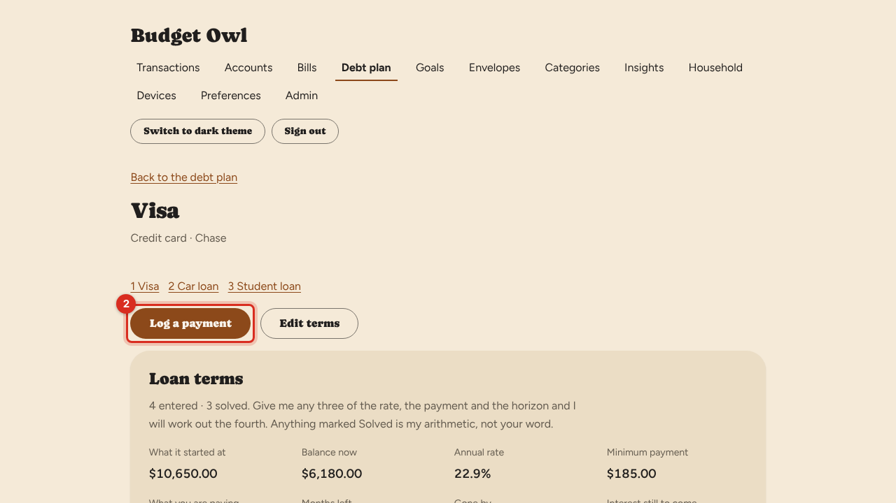

3. Check **Amount paid**.

   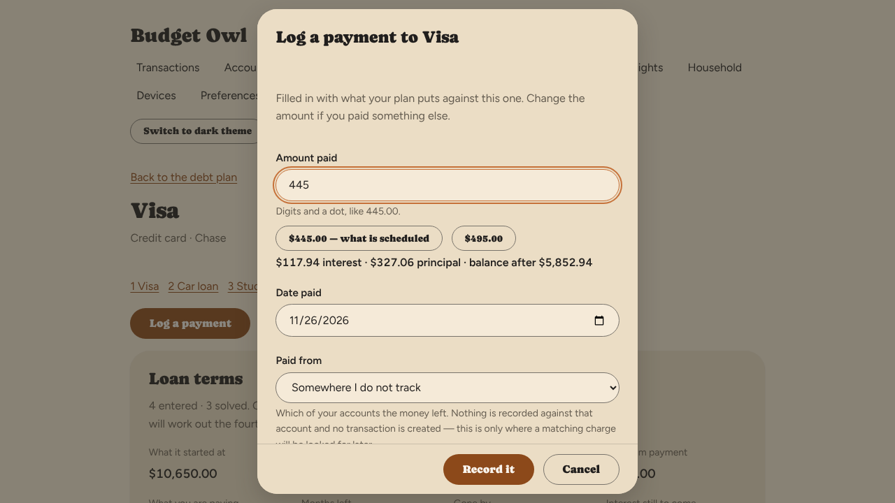

   It's filled in with what your plan puts against this debt. Change it if you paid something else.
   The two buttons underneath fill the box for you: **$445.00 — what is scheduled**, and **$495.00**
   — fifty more, for a month you can put a bit extra at it.

4. Read the split, the line just under the two buttons.

   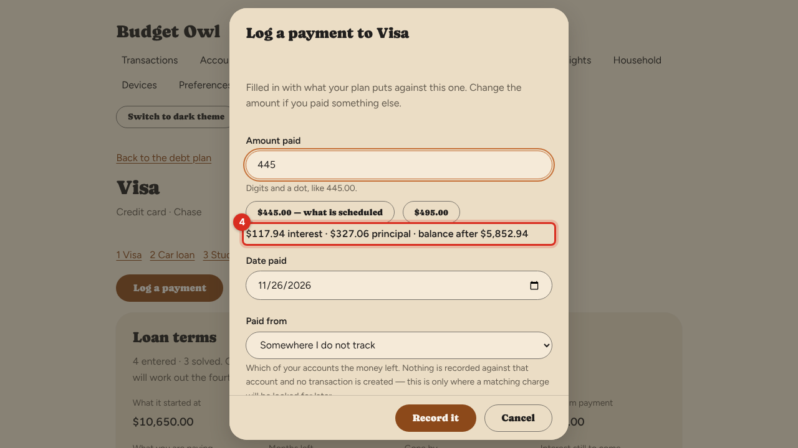

   Before you record anything, Budget Owl shows what this amount would do: how much goes on
   interest, how much comes off the balance, and what the balance will be afterwards. For $445.00
   against this card it reads **$117.94 interest · $327.06 principal · balance after $5,852.94**.
   Interest and principal always add up to exactly the amount in the box.

   The split follows the amount. If you type a different figure, it updates once you stop typing.
   If you select one of the buttons, it updates straight away:

   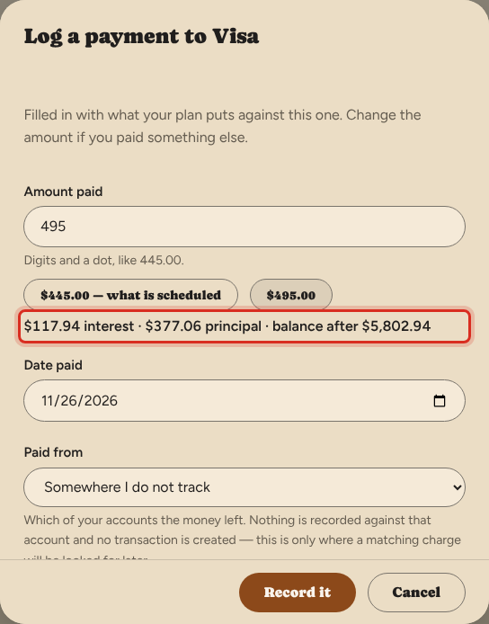

   The interest stays at $117.94, because it's worked out on the balance you owe now. All of the
   extra $50.00 comes off the balance.

   **A second payment in the same month carries no interest.** Budget Owl charges a debt one
   month's interest per calendar month, on the first payment you log in that month. Pay the card
   again in the same month and the split reads **$0.00 interest**: every cent comes off the
   balance.

5. Change **Date paid** if it wasn't today.

6. Choose the account the money left, in **Paid from**.

   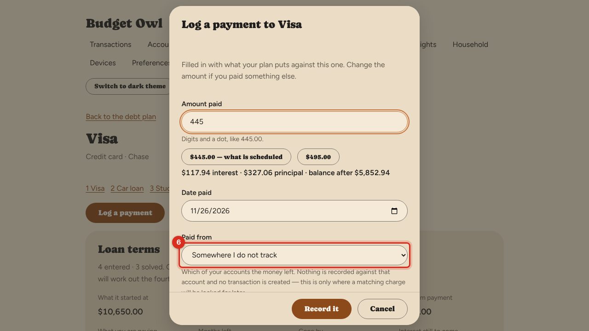

   **Nothing is written to that account.** Its balance does not move, and no transaction appears in
   your ledger. All this does is remember where the money came from, so that a real charge can be
   matched to this payment later. **Somewhere I do not track** is a perfectly good answer.

7. Add a **Note** if you want one.

   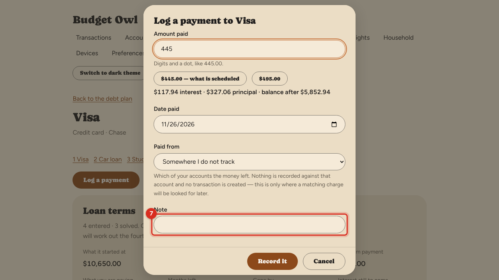

8. Select **Record it**.

   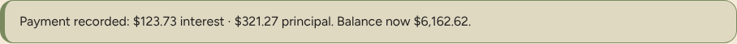

   The banner gives you the same split you saw in step 4, and the balance now. The payment appears
   at the top of **Payment history**, and the balance on the page has already changed to match.

## What you'll see

**The split you see before recording is the split that gets recorded.** Both come from the same sum,
worked out by Budget Owl on your server, so the figures in the window and in the banner afterwards
are always the same.

**If the split can't be shown, you can still record the payment.** Sometimes Budget Owl can't work
the split out in time — for example, if the connection to your server drops for a moment. The
window then says so in place of the figures:

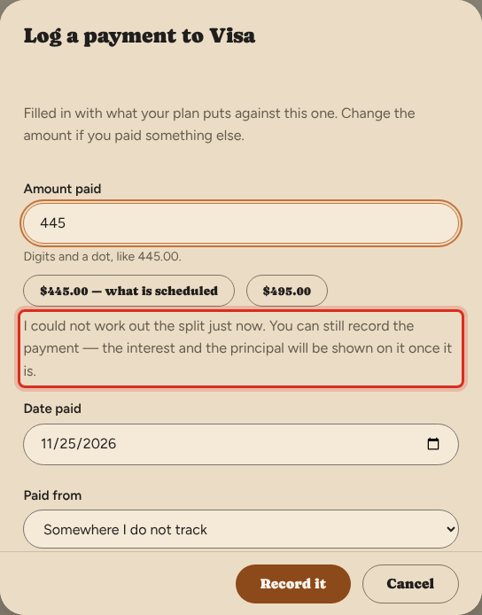

Select **Record it** as usual. The split is worked out when the payment is recorded, and you'll see
it in the banner and in **Payment history**.

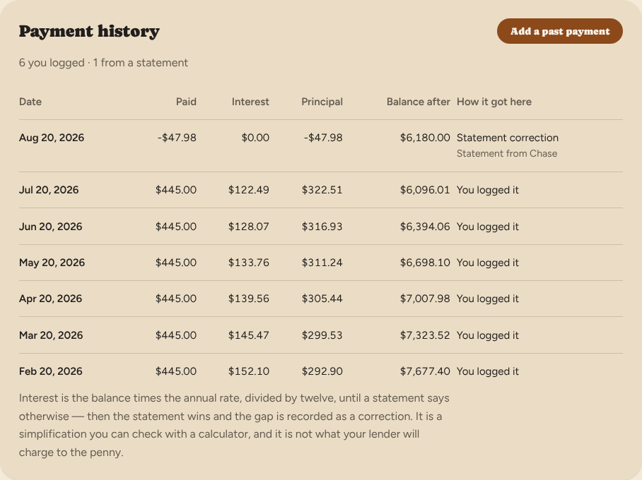

Every row says **how it got here**, so a figure a person entered is never mixed up with one Budget
Owl worked out:

- **You logged it** — somebody in your household recorded this.
- **Statement correction** — the balance was put right from a statement, and the difference was
  written down rather than tidied away. See [Confirm what you owe](confirm-what-you-owe.md).

**Balance after** reads down the column to the figure at the top of the page, so you can follow the
balance back through every payment.

The line under the table is the rule the splits come from: _"Interest is the balance times the annual
rate, divided by twelve, until a statement says otherwise — then the statement wins and the gap is
recorded as a correction. It is a simplification you can check with a calculator, and it is not what
your lender will charge to the penny."_

## Recording a payment you made a while ago

**Add a past payment**, at the top of **Payment history**, opens the same window. Set **Date paid**
to the day it went, and the split under **Amount paid** updates for that date. If you've already
logged a payment in that month, the past one carries no interest. Otherwise it carries that
month's interest, worked out on the balance you owe now. Budget Owl doesn't keep a day-by-day
record of the balance, so it can't use the balance as it stood on that day.

## What the rest of the page tells you

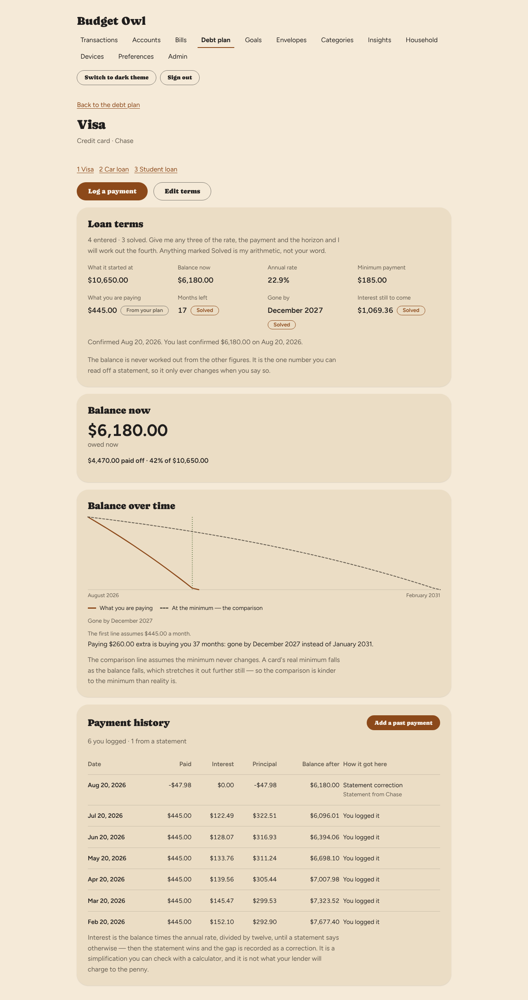

Four cards, top to bottom, and the buttons at the top work on whichever debt you're looking at. The
row of links above them — **1 Visa**, **2 Car loan**, **3 Student loan** — steps between your debts
in the order your plan is paying them.

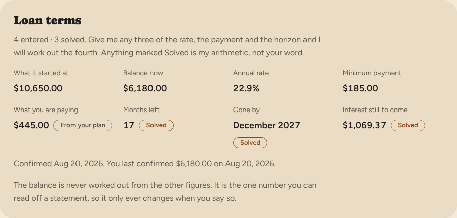

**Loan terms** is the whole debt in eight figures, and it labels each one so you always know who
said it:

- **No tag** — you entered it. The balance, the rate and the minimum are yours.
- **Solved** — Budget Owl worked it out. **Months left**, **Gone by** and **Interest still to come**
  are arithmetic, not promises.
- **From your plan** — **What you are paying** is what the ladder on the
  [debt plan](choose-how-to-clear-your-debts.md) allocates to this debt.

The card says it in its own words at the top: _"Give me any three of the rate, the payment and the
horizon and I will work out the fourth."_ **The balance is never one of them** — it's the one number
you can read off a statement, so it only changes when you say so.

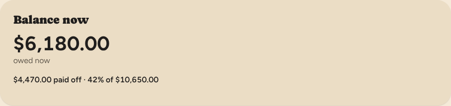

**Balance now** leads with what you owe and, underneath, how far you've come. That second line only
appears if you told Budget Owl what the debt started at.

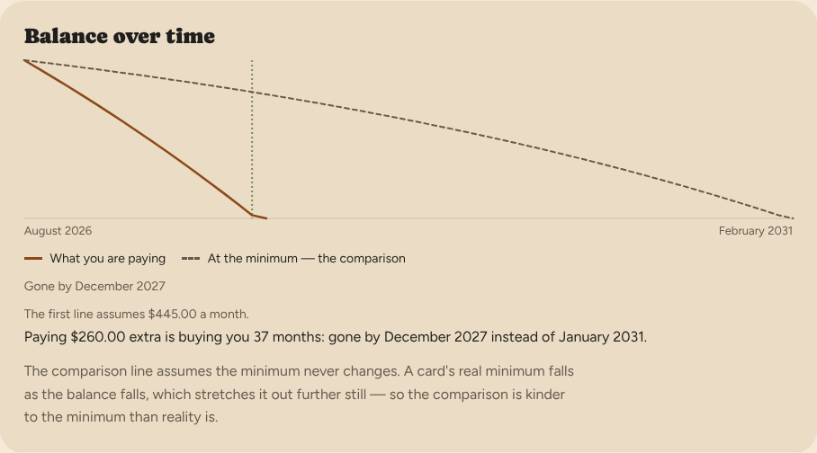

**Balance over time** draws what you're paying against what the minimum alone would do, and says
what the difference buys: _"Paying $260.00 extra is buying you 37 months: gone by December 2027
instead of January 2031."_ The dashed line is kinder than reality, and the card says so — a real
card minimum falls as the balance falls, which stretches it out further still.

## Things that can go wrong

**"I logged a payment and my account balance didn't change."**
That's how it works. A debt payment is a statement about a balance a lender holds, not a movement in
your own ledger. **Paid from** only records where the money came from. To change an account's
balance, [record a transaction](record-a-transaction.md).

**"The balance went down by less than I paid."**
The rest went on interest. The **Interest** and **Principal** columns in the history show the split
for every payment, and the two always add up to exactly what you paid.

**"My extra payment shows $0.00 interest."**
That's right. You've already logged a payment against this debt this month, and that one carried
the month's interest, so all of the extra payment comes off the balance. Until 26 November 2026,
Budget Owl charged every payment a whole month's interest. A small extra payment could then look
as if it made the balance go up. Payments you logged before that keep the split they were
recorded with. If your balance looks too high because of one, enter the figure from your next
statement — [Confirm what you owe](confirm-what-you-owe.md).

**"I can't see the split."**
It's the line just under **Amount paid** and its two buttons. If the box is empty or holds something that isn't an amount yet, such as `4.`,
there's no split to show until you finish typing.

**"It says it could not work out the split."**
Record the payment anyway. The split is worked out when it's recorded, and you'll see it in the
banner and in **Payment history**.

**"The interest figure isn't what my lender charged."**
It may be close, but don't expect it to match exactly. Budget Owl uses the balance times the annual
rate divided by twelve, rounded to the cent as a statement is. That's simple enough to check with a
calculator; real lenders work it out daily and bill on
statement cycles. When a statement disagrees, the statement wins —
[Confirm what you owe](confirm-what-you-owe.md).

**"There's no Log a payment button."**
Your role is **Viewer**. You can read every payment, and an owner or member records them.

## Related

- [Confirm what you owe](confirm-what-you-owe.md)
- [Choose how to clear your debts](choose-how-to-clear-your-debts.md)
- [Add a debt](add-a-debt.md)
- [Record a transaction](record-a-transaction.md) — the money that actually moved
