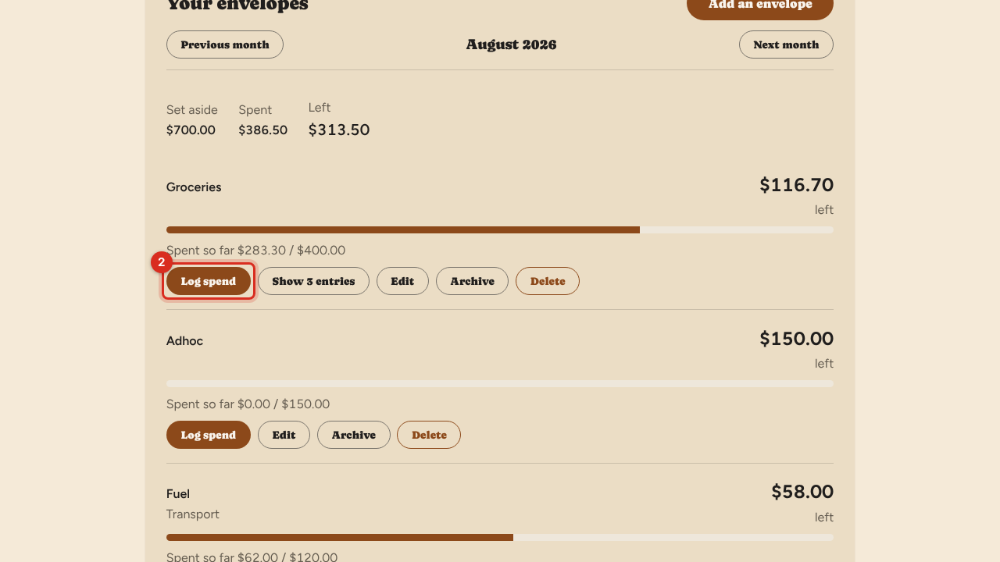
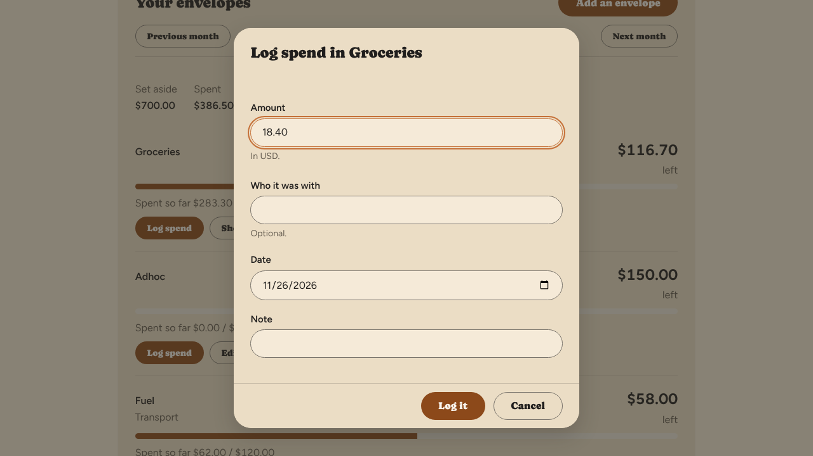
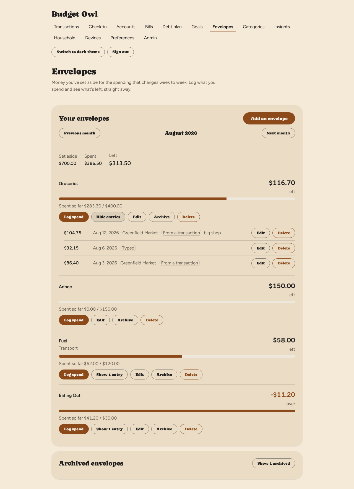
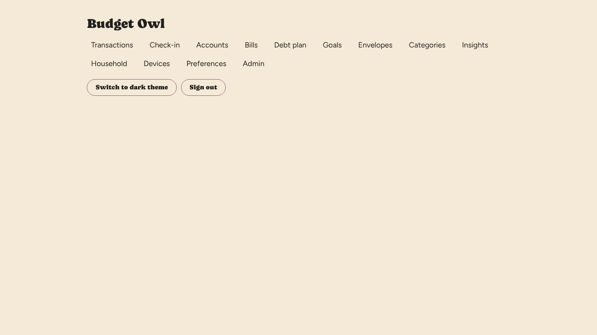

# Log spend in an envelope

The whole point of an envelope is knowing what's left **while you can still do something about
it** — standing in the shop, not at the end of the month. So logging what you spend is built to
take a few seconds.

## Before you start

You need an envelope. If you haven't set one up, start with
[Set up an envelope](set-up-an-envelope.md).

## Steps

1. Select **Envelopes** in the menu across the top.

2. Find the envelope and select **Log spend**.

   

   The big number is what's **left**. Underneath it, in smaller text, is what you've spent out of
   what you set aside.

3. Enter the **Amount**.

   

   On a phone the number keypad opens straight away. **This is the only thing you have to fill
   in.**

4. Add **Who it was with** if you want to.

   Optional, and it says so. Cash out of a machine wasn't with anyone.

5. Change the **Date** if it wasn't today.

   It starts on today.

6. Select **Log it**.

   The window closes and the envelope's **left** figure has already changed.

## Seeing what you've logged

7. Select **Show entries** on an envelope.

   

   Every entry says where it came from:

   - **Typed** — you entered the amount here.
   - **From a transaction** — you attached a transaction you'd already recorded.

   The difference matters: one is what you told Budget Owl, the other is tied to a real record of
   the purchase. Budget Owl never files a transaction into an envelope on its own, however
   obvious the match looks — that's your decision to make.

8. Select **Edit** or **Delete** on any entry to correct it.

   Deleting an entry gives the amount back to the envelope. If it came from a transaction, the
   transaction itself is kept.

## When you go over

9. An envelope you've overspent shows a **negative** figure and the word **over**.

   

   Budget Owl doesn't round this up to zero or hide it. Being £11.20 over is the thing you need to
   know, and it stays on the screen until the month turns.

   Going over doesn't come out of next month automatically. Each month's envelopes are a fresh
   decision — when you set next month's up, you decide then what to do about it.

## If something doesn't work

**"This envelope is archived."** You've archived it, so it's not taking new entries. Restore it
from **Archived envelopes** at the bottom of the screen, or log the spend somewhere else.

**"This transaction is already in an envelope."** You've already attached that purchase somewhere.
A transaction can only be in one envelope — counting it twice would make both envelopes wrong, and
both numbers would still look believable.
