# Mark a bill paid

Each bill shows a row for every date it falls on this month, and you tick each one off as you pay
it. One button does the ordinary case, and if it didn't go the way you planned, there's a way to
say that too.

**Marking a bill paid records what you say happened.** It doesn't move money, and it doesn't
create a transaction — Budget Owl never claims money moved on your behalf. If you want the payment
in your records as well, [record it as a transaction](record-a-transaction.md).

## Before you start

- You need a bill. If you haven't added one, start with [Add a bill](add-a-bill.md).
- You need to be an **owner** or a **member**. A **viewer** sees every row and every amount, and
  can't tick anything off.

## Steps

1. Select **Bills** in the menu across the top.

2. Find the bill in **Your bills**.

   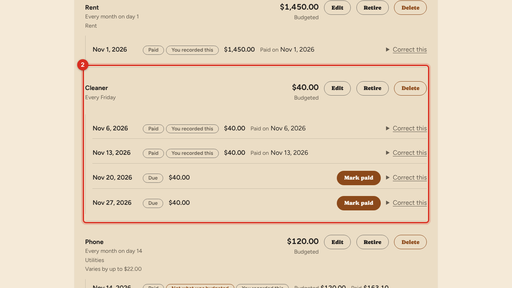

   Under the bill's name and budgeted amount is **one row per date**. A weekly bill has four or
   five rows in a month, each with its own date and its own buttons — the two Fridays that have
   been paid, and the two still to come.

3. Select **Mark paid** on the row you've paid.

   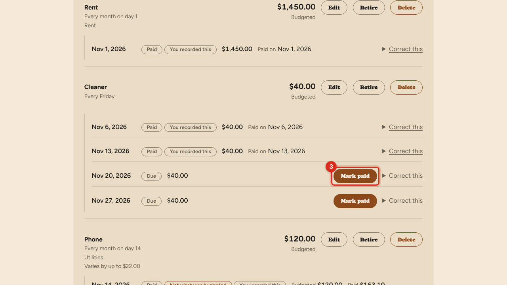

   **Mark paid** means the amount you budgeted, paid today. That's the ordinary case, so it's the
   only button kept out in the open.

4. Check the row.

   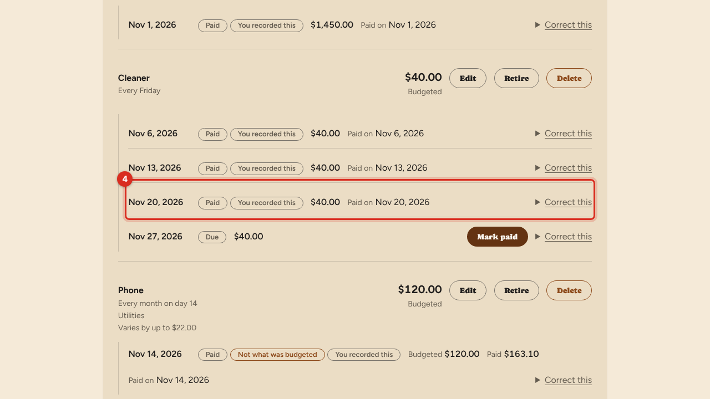

   The row is now tagged **Paid** and **You recorded this**, says what was paid and when, and has
   no **Mark paid** button left. Every other row is untouched.

   

## What you'll see

**You recorded this** on a row means exactly that: somebody in your household said so. Budget Owl
never fills a row in on its own, so you can always tell a figure a person entered from one that is
only the plan.

**Still to pay**, above the list, drops by what you ticked off. **What's left this month** doesn't
move — bills count whether or not they're paid, and
[there's a reason for that](see-whats-left-this-month.md#why-paying-a-bill-doesnt-make-the-figure-go-up).

## When it wasn't that simple

Everything else lives under **Correct this**, on the row it applies to.

5. Select **Correct this** on the row.

   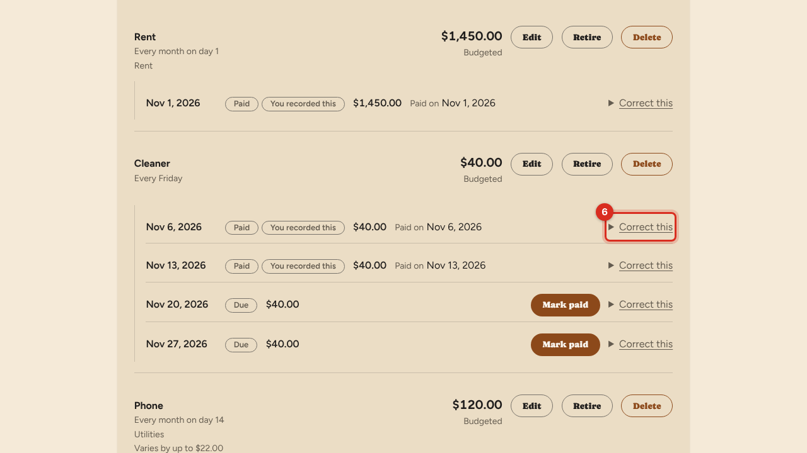

6. Pick what happened.

   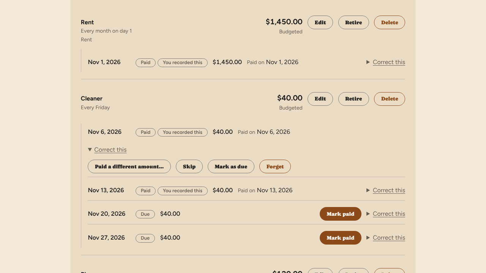

   - **Paid a different amount…** — it went out, but not for what you budgeted.
   - **Skip** — it doesn't apply this month, and isn't going to be paid.
   - **Mark as due** — you ticked it off and it hadn't gone after all. This is you saying it's
     unpaid.
   - **Forget** — remove what was recorded for that date entirely. Only offered on a row somebody
     has recorded something against.

## Paying a different amount

7. Enter what really left the account in **Amount paid**.

   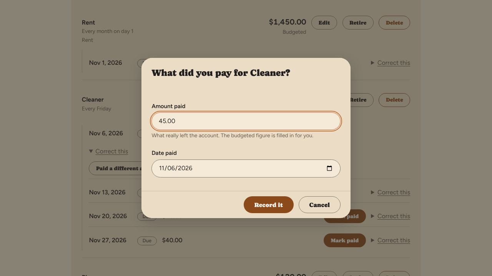

   The budgeted figure is filled in for you, so change it to the real one. For a bill with no
   budgeted figure — an irregular one — the box starts empty.

8. Change **Date paid** if it wasn't the day it was due.

9. Select **Record it**.

   The row now shows **both** figures — **Budgeted** and **Paid** — because the difference is the
   useful part.

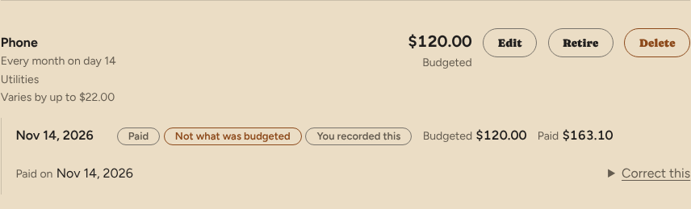

A payment further from the plan than the bill allows is also tagged **Not what was budgeted**. For
a bill you've told Budget Owl can vary, "further" means outside the **Give or take** figure —
here, $163.10 against a $120.00 plan that allows $22.00 either way. For every other bill, anything
other than the budgeted amount is flagged.

## Skipping a month

A bill you're not going to pay this month — a cleaner who's away, a subscription you've paused —
gets **Skip**, under **Correct this** on that row.

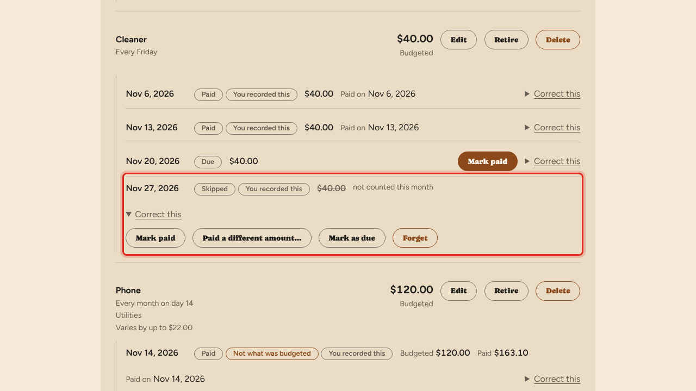

The row is tagged **Skipped**, the bill stays where it is, and the dates either side are
unaffected. The amount stays on the row with a line through it and the words **not counted this
month**, so you can still see what it would have been.

If it turns out you did pay after all, **Mark paid** is still there — under **Correct this**,
along with the rest.

To undo a skip, open **Correct this** again and select **Mark as due**, or **Forget**.

## Forget is not the same as Mark as due

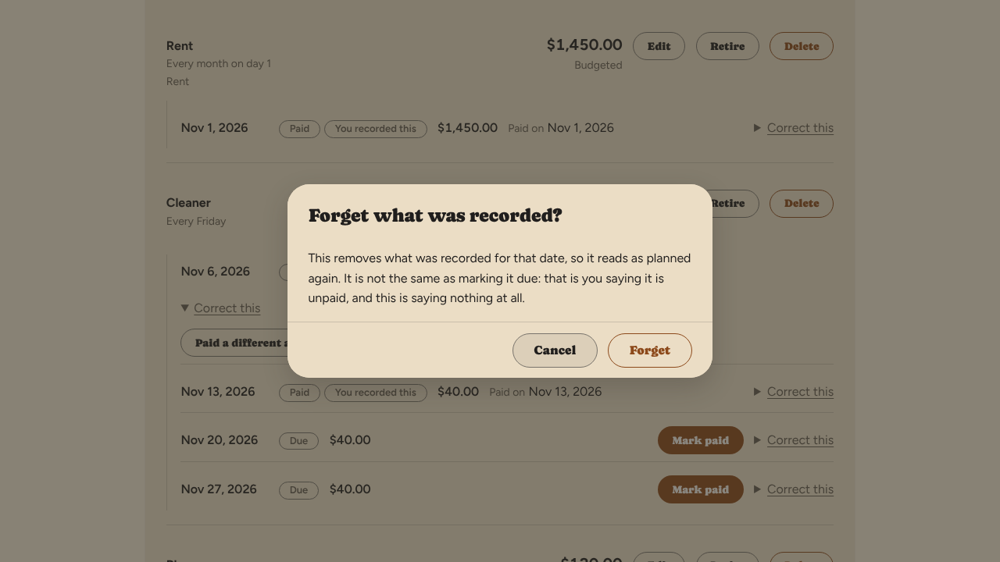

- **Mark as due** says something: _this bill is unpaid._
- **Forget** says nothing at all. It removes what was recorded, and the date goes back to reading
  as planned — exactly as if nobody had ever touched it.

Use **Forget** when the record itself was a mistake. Use **Mark as due** when you know it's still
to pay.

## A bill that's late

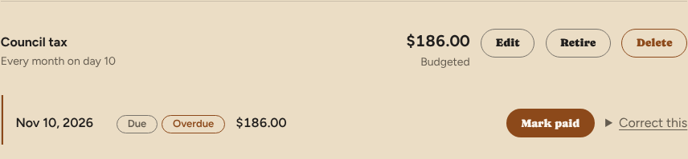

A date that's gone by with nothing recorded against it is tagged **Overdue** and marked down the
side. Those bills are added up for you above the list, beside **Bills this month** and **Still to
pay**.

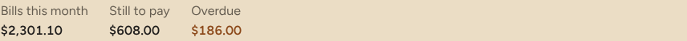

Nothing happens to an overdue bill on its own — Budget Owl doesn't chase it, and doesn't assume
you paid it.

## A bill with no set date

An irregular bill — the vet, the dentist — has no dates of its own, so there's nothing to tick
off. You record a payment when one happens, and that's what brings the date into being.

10. Select **Record a payment** on the bill.

    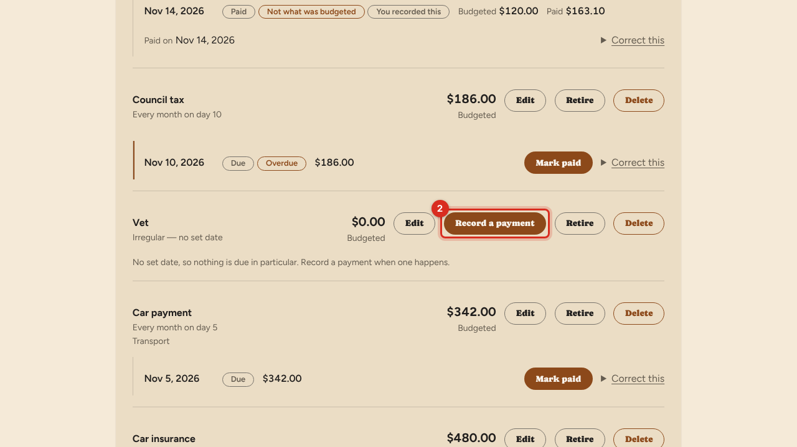

11. Set **Date it was due**.

    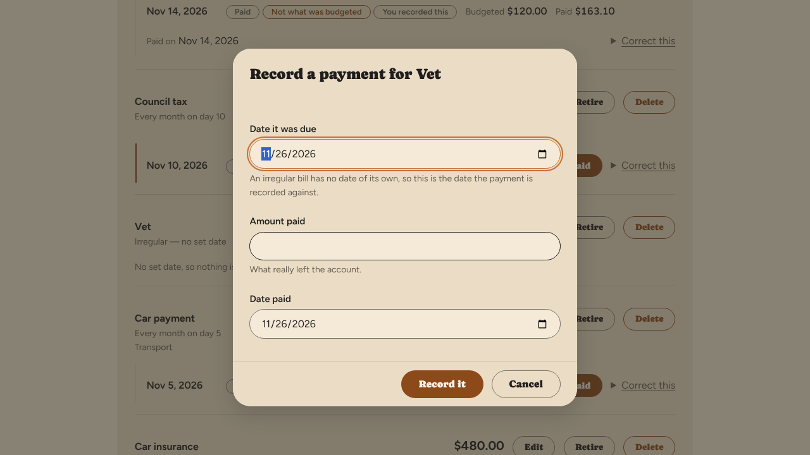

    It starts on today. This is the date the payment is recorded against, and it decides which
    month the payment belongs to.

12. Enter the **Amount paid**.

13. Select **Record it**.

    A row appears under the bill for that date, tagged **Paid**.

## Things that can go wrong

**The row went back to Due after I marked it paid.**
Somebody used **Mark as due** on it, or **Forget**. A row tagged **You recorded this** is a person
speaking; if the household disagrees about a bill, that's the conversation to have rather than a
button to find.

**I can't find Forget.**
It's only on rows that have something recorded against them. There's nothing to forget about a
date nobody has touched.

**I marked the wrong week paid.**
Open **Correct this** on that row and select **Forget**, then tick off the right one. Each date is
separate, so nothing else is affected.

**There's no Mark paid button anywhere.**
Your role is **Viewer**. You can read every figure, and an owner or member records the payments.

## Related

- [Add a bill](add-a-bill.md)
- [See what's left this month](see-whats-left-this-month.md)
- [Record a transaction](record-a-transaction.md) — the money that actually moved
