# Move money between your own accounts

Money going from your current account into savings, or out of savings to pay off a card, hasn't
been spent and hasn't been earned. It's the same money in a different place. Budget Owl calls that
a **transfer**, and writes it into both accounts at once so neither balance ends up wrong.

**Recording a transfer doesn't move any money.** It writes down a move your bank has already made,
the same as every other thing you record here.

## Before you start

- You need **two** accounts that you haven't archived. **Move money** only appears when there are
  two accounts money could go between — see [Add an account](add-an-account.md).
- You need to be an **owner** or a **member**. A **viewer** sees every transfer and every amount
  and can't make or change one — see
  [What the roles mean](manage-members.md#what-the-three-roles-mean).

## Steps

1. Select **Transactions** in the menu across the top.

   You'll see **Your transactions**.

2. Select **Move money**, beside **Record a transaction**.

   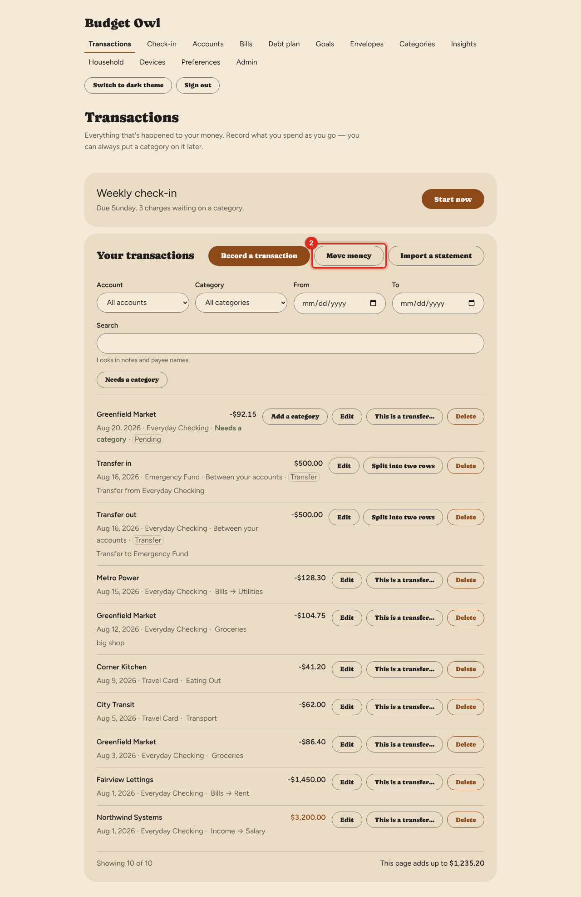

   A window called **Move money between your accounts** opens, with a line at the top: _Moving
   money between two of your own accounts isn't spending and isn't income, so a transfer has no
   category and nobody to pay._ That's why there's no category and no payee anywhere on it.

   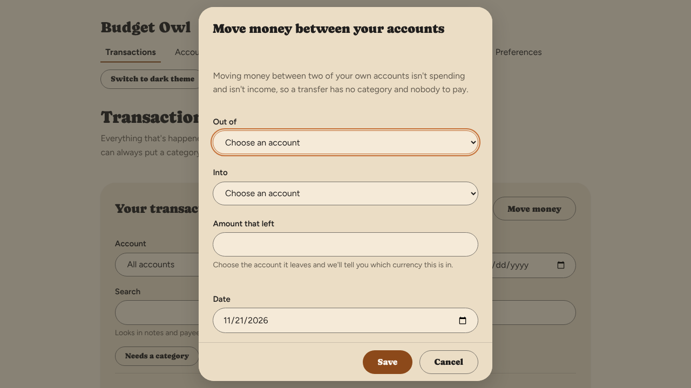

3. Choose the account the money **left**, in **Out of**.

   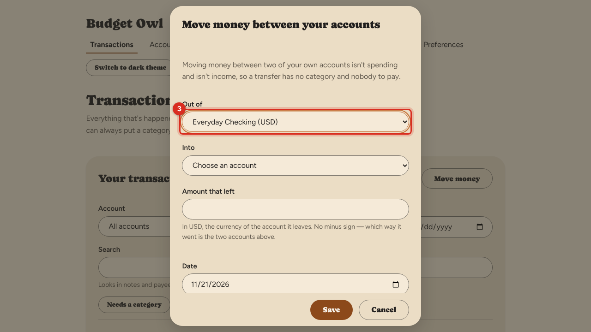

   Every account is listed with its currency — **Everyday Checking (USD)** — because that's what
   decides the currency of the amount you're about to type.

4. Choose the account the money **arrived in**, in **Into**.

   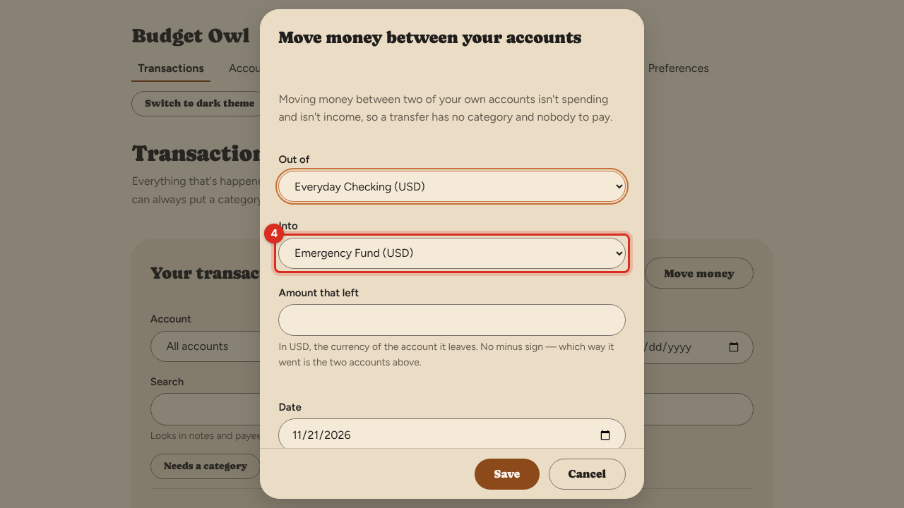

5. Enter the **Amount that left**.

   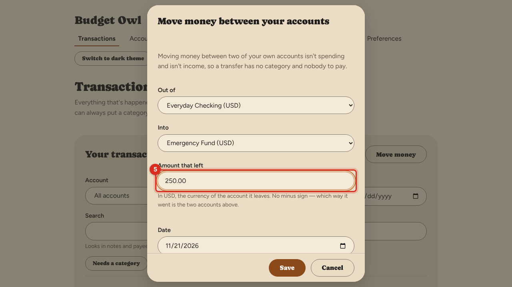

   The number on its own — `250.00`. **No minus sign:** which way the money went is the two
   accounts above. The line under the box names the currency — the currency of the account the
   money left, not your household's.

6. Check the **Date**.

   It starts on today. Change it to the day the money actually moved.

7. Scroll down inside the window to **Note**, and add one if you want.

   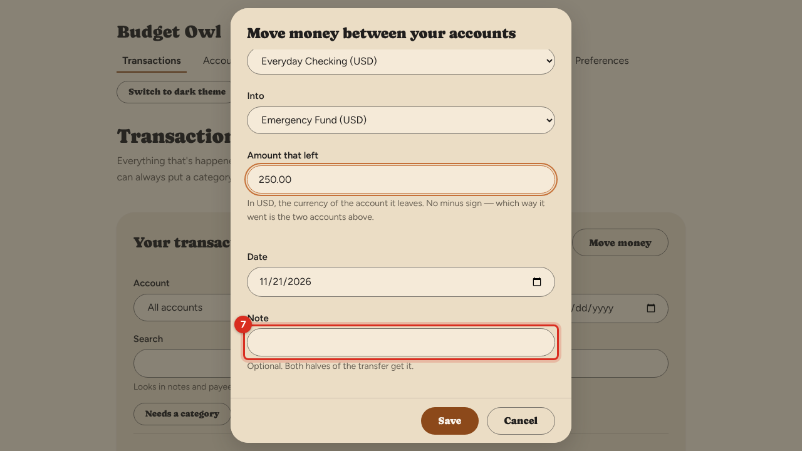

   It's optional, and both halves of the transfer get what you type. It's the one place to say
   _why_ — "to cover the car insurance" — and it's also how the list ends up saying where the
   money went (see below).

8. Select **Save**.

   The window closes and **Money moved.** appears above the list.

   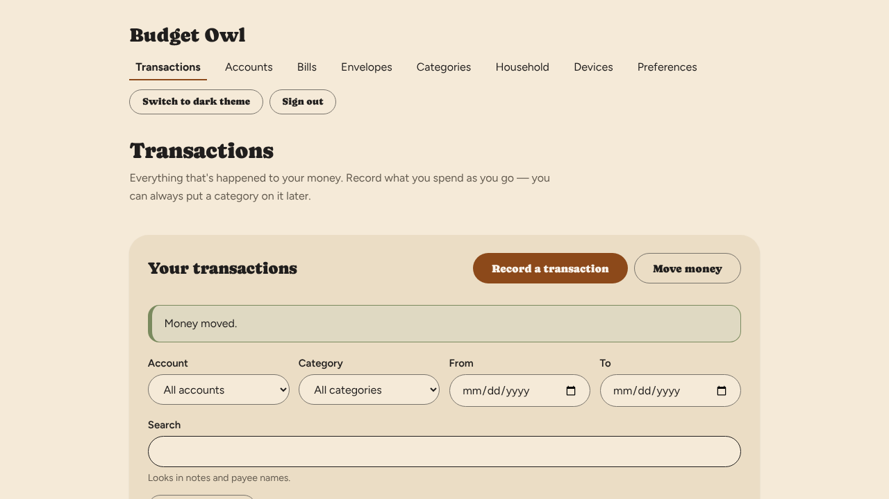

## What you'll see

Your transfer is in the list **twice** — once as **Transfer out**, once as **Transfer in**.

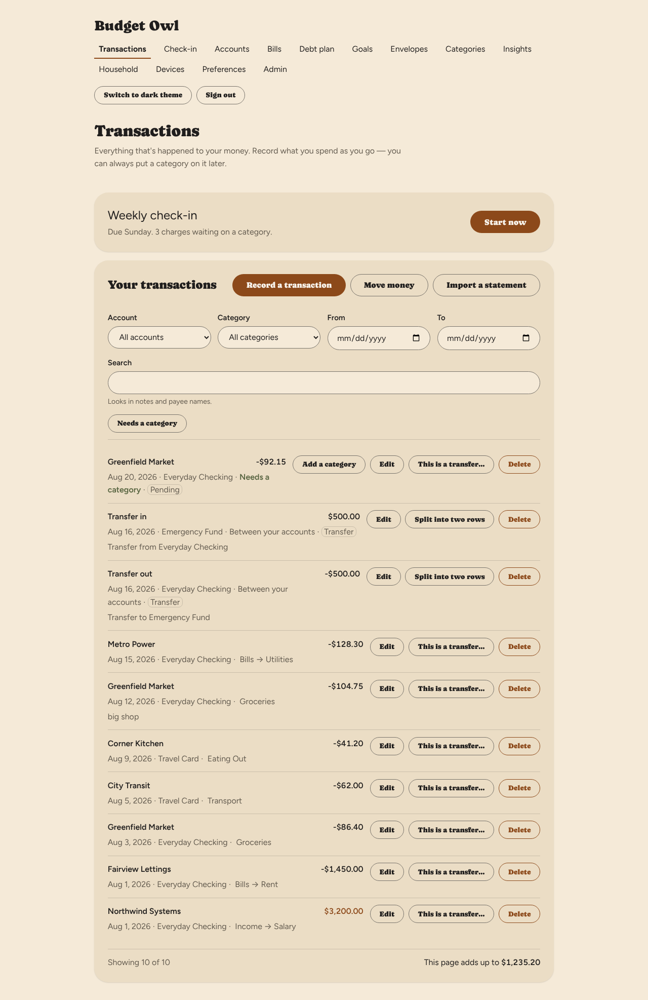

That isn't a double entry and nothing is counted twice. An account's balance is worked out from
the rows in that account, so money leaving **Everyday Checking** has to show up in Everyday
Checking, and the same money arriving in **Emergency Fund** has to show up there. Filter the list
by **Account** and you'll see one of the two rows — whichever half belongs to the account you
picked.

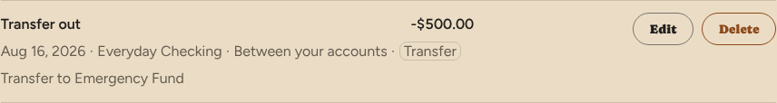

Where another transaction names who you paid, a transfer says **Transfer out** or **Transfer in**.
Where another transaction shows its category, a transfer says **Between your accounts**, and it
carries a **Transfer** badge.

**A row names its own account, not the other one.** The row above says **Everyday Checking**,
which is the account it came out of; the line reading "Transfer to Emergency Fund" is the **Note**
somebody typed. If you want the list to tell you where money went without opening anything, put
that in the note when you make the transfer.

## A transfer never needs a category

A transfer isn't spending, so no category could be right for it. Both rows read **Between your
accounts** instead of **Needs a category**, and selecting **Needs a category** doesn't bring them
up — there's nothing to file.

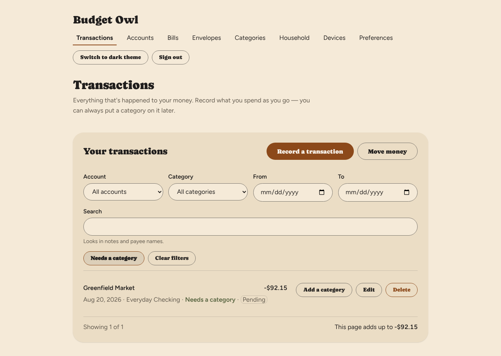

It isn't income either. Moving your salary into savings doesn't make it look like you were paid
twice.

## When the two accounts are in different currencies

$200.00 leaving a dollar account doesn't make €200.00 arrive in a euro one, and Budget Owl can't
tell you what did arrive. It doesn't know your bank's rate, and a published rate wouldn't be it —
the bank's fee is usually buried inside the rate it used.

So when **Out of** and **Into** are in different currencies, a second box appears under the first:
**Amount that arrived**.

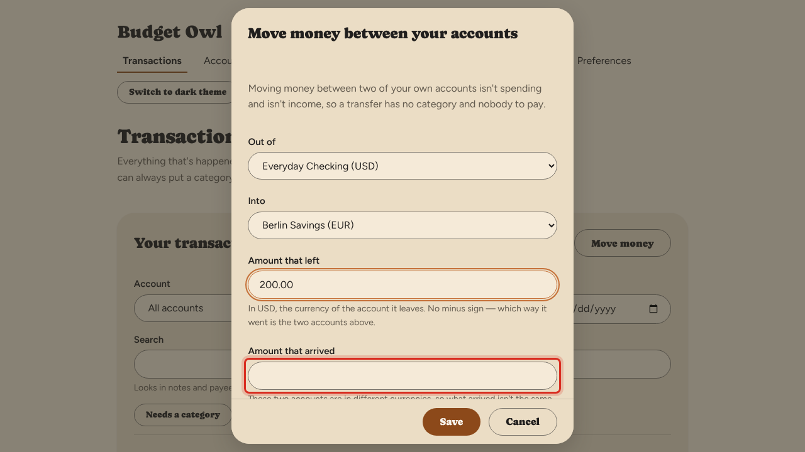

9. Enter what left the first account in **Amount that left**, in that account's currency.

10. Enter what arrived in the second account in **Amount that arrived**, in _its_ currency.

    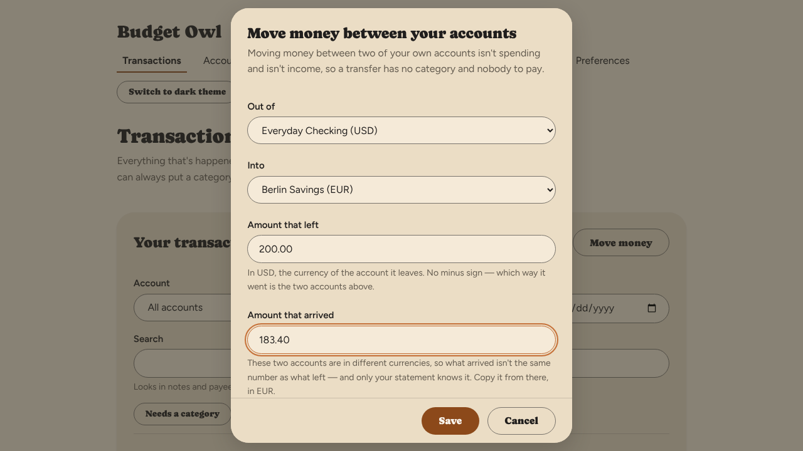

    Both figures come off your statement. The second one is the amount your bank actually put in
    the receiving account, after whatever it charged — so copy it rather than working it out.

The rest is the same: check the date, add a note if you want, then select **Save**.

If you change **Into** back to an account in the same currency, **Amount that arrived** disappears
and one figure is all you're asked for.

## Change a transfer

11. Select **Edit** on either row. Both rows are the same transfer, so it doesn't matter which.

    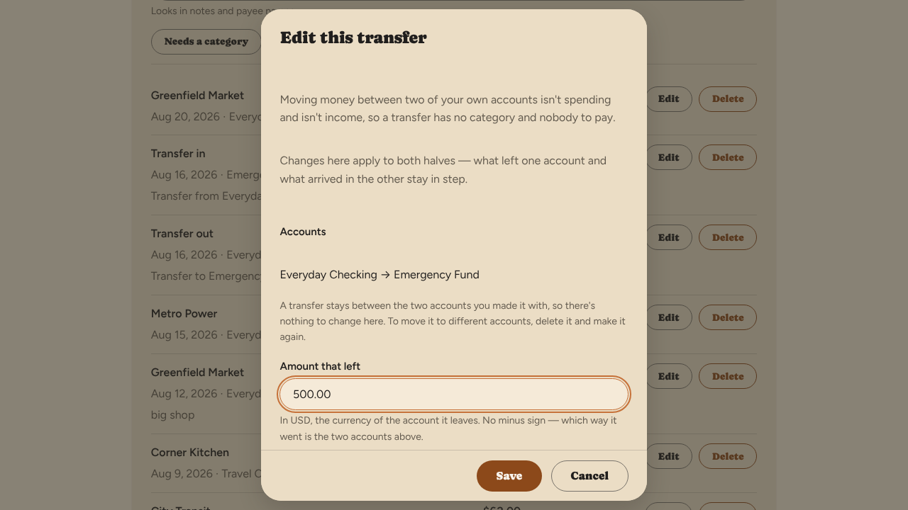

12. Change the amount, the date or the note.

13. Select **Save**.

    Both halves of the transfer change together — there's no way to change one on its own.

**You can't change the accounts here.** They're named at the top — **Everyday Checking → Emergency
Fund** — with no lists to change them, and the window says why: _A transfer stays between the two
accounts you made it with, so there's nothing to change here. To move it to different accounts,
delete it and make it again._

## Remove a transfer

14. Select **Delete** on either row.

    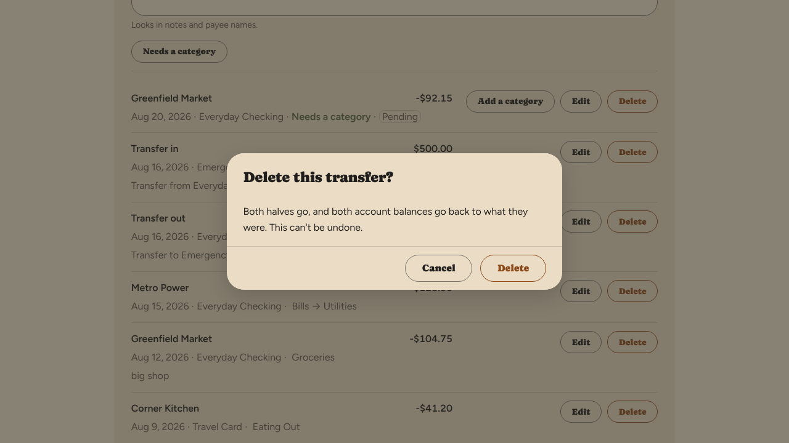

15. Select **Delete** in the **Delete this transfer?** window.

    Both rows go, not only the one you were looking at, and both balances go back to what they
    were. You can't undo it, but you can record the transfer again.

## What a viewer sees

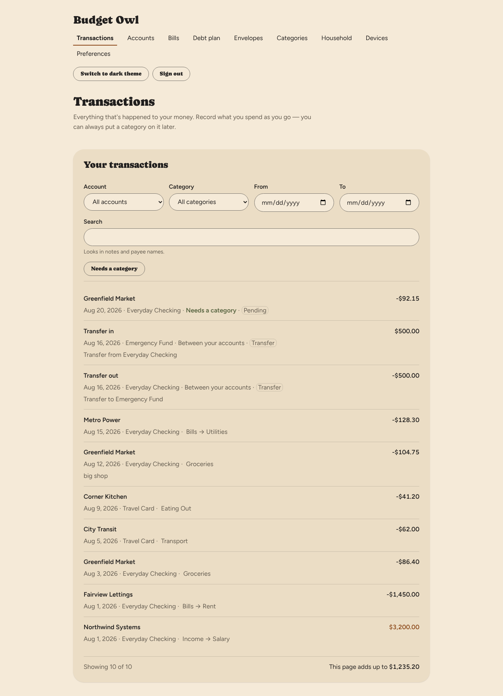

A **viewer** sees both halves of every transfer and every figure, and has no **Move money**
button and no **Edit** or **Delete** on any row.

## Things that can go wrong

**"Choose a different account. Money can't move from an account to itself."**
**Out of** and **Into** are set to the same account. The message appears under **Into** as soon as
you move on to the next box.

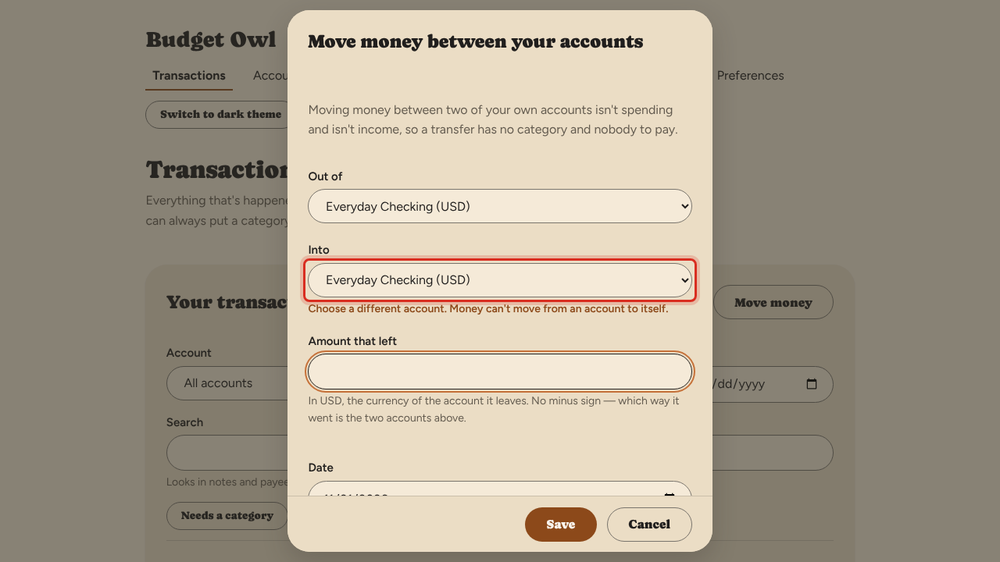

**There's no Move money button.**
Either you're a **viewer**, or you have fewer than two accounts that can take a transaction. Add
the second account, or bring back one you archived — see
[Archive or delete an account](archive-or-delete-an-account.md).

**The account I want isn't in the Out of or Into list.**
Accounts you've archived aren't offered, because nothing new can be recorded in them. Restore it
on the **Accounts** screen and it comes back to both lists. A transfer you made _before_ archiving
an account stays exactly as it is — it already happened.

**I already recorded the two sides by hand, as an expense and some income.**
Delete both of those transactions and use **Move money** instead. Recorded as an expense and
income, the same money counts as spending in one place and earnings in another, and every total
that uses either is wrong.

**I picked the wrong account.**
Delete the transfer and make it again. The accounts are fixed once a transfer exists, for the same
reason you can't move a transaction between accounts: it would change two balances at once.

## Related

- [Record a transaction](record-a-transaction.md) — money going to or coming from somebody else
- [Add an account](add-an-account.md)
- [Archive or delete an account](archive-or-delete-an-account.md)
