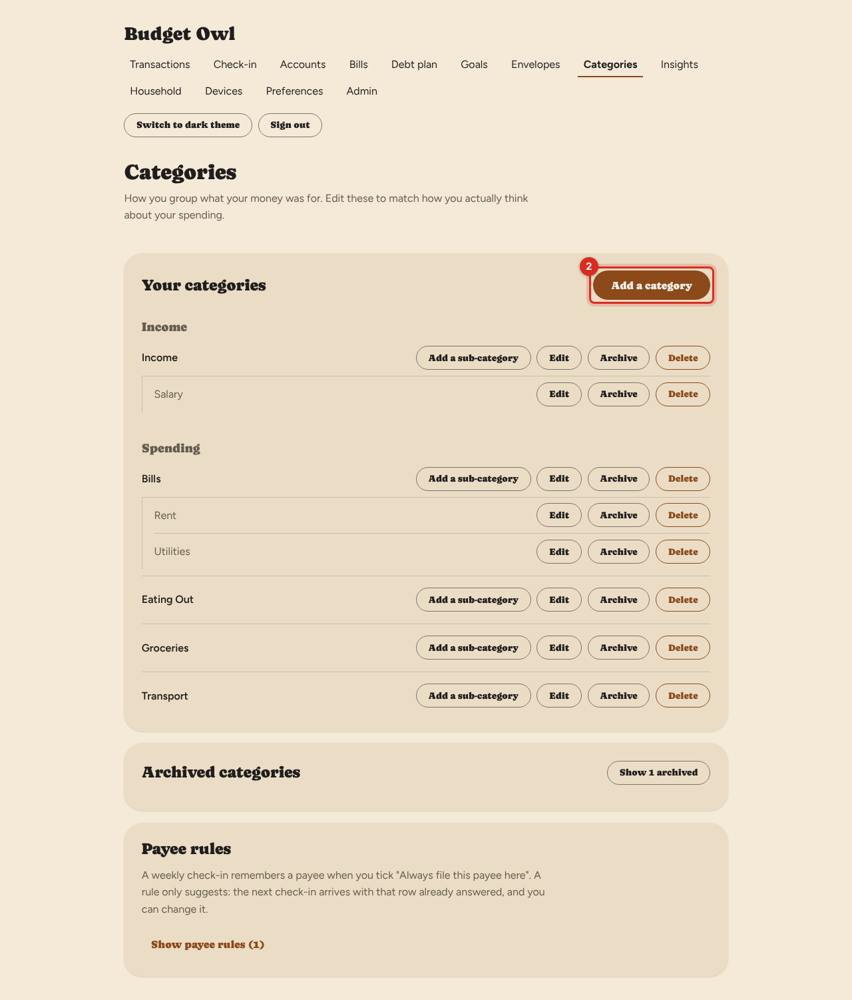
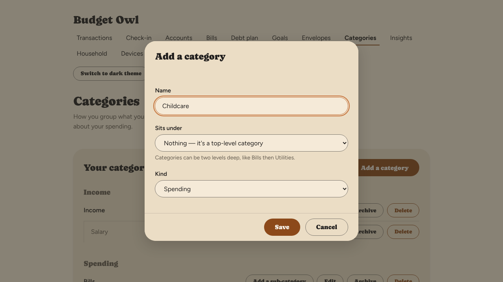
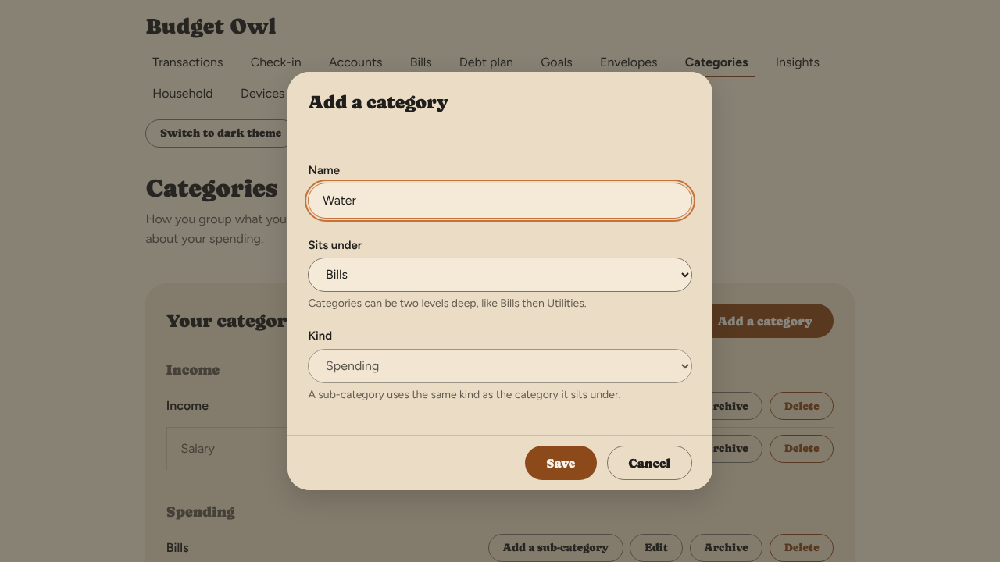
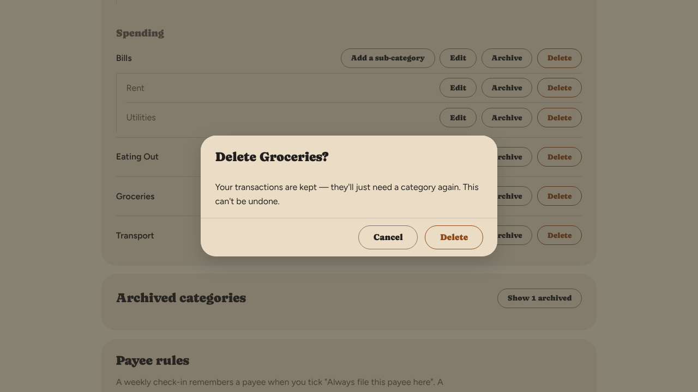

# Organise your categories

A category is how you say what money was **for** — Groceries, Rent, Salary. Budget Owl starts you
off with a set, and you change them to match how you actually think about your money.

## Before you start

You need to be an **owner** or a **member** of your household. A **viewer** can read the
categories but not change them.

## What you start with

Your household already has about twenty categories, grouped under **Income** and **Spending**.
They exist so you can start recording straight away rather than designing a list first. Rename
them, delete the ones you'd never use, and add your own.

## Steps

### Add a category

1. Select **Categories** in the menu across the top.

   

2. Select **Add a category**.

   

3. Enter a **Name**.

4. Leave **Sits under** as **Nothing — it's a top-level category**.

5. Choose a **Kind**: **Income** for money arriving, **Spending** for money going out.

   You can't change this later, because it would change the meaning of everything already filed
   under it. Budget Owl asks now so it doesn't have to argue with you later.

6. Select **Save**.

   Your new category appears in the right group.

### Add a sub-category

Two levels, no more. **Bills → Utilities** works; **Bills → Utilities → Water** doesn't.

7. Select **Add a sub-category** on the category it belongs under.

   

   **Sits under** is already filled in, and **Kind** is greyed out — a sub-category always matches
   its parent, so there's nothing to decide.

8. Enter a **Name** and select **Save**.

### Retire one you've stopped using

9. Select **Archive**.

   It disappears from the list and from the category list when you record a transaction. Your old
   transactions still show it, so last year's spending still reads correctly.

   Archived categories live under **Archived categories** at the bottom of the screen. Select
   **Show archived** to see them, and **Restore** to bring one back.

### Delete one you added by mistake

10. Select **Delete**.

11. Read what it says, then select **Delete** again.

    

    **Your transactions are safe.** Deleting a category never deletes money. Anything filed under
    it goes back to **Needs a category**, and you can re-file it — see
    [Give a transaction a category](give-a-transaction-a-category.md).

    If the category has sub-categories, those are deleted too, and the window says how many.

## Which should I use — archive or delete?

**Archive** when you used it and stopped. Your history keeps reading correctly, and the category
stays out of the way.

**Delete** when it was a mistake, or you never used it. There's nothing to preserve.

## If something doesn't work

**"A category with this name already exists."** You already have one with that name at the same
level. Names only have to be different among siblings, so **Bills → Phone** and
**Transport → Phone** are both fine.

**"Categories can only be nested two levels deep."** You're trying to put a sub-category under a
sub-category, or to move a category that has sub-categories of its own underneath another one.
Move its children out first, or pick a top-level parent.

**The Kind box is greyed out.** That's expected on a category that already exists, and on any
sub-category. Add a new one if you need the other kind.

**"This household has too many categories."** There's a limit of 200. If you're near it, something
has probably gone wrong — a category list that long is harder to use than no list at all.
