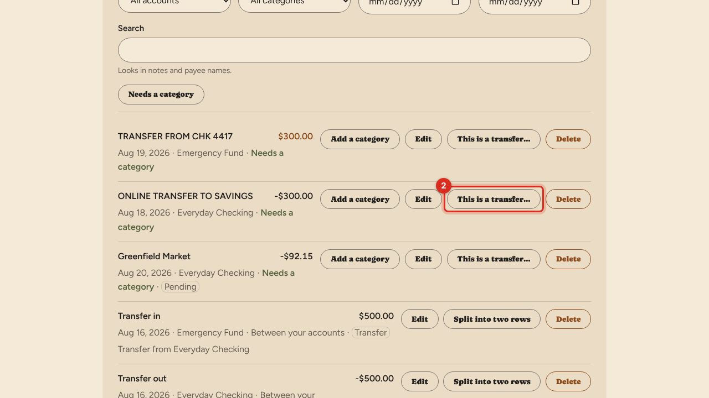
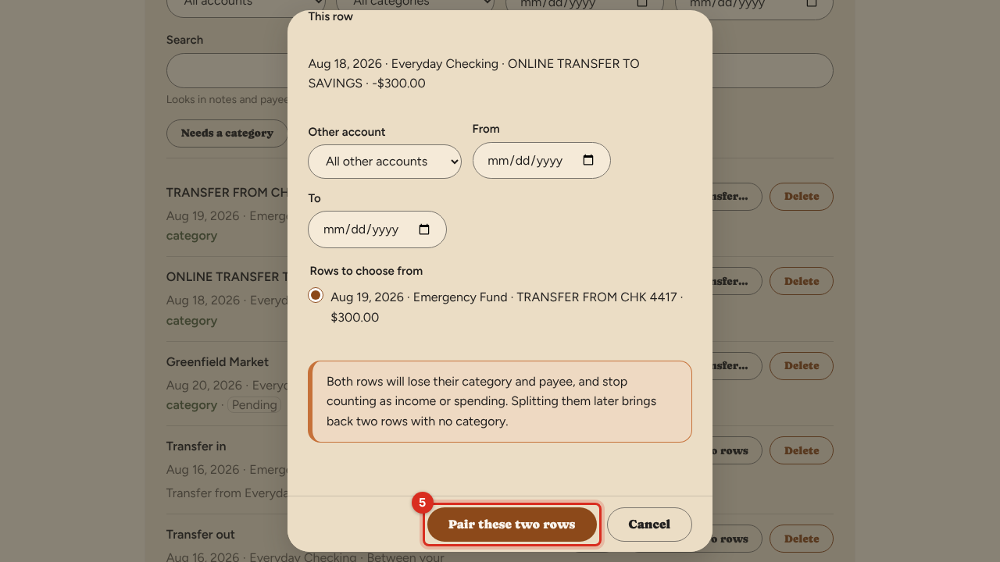
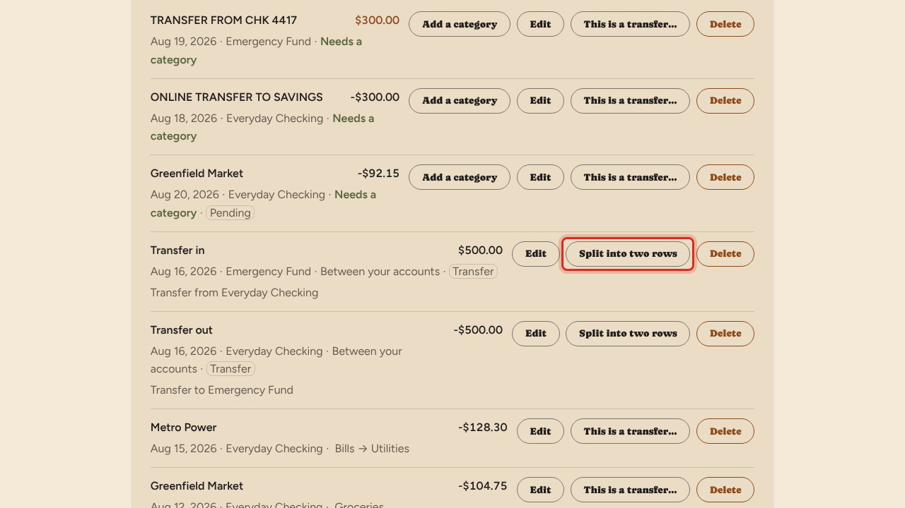
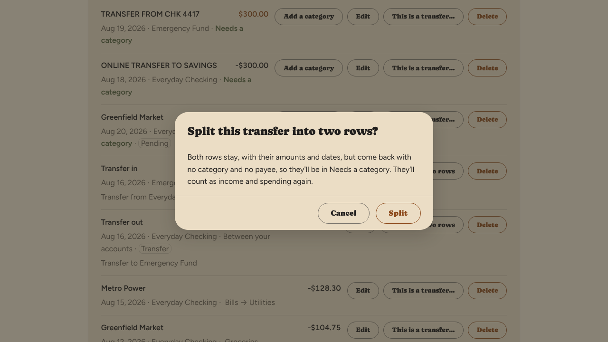

# Pair two rows into a transfer

When you move money between two of your own accounts, each bank shows its own half: money out of
one statement, money into the other, often a day or two apart. Imported, that's two ordinary
transactions, and Budget Owl would count one as spending and the other as income.

Pairing tells Budget Owl the two rows are one transfer. They stop counting as spending or income,
and each keeps the date its own bank gave it.

Budget Owl never pairs rows for you, and never suggests which rows go together. You choose.

## Before you start

- Both rows must already be in your ledger — usually from importing both accounts' statements. See
  [Import a bank statement](import-a-bank-statement.md).
- You need to be an **owner** or a **member**. A **viewer** can't pair or split rows.

## Steps

1. Go to **Transactions**, and find one of the two rows.

2. Select **This is a transfer…** on that row.

   

   A window called **Pair this with the other half of a transfer** opens. **This row** shows the
   row you started from.

   

   **Rows to choose from** lists rows in your other accounts where the money went the other way,
   newest first. Nothing is ticked for you.

3. If the list is long, narrow it with **Other account**, **From** and **To**.

4. Tick the other half of the transfer.

5. Read the box above the buttons, then select **Pair these two rows**.

   

   **Both rows lose their category and payee.** A transfer has neither: it isn't spending, and
   nobody else was paid.

## What you'll see

**Paired into a transfer.** appears above the list. The two rows now read **Transfer out** and
**Transfer in**, with **Between your accounts** instead of a category and a **Transfer** badge —
the same as a transfer you record with **Move money**. See
[Move money between your own accounts](move-money-between-accounts.md#what-youll-see).

Each row keeps its own date. If you edit the transfer later and leave **Date** alone, both dates
stay as they are; the window says what each half's date is when they differ.

## Split a transfer back into two rows

If you paired the wrong rows, split them again.

1. Select **Split into two rows** on either half of the transfer.

   

2. Select **Split** in the **Split this transfer into two rows?** window.

   

   **Split into two rows. Both need a category.** appears. The rows keep their amounts and dates,
   but come back with **no category and no payee** — what they had before pairing isn't kept —
   so they're in **Needs a category**.

**Split into two rows** works on any transfer, including one recorded with **Move money**.

## Things that can go wrong

**"Both rows are in the same account."**
A transfer moves money between two different accounts. Choose a row in another account.

**"Both rows went the same way."**
One row has to be money leaving an account and the other money arriving. The list only offers rows
that went the other way, so this means one of the rows changed while the window was open.

**"The two amounts aren't equal."**
Between two accounts in the same currency, what left one has to be exactly what arrived in the
other. If your bank charged a fee, record the fee as its own transaction first, then correct the
amount so the two halves match. Between accounts in **different** currencies, the two amounts can
differ — each keeps its own figure.

**"This is one half of a transfer…"**
One of the rows is already part of a transfer. Split that transfer first.

**"One of these rows is logged against an envelope…"**
Moving money between your own accounts isn't spending, so a transfer can't count against an
envelope. Open the envelope, remove that entry, then pair the two rows again.

**"That account is archived…"**
One of the rows is in an account you've archived. Restore it on the **Accounts** screen first.

**"Somebody else changed this while you were editing it."**
One of the rows was edited after you opened the window. Close it, and pair them again.

**The row I want isn't in the list.**
It may be in the same account, already part of a transfer, or on a different date from the ones in
**From** and **To**. Clear the dates, or set **Other account** to the account it's in.

## Related

- [Import a bank statement](import-a-bank-statement.md)
- [Move money between your own accounts](move-money-between-accounts.md)
- [Give a transaction a category](give-a-transaction-a-category.md)
