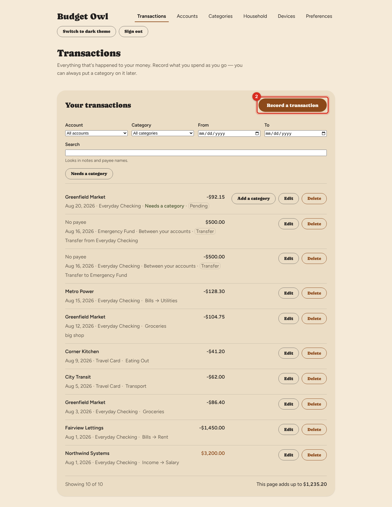
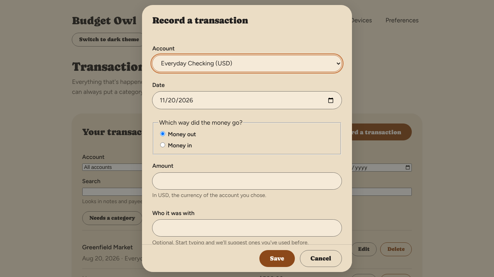
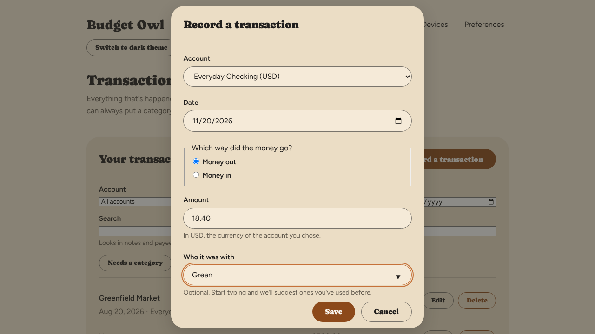
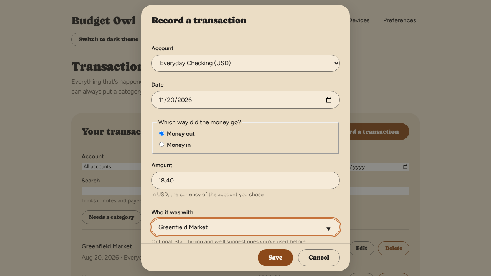

# Record a transaction

Every time money leaves or arrives in one of your accounts, you tell Budget Owl about it. This is
the thing you'll do most, so it's built to be quick — and you never have to tidy anything up first.

## Before you start

- You need at least one account. If you haven't added one yet, start with
  [Add an account](add-an-account.md).
- You need to be an **owner** or a **member** of your household. A **viewer** can read everything
  here but not add or change anything — see
  [What the roles mean](manage-members.md#what-the-three-roles-mean).

## Steps

1. Select **Transactions** in the menu across the top.

   You'll see the **Transactions** screen. It's also where Budget Owl starts when you sign in.

2. Select **Record a transaction**.

   

   If you haven't recorded anything yet, the button says **Record your first transaction**
   instead. It does the same thing.

   A window called **Record a transaction** opens.

3. Check the **Account**.

   

   It starts on your first account. If the money moved in a different one, choose it here.

4. Check the **Date**.

   It starts on today, which is right most of the time. Change it if you're catching up on a
   receipt from last week.

5. Choose **Money out** or **Money in** under **Which way did the money go?**

   **Money out** is already chosen, because that's most of what anyone records. Choose **Money in**
   for wages, a refund, or anything else arriving.

   You never type a minus sign. This choice is what makes it count the right way.

6. Enter the **Amount**.

   Just the number — `18.40`. Underneath, Budget Owl reminds you which currency it's in: that's
   the currency of the account you chose, not your household's.

7. Enter who it was with in **Who it was with**.

   

   This is optional — cash out of a machine wasn't "with" anyone. After a couple of letters,
   Budget Owl suggests names you've used before, so the second trip to the same shop is two
   keystrokes. Picking a suggestion keeps your spelling consistent, which makes your reports add
   up properly later.

8. Choose a **Category**.

   

   This is optional too. If you're in a hurry, leave it as **Needs a category** and come back to
   it — see [Give a transaction a category](give-a-transaction-a-category.md). Getting it written
   down matters more than getting it filed.

9. Add a **Note** if you want one.

   Anything that'll help you remember — "birthday present", "split with Sam".

10. Leave **Status** as **Cleared**.

    Change it to **Pending** only if you're recording something you expect to settle later, like a
    cheque you've posted.

11. Select **Save**.

    The window closes, your transaction appears at the top of the list, and the account's balance
    on the **Accounts** screen has already changed to match.

## What you'll notice

**Your balances come from what you record.** You tell Budget Owl the balance an account started
with, once, and from then on every balance is worked out from your transactions. You never type a
balance in to correct it — you record the thing you missed.

**The amounts line up in a column** so you can run your eye down them. Money out keeps its minus
sign; money in doesn't have one.

**Nothing is ever added across currencies.** If your transactions are in more than one currency,
the total at the bottom of the page says so instead of inventing a number.

## Fixing a mistake

Select **Edit** on the transaction, change whatever's wrong, and select **Save**. Anything you
don't touch stays as it was.

Select **Delete** to remove it entirely. Budget Owl asks first, and tells you the account balance
will go back to what it was. You can't undo it, but you can record it again.

One thing you can't change is which account a transaction is in. Moving it would shift two
balances at once, so instead delete it and record it in the right account.

## If something doesn't work

**"This account is archived."** You've chosen an account you retired. Restore it on the
**Accounts** screen first, or pick a different one — see
[Archive or delete an account](archive-or-delete-an-account.md).

**The Amount box won't accept what you typed.** It takes digits and at most one decimal point:
`18.40`, not `18,40` and not `$18.40`. Leave the currency to Budget Owl.

**"This record changed while you were editing it."** Someone else in your household saved first.
Close the window, look at the transaction again, and make your change on top of theirs.
