# Save towards a goal

A goal is money you're putting aside for something: a trip, a new laptop, an emergency fund. Give
it a name and how much it needs, with a month if you have one. Budget Owl shows how far along you
are and when you'll get there, and takes what you plan to put aside each month off what's left to
spend.

## Before you start

Your role needs to be **Owner** or **Member** to add a goal or set money aside. A **Viewer** sees
every goal and every figure, but can't change anything.

## Steps

1. Select **Goals** in the menu across the top.

   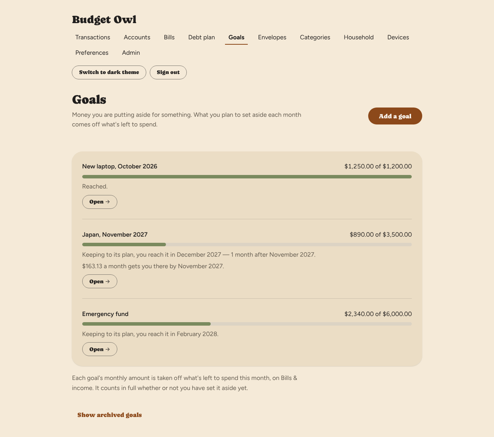

   Each goal shows a bar, what you've saved of what it needs, and a sentence saying when you get
   there if you keep to its plan. **Japan, November 2027** reads _"$890.00 of $3,500.00"_. A goal
   you've already reached says **Reached.**

2. Select **Add a goal**.

   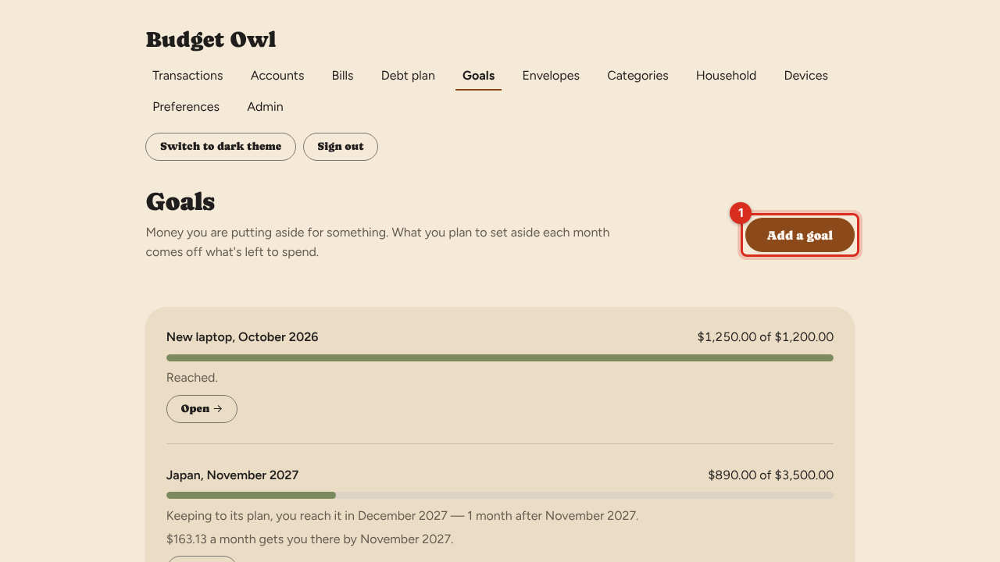

   The **Add a goal** window opens.

3. Enter what it's for in **What it is for**, and the total in **How much it needs**.

   Type the amount as a number, like **900**. Leave out the currency sign.

4. If you have a month in mind, choose it in **Month you want it by (optional)**.

   Leave it empty for a goal with no date, like an emergency fund.

5. If you'd already put money by before you started tracking this goal, enter it in **Already
   saved (optional)**.

   It counts towards the goal. It is never taken off any month's left-over figure, because it was
   saved before.

6. Enter what you plan to put aside every month in **Each month (optional)**.

   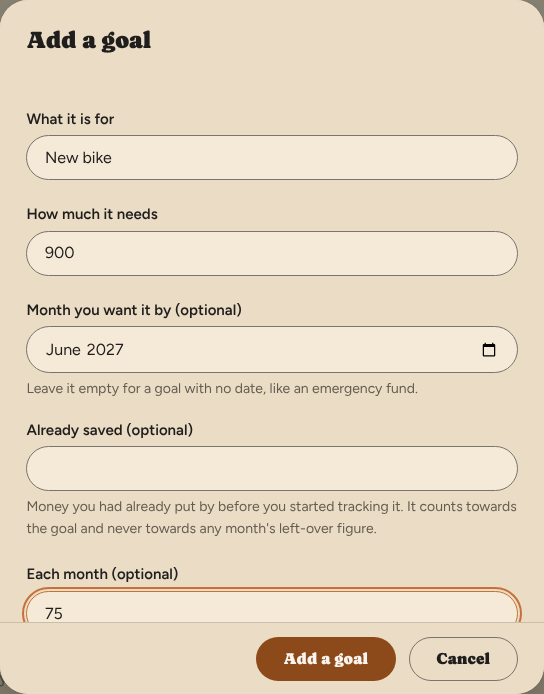

   As you type, the window works out when that amount gets you there. If you chose a month, it also
   says what you'd need to put aside each month to make it.

7. If you keep the money in one of your accounts, choose it in **Where it is kept (optional)**.

   This is only for your reference. One savings account often holds several goals, so the goal's
   figure comes from what you record against it, not from the account's balance.

8. Select **Add a goal** at the foot of the window.

   You'll see _"New bike is added."_ and the goal joins the list.

## Set money aside

Do this when you move money towards a goal at your bank.

1. On the **Goals** page, select **Open →** on the goal.

   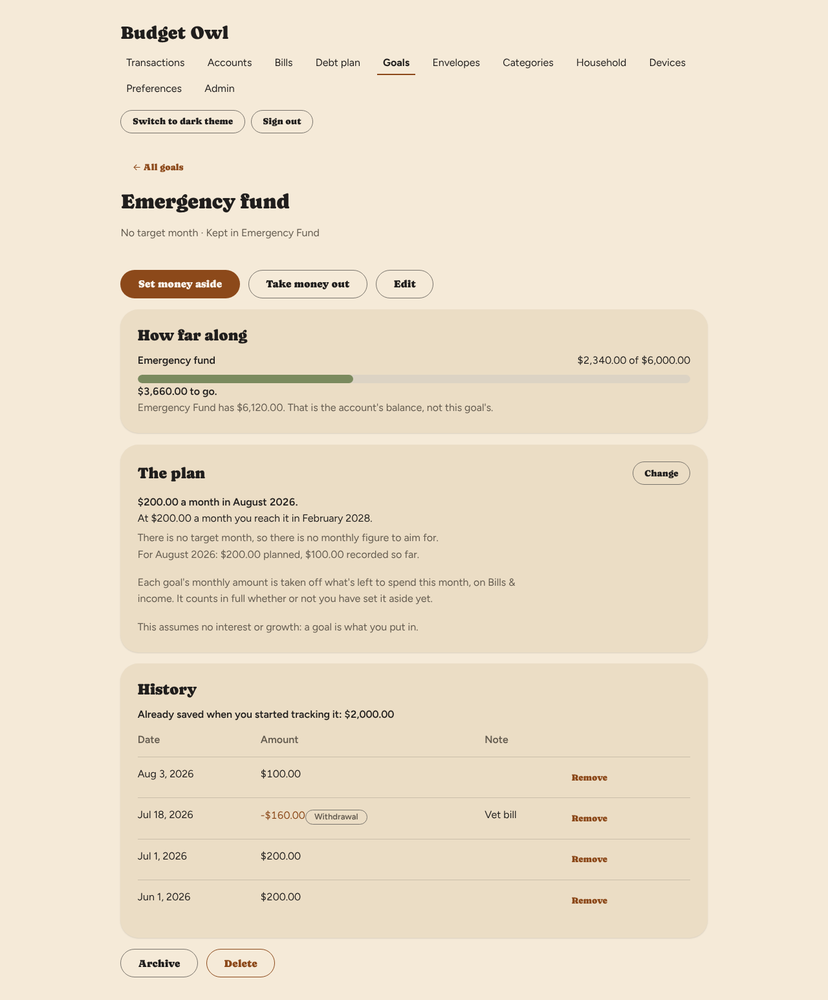

   The goal's page has three cards: **How far along**, **The plan** and **History**.

2. Select **Set money aside**.

   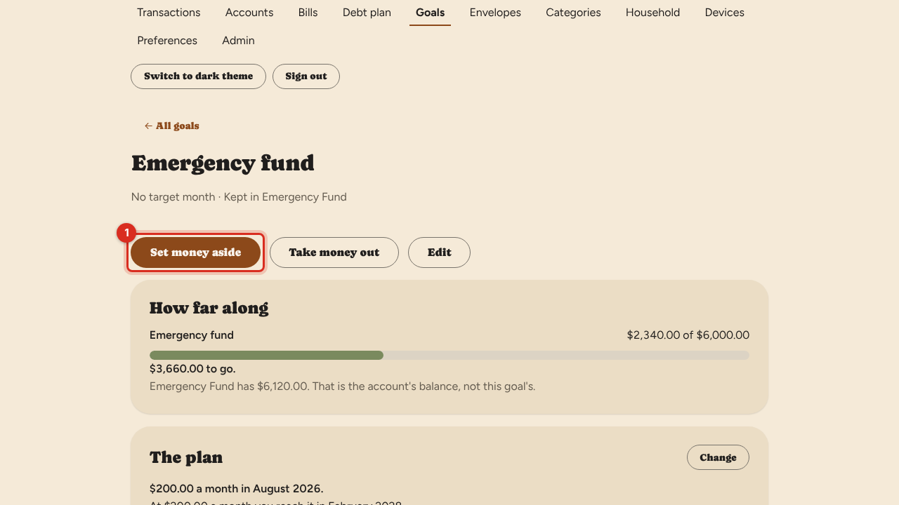

3. Check the **Amount**.

   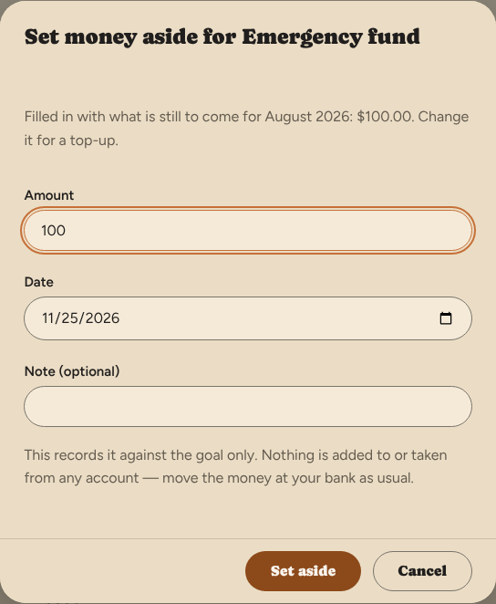

   It's already filled in with what the plan still asks for this month. Here, the plan is $200.00
   a month and $100.00 has been set aside already, so it says $100.00. Change it if you're putting
   in more or less.

4. Check the **Date**, and add a **Note (optional)** if you want one.

5. Select **Set aside**.

   

   You'll see **Money set aside.** The bar and the figures move to match.

**Setting money aside doesn't move any money.** It records what you did against the goal only.
Nothing is added to or taken from any of your accounts in Budget Owl. Move the money at your bank as
usual.

## Take money out

Sometimes you need some of it back, such as for a vet bill out of your emergency fund.

1. On the goal's page, select **Take money out**.

2. Enter the **Amount** as a plain number, with no minus sign.

   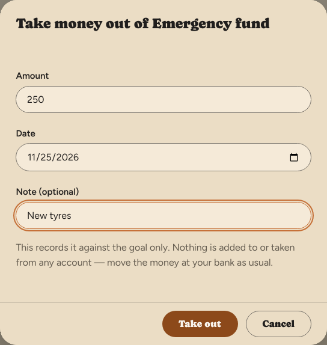

3. Add a **Note (optional)** to remind yourself what it was for.

4. Select **Take out**.

   You'll see **Money taken out.** The goal's figure goes down by that amount.

## What you'll see

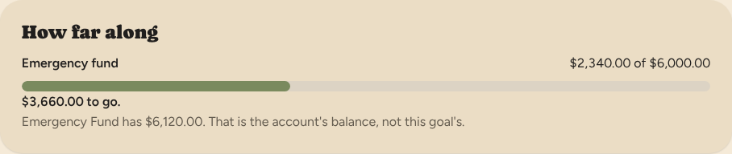

**How far along** shows what you've saved of what the goal needs, and how much is still to go. If
the goal is kept in an account, the card also shows that account's balance. It says _"That is the
account's balance, not this goal's"_ because the two are different things. Here, the Emergency Fund
account holds $6,120.00, but only $2,340.00 of it has been recorded against this goal.

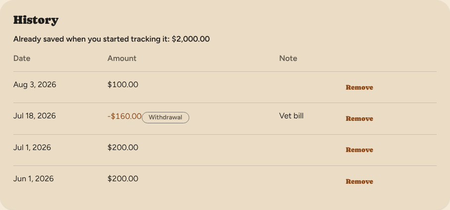

**History** starts with what was already saved when you started tracking the goal. Then it lists
everything you've set aside or taken out, newest first. Money taken out shows with a minus sign and
the word **Withdrawal**.

**The plan** says what you're putting aside this month and when that gets you there. To change the
monthly amount, see [Change what you set aside each month](change-what-you-set-aside.md).

**Each goal's monthly amount comes off what's left to spend this month**, on the **Bills & income**
page. It counts in full whether or not you've set it aside yet. See
[See what's left this month](see-whats-left-this-month.md).

**Budget Owl doesn't add interest or growth.** A goal is what you put in.

## Put a goal away, or delete it

At the foot of a goal's page, **Archive** puts the goal away without losing anything. Its history
stays. It stops being part of the month's plan, so what's left to spend goes up.

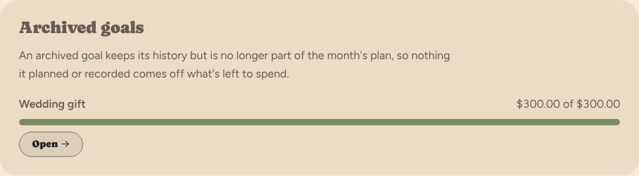

Archived goals sit under **Show archived goals** at the foot of the **Goals** page. Open one and
select **Restore** to bring it back.

**Delete** removes the goal, its plan and everything recorded against it, permanently. None of your
transactions are touched. To keep the history, archive it instead.

## If your role is Viewer

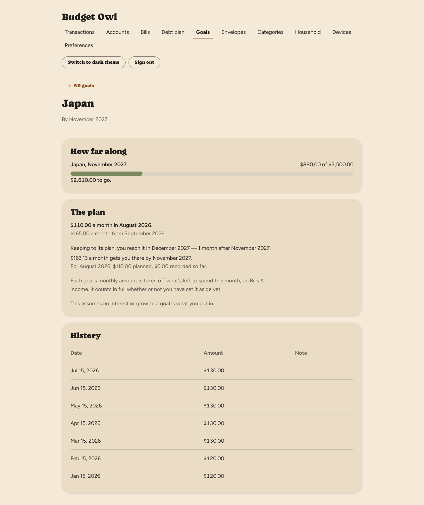

A **Viewer** sees every goal, every figure, the plan and the history, and has no buttons to change
anything. Setting money aside, changing the plan or adding a goal needs **Owner** or **Member**. See
[See who is in your household](manage-members.md).

## Things that can go wrong

**"You already have a goal with this name."**
Two goals that aren't archived can't share a name, whatever the capitals. Choose a different
name, or archive the old one first.

**"That account is in a different currency from this goal, so it cannot hold it."**
A goal kept in an account has to be in that account's currency. Choose an account in the goal's
currency, or choose **Nowhere in particular**.

**"This goal is archived."**
You can't set money aside for an archived goal or change its plan. Select **Restore** on its page
first.

**"I set money aside on the wrong day, or the wrong amount."**
Select **Remove** on that line in **History**, then set it aside again with the right figures. The
goal's figure changes to match, and nothing in any account is touched.

**"My savings account says more than the goal does."**
That's expected. The goal counts only what you've recorded against it, and one account can hold
money for several goals. Budget Owl shows both figures and doesn't try to make them agree.

## Related

- [Change what you set aside each month](change-what-you-set-aside.md)
- [See what's left this month](see-whats-left-this-month.md)
- [Add an account](add-an-account.md)
