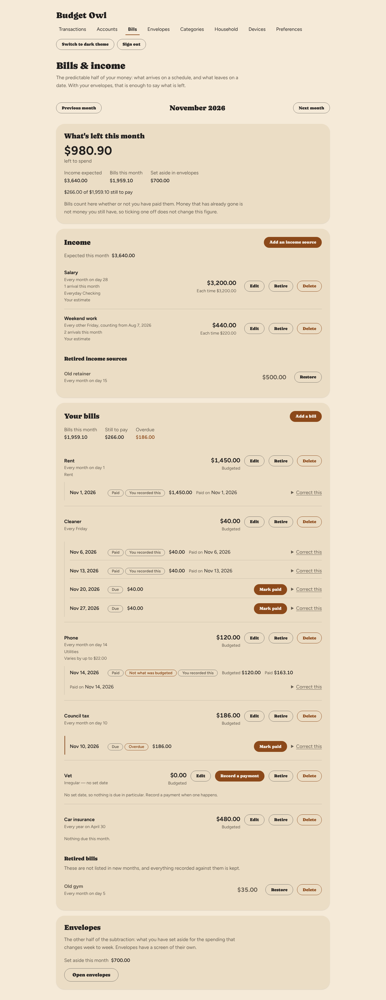
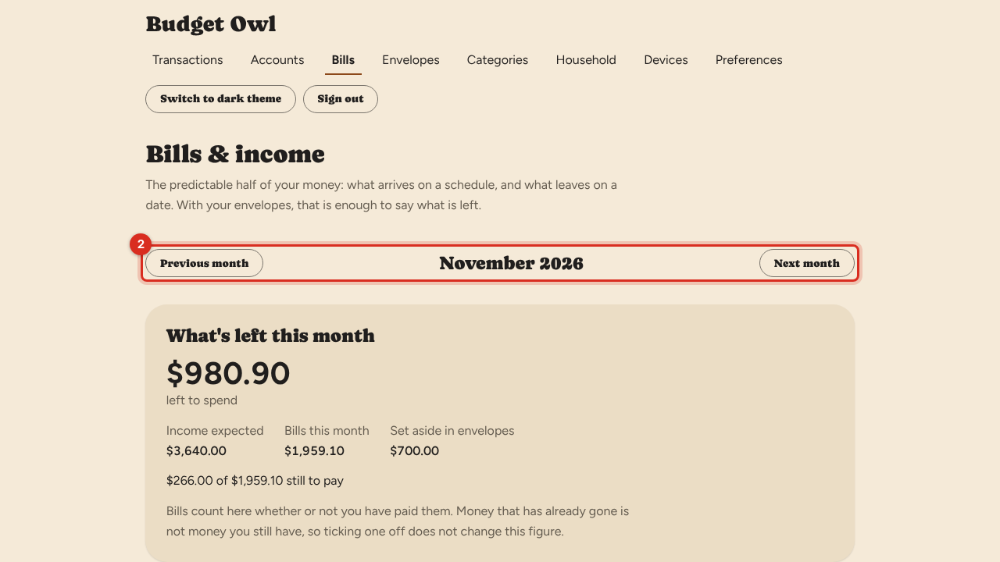
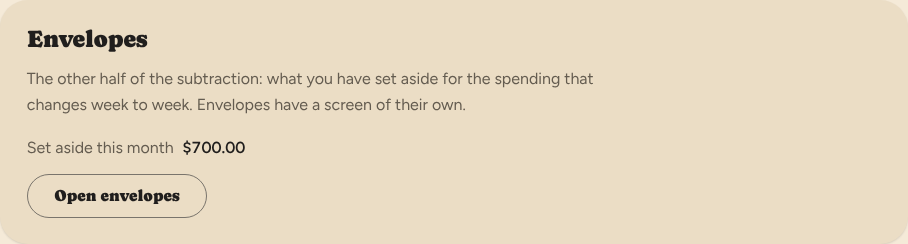
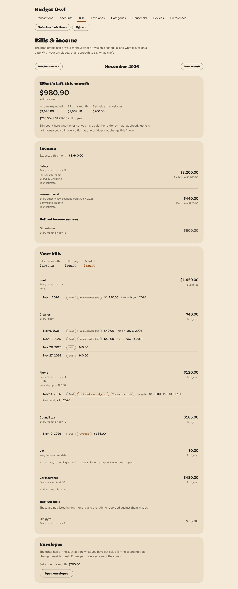

# See what's left this month

Budget Owl takes the money you expect this month, subtracts the bills that fall in it and the
money you've set aside in envelopes, and shows you what's left. That one figure is what the
**Bills & income** page is for.

## Before you start

The figure is only as good as what you've told Budget Owl. If the page looks empty, start with
[Add your income](add-your-income.md) and [Add a bill](add-a-bill.md).

Everyone in your household can read this page, whatever their role.

## Steps

1. Select **Bills** in the menu across the top.

   

   The page opens on the month you're in and shows four blocks: **What's left this month**,
   **Income**, **Your bills** and **Envelopes**.

2. Check the month above the figures.

   

   **Previous month** and **Next month** move every block on the page at once, so the income, the
   bills and the totals always belong to the same month.

3. Read the figure under **What's left this month**.

   

   The three smaller figures underneath are the sum it came from:

   - **Income expected** — everything your income sources add up to this month.
   - **Bills this month** — every bill date that falls in the month, paid or not.
   - **Set aside in envelopes** — what your envelopes hold for the month.

   $3,640.00 − $1,959.10 − $700.00 leaves **$980.90 left to spend**.

## Why paying a bill doesn't make the figure go up

**Bills count whether or not you've paid them.** The rent that left your account on the 1st is
not money you still have, so ticking it off doesn't give it back to you.

If unpaid bills were the only ones counted, "what's left" would climb every time you paid
something, and be at its most cheerful on the day you had least. So the figure stays still as you
work through the month, and **Still to pay** keeps the other number for you: $266.00 of the
$1,959.10 in this month's bills hasn't gone yet.

## When the month is short

When the bills and envelopes come to more than the income, the figure goes **negative** and the
label changes to **short this month**. Budget Owl doesn't round it up to zero or hide it, and it
says so in words: _"Your income this month does not cover the bills and what you have set aside.
Nothing is wrong with the figures — they are telling you something."_

It's a number to act on, not an error. You can set less aside in an envelope, move a bill you
control to another month, or skip one that doesn't apply.

## Envelopes are the other half

Bills are the spending you know the date of. Envelopes are the spending that changes week to
week. The card at the foot of the page shows what your envelopes hold this month and takes you to
them with **Open envelopes**.

## If your role is Viewer

A **Viewer** sees every figure, every income source and every bill — and has nothing to click.
Marking a bill paid, adding one, or changing an amount needs **Owner** or **Member**. See
[See who is in your household](manage-members.md).

## Things that can go wrong

**"I paid a bill and the figure didn't move."**
That's how it's meant to work — the bill was already counted. Watch **Still to pay** instead:
that's the one that drops when you tick something off.

**"Something looks counted twice."**
It can be. If you've set rent up as a bill _and_ given it an envelope, it is subtracted twice —
once as a bill, once as money set aside. Budget Owl can't tell the two apart, which is why it
shows you all three terms. Pick one home for anything with a fixed date, and let envelopes handle
the rest.

**"Next month shows the same bills."**
It should. A bill repeats on its schedule, so it appears in every month it falls in, waiting to be
ticked off. A yearly bill in a month it doesn't fall in says **Nothing due this month.**

## Related

- [Add a bill](add-a-bill.md)
- [Mark a bill paid](mark-a-bill-paid.md)
- [Add your income](add-your-income.md)
- [Set up an envelope](set-up-an-envelope.md)
