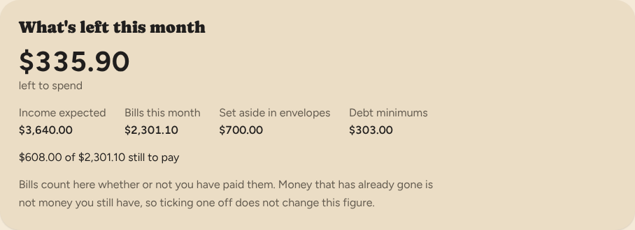
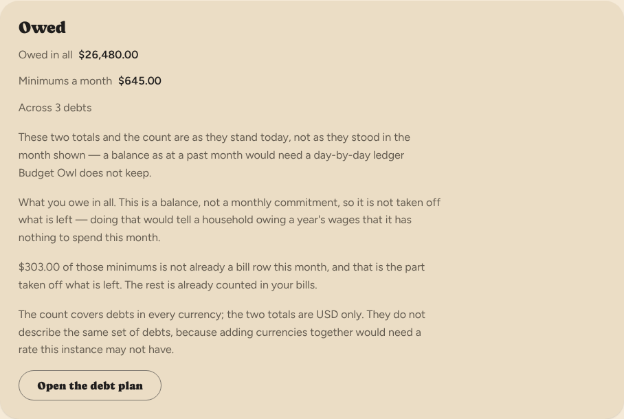
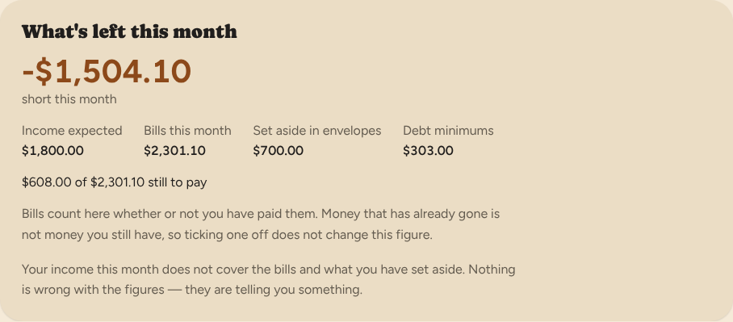

# See what's left this month

Budget Owl takes the money you expect this month, subtracts the bills that fall in it, the money
you've set aside in envelopes and the debt minimums you owe, and shows you what's left. That one
figure is what the **Bills & income** page is for.

> **This figure got smaller, and no money went missing.** Budget Owl used to leave your debt
> minimums out of the sum, so the card showed more left than you really had. It now counts them —
> see [What changed, and why](#what-changed-and-why) below.

## Before you start

The figure is only as good as what you've told Budget Owl. If the page looks empty, start with
[Add your income](add-your-income.md) and [Add a bill](add-a-bill.md).

Everyone in your household can read this page, whatever their role.

## Steps

1. Select **Bills** in the menu across the top.

   

   The page opens on the month you're in and shows five blocks: **What's left this month**,
   **Income**, **Your bills**, **Owed** and **Envelopes**.

2. Check the month above the figures.

   

   **Previous month** and **Next month** move every block on the page at once, so the income, the
   bills and the totals always belong to the same month.

3. Read the figure under **What's left this month**.

   

   The four smaller figures underneath are the sum it came from:

   - **Income expected** — everything your income sources add up to this month.
   - **Bills this month** — every bill date that falls in the month, paid or not.
   - **Set aside in envelopes** — what your envelopes hold for the month.
   - **Debt minimums** — the minimum payments on your debts that aren't already one of your bills.

   $3,640.00 − $2,301.10 − $700.00 − $303.00 leaves **$335.90 left to spend**.

## What changed, and why

**What's left now takes off your debt minimums too.** It used to be income, less bills, less what's
in your envelopes. Now it also takes off the minimum payment on each debt you've added to the
[debt plan](choose-how-to-clear-your-debts.md) — but only the ones that aren't already one of your
bills, so nothing is taken off twice.

So if your figure went down after this change, nothing went wrong and no money has gone anywhere.
Those minimums were always going to leave your account each month. The page used to leave them
out, and told you that money was free when it wasn't.

**If you haven't added any debts, your figure hasn't changed.** The same goes for any debt whose
minimum is already one of your bills — it was counted before, and it's counted the same way now.

### How it works out, for the example household

The household in these pictures has three debts, with minimums of $185.00, $342.00 and $118.00 —
$645.00 a month in all. The $342.00 car loan is paid by a **Car payment** bill, and the household
linked the two when it added the debt.

- The car loan's **$342.00 is already in Bills this month**, so it isn't counted again.
- The other two, **$185.00 + $118.00 = $303.00**, are the new fourth figure on the card: **Debt
  minimums $303.00**. That's what comes off.

That link is what keeps a minimum from being counted twice, and it's yours to make — when you add
a debt, you choose the bill that pays it, as [Add a debt](add-a-debt.md) shows. Budget Owl won't
guess it from a name or an amount, because a wrong guess would quietly change this figure.

## What you owe in all

The **Owed** card is the other new block, and nothing on it comes off **What's left this month**.
**Owed in all — $26,480.00** is a balance, not something due this month. Taking it off what's left
would tell a household owing a year's wages that it has nothing to spend today, which is both
untrue and no help.

**Minimums a month — $645.00** is what your debts ask for each month in all. The note underneath
says which part of it actually comes off: _"$303.00 of those minimums is not already a bill row this
month, and that is the part taken off what is left. The rest is already counted in your bills."_

The two totals and the count are **as they stand today**, not as they stood in the month you're
looking at — a balance for a past month would need a day-by-day history Budget Owl doesn't keep.

**Open the debt plan** takes you to [the order you're paying them in](choose-how-to-clear-your-debts.md).

## Why paying a bill doesn't make the figure go up

**Bills count whether or not you've paid them.** The rent that left your account on the 1st is
not money you still have, so ticking it off doesn't give it back to you.

If unpaid bills were the only ones counted, "what's left" would climb every time you paid
something, and be at its most cheerful on the day you had least. So the figure stays still as you
work through the month, and **Still to pay** keeps the other number for you: $608.00 of the
$2,301.10 in this month's bills hasn't gone yet.

## When the month is short

When the bills, envelopes and debt minimums come to more than the income, the figure goes
**negative** and the
label changes to **short this month**. Budget Owl doesn't round it up to zero or hide it, and it
says so in words: _"Your income this month does not cover the bills and what you have set aside.
Nothing is wrong with the figures — they are telling you something."_

It's a number to act on, not an error. You can set less aside in an envelope, move a bill you
control to another month, or skip one that doesn't apply.

## Envelopes are the other half

Bills are the spending you know the date of. Envelopes are the spending that changes week to
week. The card at the foot of the page shows what your envelopes hold this month and takes you to
them with **Open envelopes**.

## If your role is Viewer

A **Viewer** sees every figure, every income source and every bill — and has nothing to click.
Marking a bill paid, adding one, or changing an amount needs **Owner** or **Member**. See
[See who is in your household](manage-members.md).

## Things that can go wrong

**"I paid a bill and the figure didn't move."**
That's how it's meant to work — the bill was already counted. Watch **Still to pay** instead:
that's the one that drops when you tick something off.

**"Something looks counted twice."**
It can be. If you've set rent up as a bill _and_ given it an envelope, it is subtracted twice —
once as a bill, once as money set aside. Budget Owl can't tell the two apart, which is why it
shows you all four terms. Pick one home for anything with a fixed date, and let envelopes handle
the rest.

A **debt minimum** is the one case Budget Owl does keep straight, and only because you tell it how:
name the bill that pays the minimum when you [add the debt](add-a-debt.md), and the figure is
subtracted once. Leave that blank and it is counted in both **Bills this month** and **Debt
minimums**.

**"Next month shows the same bills."**
It should. A bill repeats on its schedule, so it appears in every month it falls in, waiting to be
ticked off. A yearly bill in a month it doesn't fall in says **Nothing due this month.**

## Related

- [Add a bill](add-a-bill.md)
- [Mark a bill paid](mark-a-bill-paid.md)
- [Add your income](add-your-income.md)
- [Set up an envelope](set-up-an-envelope.md)
- [Add a debt](add-a-debt.md)
- [Choose how to clear your debts](choose-how-to-clear-your-debts.md)
