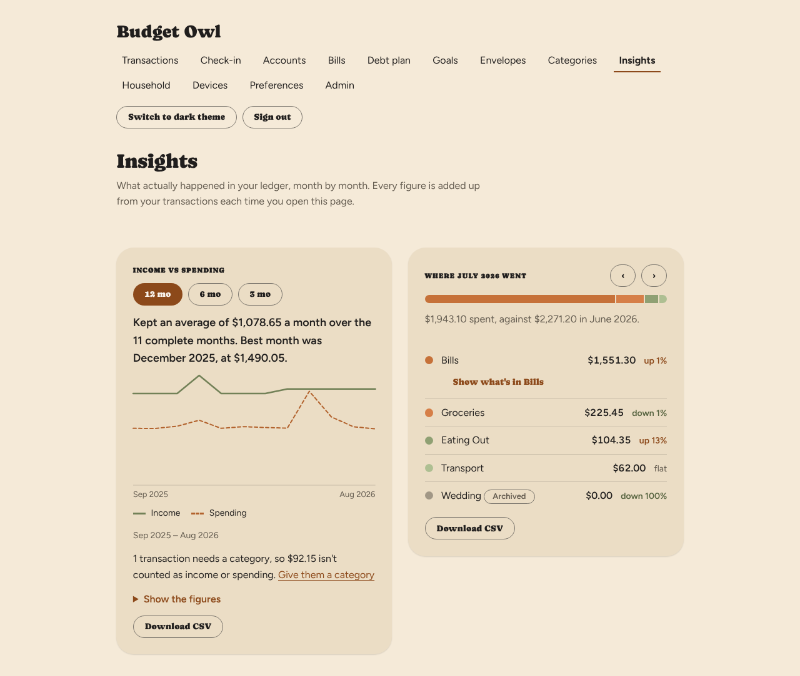
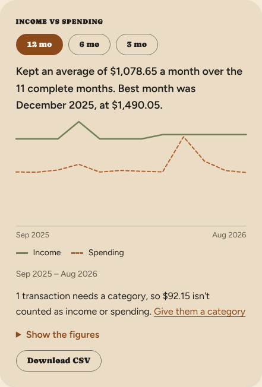
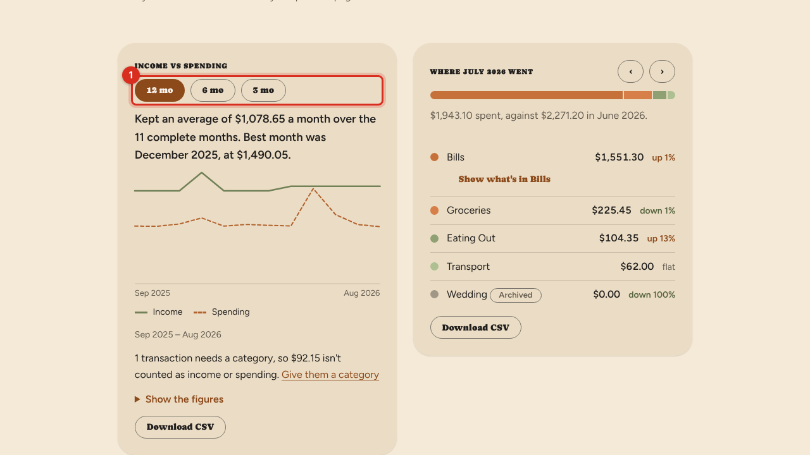
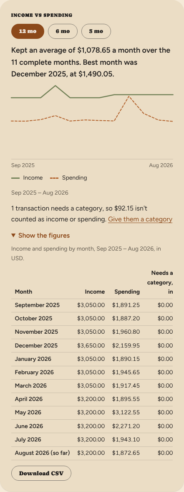
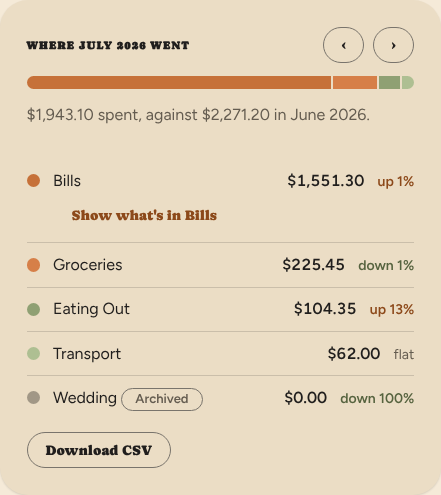
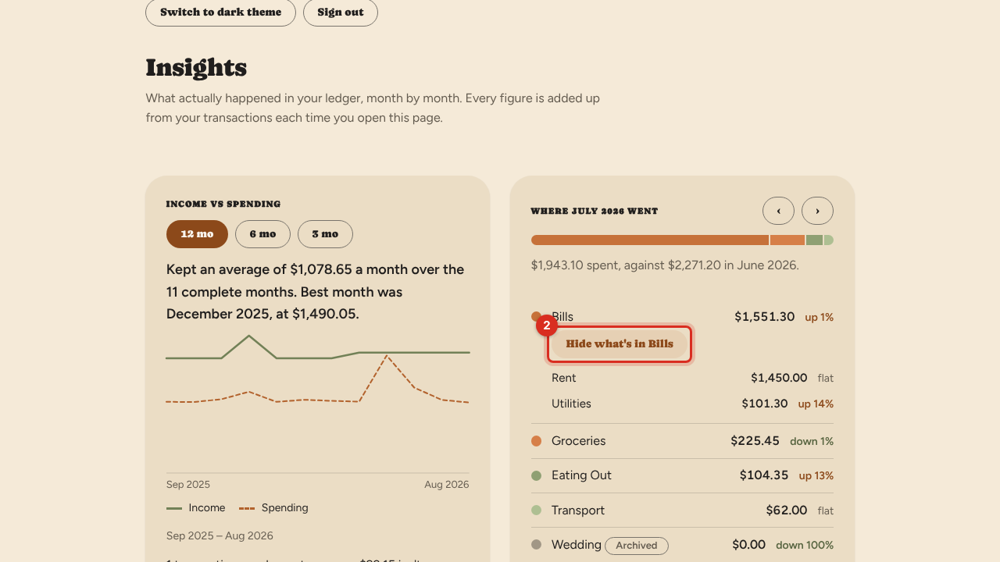
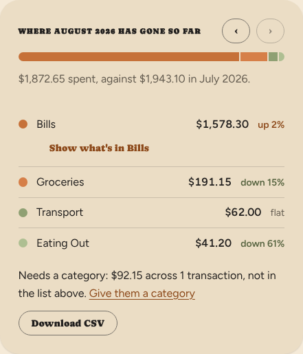
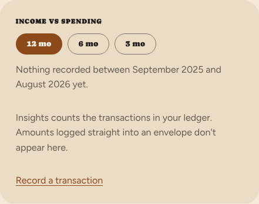
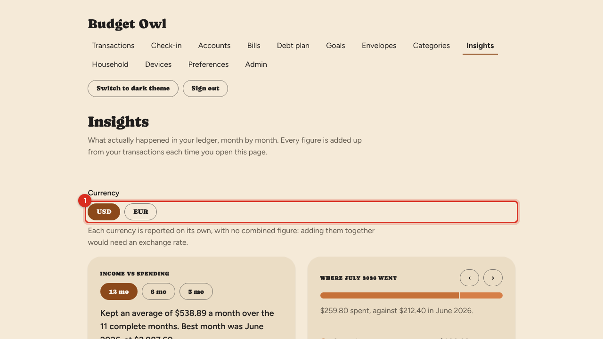

# See where your money went

The **Insights** page looks back at what actually happened: how much came in and went out each
month, how much you kept, and where last month's spending went by category. Every figure is
added up from the transactions you've recorded, each time you open the page.

## Before you start

Insights counts **transactions**, the rows on your **Transactions** page. Three things that look
like money moving are not counted, so the same money is never counted twice:

- amounts you logged straight into an envelope;
- bills you ticked off as paid (the transaction that paid them is counted instead);
- payments you logged against a debt.

Moving money between your own accounts isn't counted either. It isn't income or spending: it's
the same money in a different place.

Everyone in your household can read this page, whatever their role.

## Steps

1. Select **Insights** in the menu across the top.

   

   The page has two cards. On a phone they sit one under the other.

2. Read the **Income vs spending** card.

   

   The solid line is your **income** each month and the dashed line is your **spending**. The
   sentence above them says how much you **kept** on average, and your best month:
   *Kept an average of $1,078.65 a month over the 11 complete months. Best month was December
   2025, at $1,490.05.*

   This month isn't over yet, so it isn't in the average or the best month. That's why the
   sentence says **11 complete months** when you're looking at 12. On a phone, the card shows
   the short form instead: **Avg kept $1,078.65/mo**.

3. To look at a shorter stretch, select **6 mo** or **3 mo**.

   

   The chart, the average and the table below it change to cover the months you chose. Nothing
   is saved: the next time you open the page, it shows 12 months again.

4. To see the numbers behind the chart, select **Show the figures**.

   

   You get one row per month, with **Income**, **Spending**, **Needs a category** (in and out)
   and **Kept**. The month you're in is marked **(so far)**. If the table is wider than your
   screen, scroll it sideways to see the last columns.

5. Read the **Where July 2026 went** card.

   

   It opens on **last month**, the most recent month that's finished, and compares it with the
   month before: *$1,943.10 spent, against $2,271.20 in June 2026.* Each category shows what you
   spent and how that moved: **up 13%**, **down 1%**, **flat**, or **new** if you spent nothing
   in it the month before.

   The coloured bar is a picture of the same rows: the bigger a category's share of the spending,
   the longer its piece.

6. To see what's inside a category, select **Show what's in** under it.

   

   **Show what's in Bills** lists **Rent** and **Utilities**, each with its own amount and how it
   moved. **Bills** itself is the two added together, plus anything you filed under **Bills**
   directly.

7. To look at a different month, select **‹** (previous month) or **›** (next month) beside the
   card's title.

   

   The month you're in is titled **has gone so far**, and you can't go past it.

## What you'll see

- **Kept** is everything that came in less everything that went out, including transactions that
  haven't got a category yet. A month where more left than arrived shows a **negative** kept
  figure.
- **A refund** comes off the spending in its category. It's never counted as income. If a
  category's refunds come to more than you spent in it that month, its spending shows as
  **negative**, like **-$50.00**. The chart draws that month at zero and the table shows the
  real figure.
- **Archived categories** still appear, marked **Archived**. Archiving a category hides it when
  you're filing new transactions; it doesn't remove what you already filed under it.
- **Categories you've moved or deleted** show their history where they are today. A category you
  moved under a new group carries its past spending with it. A category you deleted leaves its
  transactions needing a category, in past months too.

## Download the figures

Select **Download CSV** at the bottom of either card. You get a file you can open in a
spreadsheet, with exactly the rows the card shows. The file goes to your own device; Budget Owl
doesn't send it anywhere.

## Things that can go wrong

**"1 transaction needs a category, so $92.15 isn't counted as income or spending."**
Some of your transactions haven't been filed under a category yet, so Insights can't tell whether
they're income or spending. They still count towards **Kept**. Select **Give them a category** to
open your **Transactions** page with only those transactions showing, and file each one. See
[Give a transaction a category](give-a-transaction-a-category.md).

**"Nothing recorded between September 2025 and August 2026 yet."**

There are no transactions in those months. If you've been logging spending straight into your
envelopes, that's why: Insights only counts transactions. Select **Record a transaction** to add
one. See [Record a transaction](record-a-transaction.md).

**Your spending looks doubled.**
If you track a credit card as an account in Budget Owl, record paying it off as a **transfer**
from your bank account to the card, not as spending. The purchases on the card are the spending.
Recording the payment as spending as well counts the same money twice. See
[Move money between your own accounts](move-money-between-accounts.md).

**There's no average yet.**
The average and the best month only use months that are over. In your first month, or when you
choose a range that only covers this month, there isn't one to show.

## If you have accounts in more than one currency

A **Currency** choice appears above the two cards. Each currency gets its own complete report.
Budget Owl never adds dollars and euros together, because that would need an exchange rate you
haven't agreed to.

## Related

- [Give a transaction a category](give-a-transaction-a-category.md)
- [Record a transaction](record-a-transaction.md)
- [See what's left this month](see-whats-left-this-month.md): the plan for this month, where
  Insights is what actually happened
