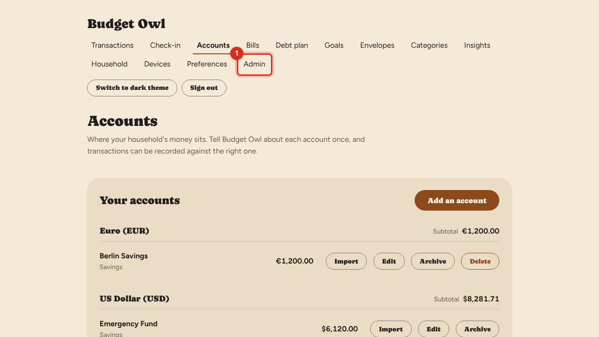
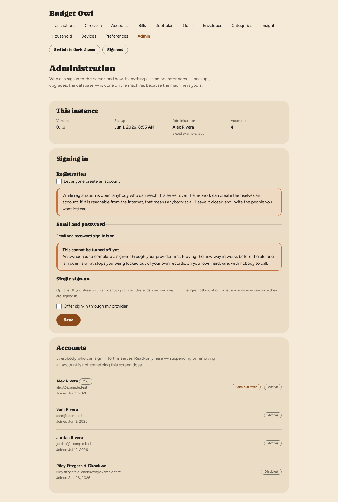
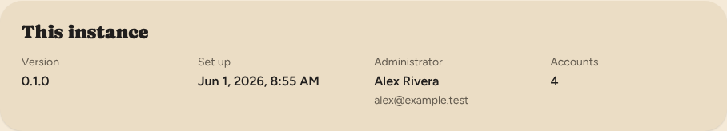
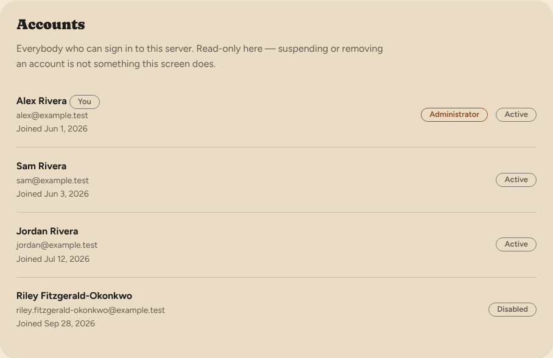
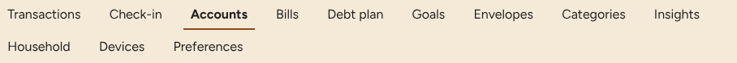

# See who can sign in to your server

The **Admin** screen is the one screen in Budget Owl that is about your server rather than about
your money. It tells you what version is running, who looks after this server, and everybody who
has an account on it.

Nobody's transactions, balances or budgets appear here, whoever you are.

## Before you start

You need to be the person who looks after this server — the one who filled in **Set up Budget
Owl** and created the very first account on it. That person, and only that person, has an
**Admin** link. Being an owner of a household is not the same thing and does not give you one.

## Open the Admin screen

1. Select **Admin**, at the end of the row of links across the top.

   

   The **Administration** screen opens. It has three blocks: **This instance**, **Signing in**
   and **Accounts**.

   

## What This instance tells you

The first block is four facts about the server itself. **Instance** is the word Budget Owl uses
for this installation of it — the one running on your hardware.

| What it says      | What it means                                                                                          |
| ----------------- | ------------------------------------------------------------------------------------------------------ |
| **Version**       | Which version of Budget Owl this server is running. Worth quoting if you ever ask for help.            |
| **Set up**        | When the first account was created here. If it has never been recorded, it says **Not recorded**.      |
| **Administrator** | Who looks after this server — the name and email address of the one account that can open this screen. |
| **Accounts**      | How many people can sign in. This is a count of accounts, not of money.                                |

## Who can sign in

The **Accounts** block lists everybody who can sign in to this server: their name, email address
and the date they joined.

- **You** marks your own account.
- **Administrator** marks the one account that looks after this server. Exactly one account has
  it.
- **Active** or **Disabled** says whether that person can sign in at the moment.

**This list is read-only.** The screen says so itself: _suspending or removing an account is not
something this screen does._ There is no button beside any row, and a **Disabled** account cannot
be switched back on from here.

An account is not the same as a place in your household. Somebody can have an account on this
server and see none of your money until they accept an invitation — see
[Invite someone to your household](invite-someone.md).

## Things that can go wrong

**There is no Admin link in my row of links.**
Then you are not the person who looks after this server. The link is hidden rather than shown and
refused, so this is what everybody else's screen looks like:

Typing the address in by hand does not get you there either — Budget Owl sends you to your
transactions instead. Ask whoever set the server up; their name is the one you will find under
**Administrator** if they show you their screen.

**I want somebody else to look after this server.**
Budget Owl has no screen for handing that over. It stays with the account that created the
server, and changing it is something done on the machine itself.

**Nobody can sign in at all.**
That is fixed at the server, not in the browser — see
[Nobody can sign in](../installing.md#nobody-can-sign-in).

## Related

- [Choose how people sign in](choose-how-people-sign-in.md)
- [Invite someone to your household](invite-someone.md)
- [See who is in your household, and change what they can do](manage-members.md)
