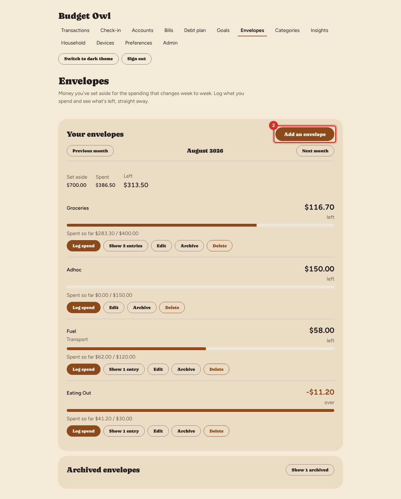
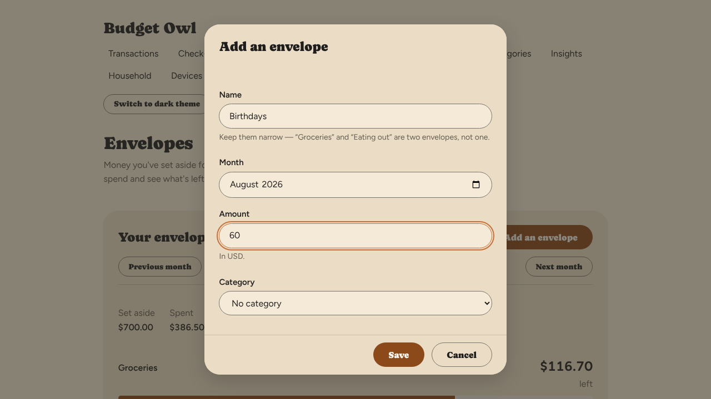

# Set up an envelope

An envelope is money you've set aside for one kind of spending this month — groceries, eating out,
fuel. You decide the amount, then log what you spend against it, and Budget Owl keeps telling you
what's left.

This is for the spending that changes week to week. For something owed on a date, like rent, use a
bill instead.

## Before you start

- You need to be an **owner** or a **member** of your household. A **viewer** can see envelopes
  and what's left in them, but can't set one up or log spending.

## Steps

1. Select **Envelopes** in the menu across the top.

   

   You'll see the month you're looking at, what you've set aside across all your envelopes, what
   you've spent, and what's left.

2. Select **Add an envelope**.

3. Enter a **Name**.

   

   **Keep them narrow.** "Groceries" and "Eating out" are two envelopes, not one. A weekly shop
   and a restaurant are different decisions, and lumping them together hides the thing you set the
   envelope up to see.

4. Check the **Month**.

   It starts on the month you're looking at. An envelope belongs to one month — next month you
   decide again, which is what lets you compare the two.

5. Enter the **Amount** you're setting aside.

   Zero is allowed. Deciding to spend nothing on something is a real decision.

6. Choose a **Category** if you want one.

   Optional. It's there so your envelopes and your transactions use the same words, but an
   envelope like "Adhoc" doesn't need one.

7. Select **Save**.

   Your envelope appears in the list with the whole amount still to spend.

## Moving between months

**Previous month** and **Next month** move the whole screen. Each month has its own envelopes and
its own totals.

When you open the screen, Budget Owl shows this month — unless you haven't set any up for this
month yet, in which case it shows the most recent month that has some, so you're not looking at an
empty screen wondering where everything went.

## Changing your mind

Select **Edit** to rename an envelope, change the amount, or change its category. The one thing
you can't change is which month it's for; make a new envelope for the other month instead.

**Archive** an envelope you've stopped using. It drops out of the list and stops taking new
entries, and everything you logged against it is kept. It also stops counting towards the month's
totals, because it's no longer part of your plan. You'll find it under **Archived envelopes**, with
a **Restore** button.

**Delete** removes the envelope and everything logged against it. Your transactions are kept —
only the envelope's own record of them goes. This can't be undone.

## If something doesn't work

**"An envelope with this name already exists."** You already have one with that name in that
month. The same name in a different month is fine, and is how you compare one month to the next.

**The Amount box won't accept what you typed.** It takes digits and at most one decimal point:
`60` or `60.00`, not `60,00` and not `$60`. You can't set aside a negative amount.
