# Use Budget Owl on your phone

The Budget Owl app for Android and iPhone shows the same household and the same figures as the
web. Record a coffee at the till, do Sunday's check-in on the sofa, and read your balances on a
train with no signal. The app talks to your household's own server and to nothing else.

## Before you start

- **Your server's address.** It starts with `https://` — ask the person who runs your household's
  server. If theirs starts with `http://`, the app won't connect to it until they follow
  [Give your server an HTTPS address](../give-your-server-an-https-address.md).
- **An account on that server, or an invitation link** from someone in your household.
- **The app.** Budget Owl isn't in the Google Play Store or the App Store yet, so the person who
  runs your server gives it to you. The next section says how.

## Get the app

### On Android

The person who runs your server gives you a file whose name ends in `.apk`. That file is the app.
Installing an app from a file instead of from the Play Store is called sideloading, and Android
lets you do it once you allow it.

**Only install a Budget Owl file that the person who runs your server gave you themselves.** A file
from anywhere else could be anything, and this app will hold your household's finances.

1. Open the file on your phone, from **Files**, **Downloads**, or the message it came in.

   Android may say your phone isn't allowed to install unknown apps from this source.

2. Select **Settings** in that message.

3. Turn on **Allow from this source**.

4. Go back.

   You'll see Budget Owl's install screen.

5. Select **Install**.

   Android may warn you that it doesn't know who made the app. That's expected for an app that
   didn't come from the Play Store. When it finishes, you'll see that the app is installed.

6. Select **Open**.

   You'll see **Connect to your server**.

The exact words differ a little between phone makers. When you're done, you can turn **Allow from
this source** off again: search your phone's **Settings** for **Install unknown apps**.

**Updates arrive the same way:** a new file from the person who runs your server. Open it and
select **Update**. You stay signed in.

### On iPhone

You can't install it yourself yet. The person who runs your server has to build it on a Mac and put
it on your iPhone with a cable, using
[the steps for them at the end of this page](#for-the-person-who-runs-the-server-build-the-app).
**If nobody in your household has a Mac, Budget Owl isn't available on iPhone for now.** Use the web
app in Safari instead: open your server's address, and it fits a phone screen.

Two things to know about an iPhone app built this way:

- **The first time you open it**, your iPhone may say the developer isn't trusted. Go to
  **Settings › General › VPN & Device Management**, select the Apple ID listed under **Developer
  App**, and select **Trust**.
- **It stops opening after seven days** when it was built with a free Apple account. That's Apple's
  limit, not Budget Owl's. Ask the person who runs your server to install it again from their Mac.
  What the app keeps on your phone is still there when it does.

## Connect to your server

1. Open Budget Owl.

   You'll see **Connect to your server**.

   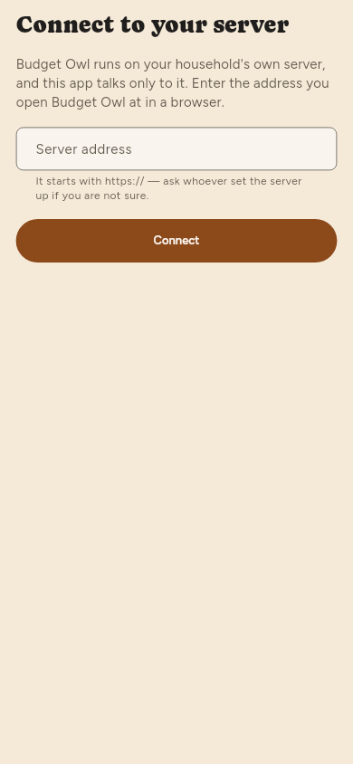

2. Enter your server's address in **Server address**.

   It's the address you open Budget Owl at in a browser, like `https://owl.example.test`. If you
   leave out `https://`, the app adds it. Type only the server's name: nothing after it, such as
   `/api`.

3. Select **Connect**.

   Before it sends anything, the app checks that the address answers over HTTPS with a certificate
   your phone trusts, and that it's a Budget Owl server this app can work with. If all of that is
   right, you'll see **Connected to** and your server's name.

   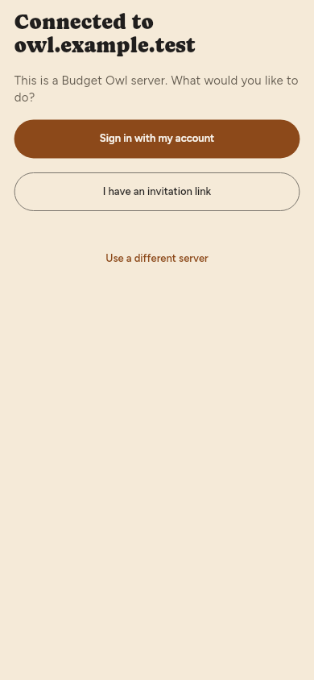

4. Choose what you're here to do:

   - **Sign in with my account** if you already have an account on this server.
   - **I have an invitation link** if someone in your household sent you one.
   - **Use a different server** if you typed the wrong address.

   On a brand-new server where nobody has an account yet, you'll see **Set up a new server**
   instead of **Sign in with my account**. That's for the person who runs the server: the first
   account made becomes its owner.

### Sign in

1. Select **Sign in with my account**.

   You'll see **Sign in**, with **Signing in to** and your server's name under it.

   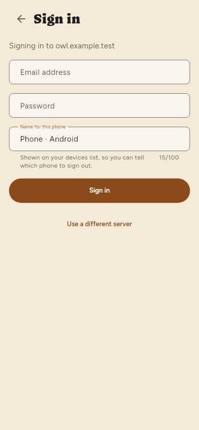

2. Enter your email address in **Email address**.

3. Enter your password in **Password**.

4. Check **Name for this phone**.

   It starts as **Phone · Android** on Android. It's how this phone appears on your list of
   devices, so give it a name you'll recognise, like `Sam's phone`.

5. Select **Sign in**.

   You'll see **Transactions**, with five tabs along the bottom.

The app signs in with an email address and a password only. If your server has turned that off in
favour of its own login provider, the app says so, and you sign in on the web instead.

### Join with an invitation link

1. Select **I have an invitation link**.

   You'll see **Join a household**, with a box for the link.

2. Paste the link into **Invitation link**.

3. Select **Connect**.

   You'll see **Before you join: who can see your finances**. Read it: the person who runs the
   server can see everything you record, and so can everyone else in the household.

   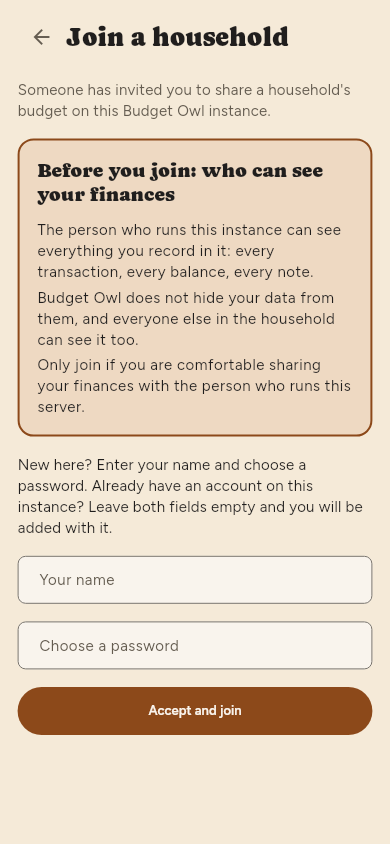

4. If you're new, enter **Your name** and a password in **Choose a password**.

   If you already have an account on this server, leave both empty, and you'll be added with that
   account.

5. Select **Accept and join**.

   You'll see **You have joined** and **Welcome to** with your household's name.

6. Select **Sign in**, and sign in as above.

## "Trusted through a certificate authority installed on this phone"

You'll see this on Android, and only if your server uses its own certificate authority: a
certificate maker the person who runs it set up themselves, and installed on your phone. It appears
on the connect screen and under **Server** on the **More** tab, with the authority's name and the
start of its fingerprint.

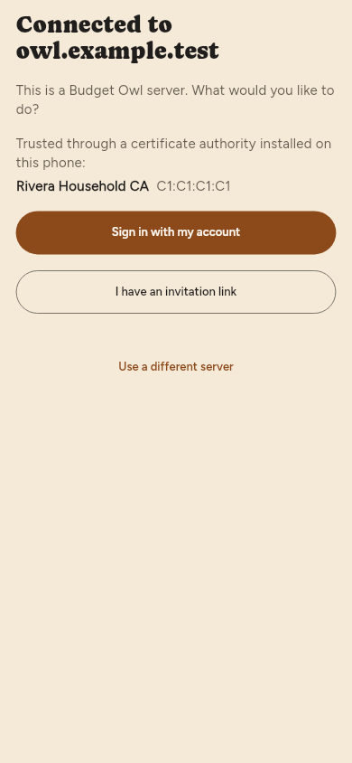

**The app remembers that one authority for this server.** From then on, it trusts your server
through it and through no other authority installed on your phone. If an employer's or a school's
authority is also on your phone, the app won't let it vouch for your household's server.

**On iPhone you won't see this note.** The app trusts your server whenever your iPhone does, through
any authority you've turned on full trust for, and it doesn't remember one in particular. If your
iPhone is managed by an employer or a school, ask the person who runs your server before you sign
in on it.

**Check the name is one you expect.** Ask the person who runs your server what theirs is called. If
you don't recognise it, don't sign in: something between your phone and your server may be able to
read the connection. Select **Use a different server**, which makes the app forget it, and talk to
the person who runs your server before you connect again.

If your server has a certificate every phone already trusts, you won't see this note at all. That's
normal.

### "…no longer installed on this phone"

On Android, this means the authority your server was trusted through has been removed from your
phone's settings. Until
it's back, the app can't reach your server, and the note says so.

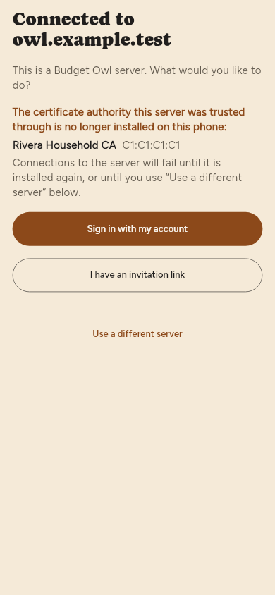

- **If it was removed by mistake**, install it again:
  [Use your own certificate authority](../give-your-server-an-https-address.md#3-use-your-own-certificate-authority)
  has the steps for each phone. Then switch back to Budget Owl.
- **If your server now has a different kind of certificate**, select **Use a different server**
  (or **Change server** on the **More** tab) and connect again. This signs you out and erases what
  the app keeps on this phone. Your household's data stays on the server.

## Use it without a signal

**You can still read what the app last fetched.** Open it with no signal, and your transactions,
accounts and bills are there as they were the last time the app reached your server. When that copy
is out of date, the screen says how old it is.

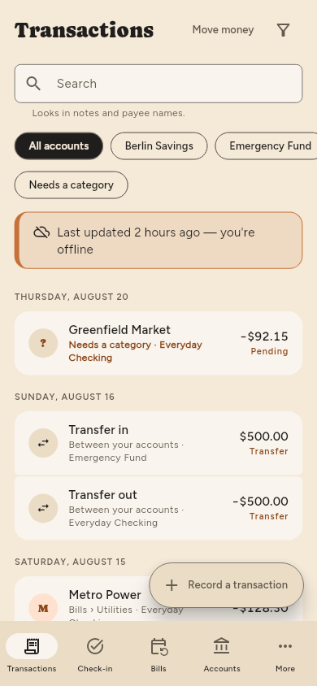

You'll see **— you're offline** when your phone has no connection, or **— the server didn't
answer** when it has one but your server isn't responding. If the app has never fetched a screen
before, it says **You're offline, and this phone has no saved copy of this yet.**

**Changes need a connection.** Without one, buttons that would change something are greyed out, and
the screen says **You're offline — this needs a connection**. Nothing is saved up to send later, so
a change can never land on top of something your partner changed in the meantime.

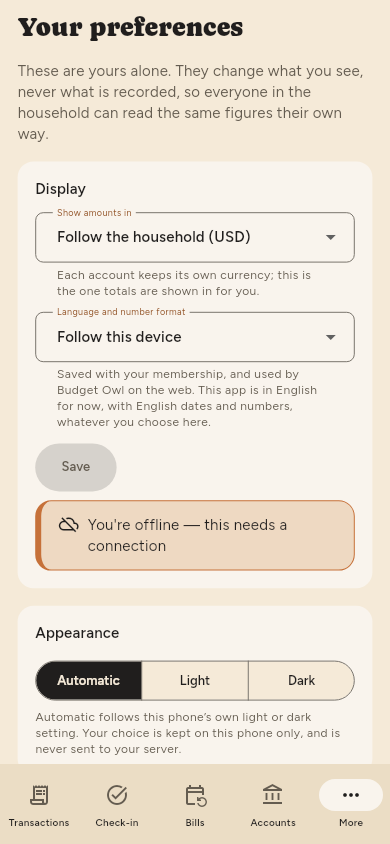

When you have a signal again, pull the screen down to refresh it.

Now and then you might see **Changes are off until the server confirms it runs a version this app
works with. Refresh to check again.** The app reached your server but hasn't yet confirmed it can
work with it, so it shows you your figures but changes nothing. Pull the screen down to refresh.
If the message stays, tell the person who runs your server.

## Sign out, and sign out a lost phone

**Signing out erases everything Budget Owl keeps on this phone.** Your household's data stays on
the server. The app remembers only your server's address, so signing back in is quick.

1. Select **More**.

2. Scroll to the bottom.

   You'll see **Server**, with your server's name and **Change server**, then **Sign out**.

   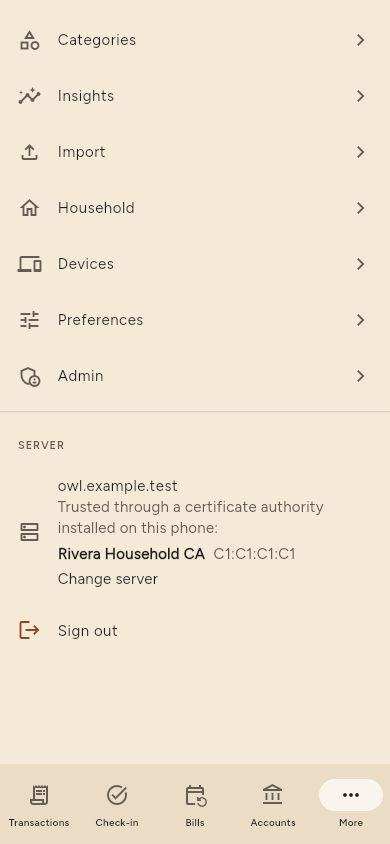

3. Select **Sign out**.

   A window asks **Sign out?** and says that everything Budget Owl keeps on this phone is erased.

4. Select **Sign out** in the window.

   You'll see the connect screen, with your server's name already there.

**Change server** does the same and also forgets the server's address. Use it when your household's
server moves to a new address.

### See where you are signed in

Select **More**, then **Devices**. Every browser and phone where you're signed in is listed, and
this one is marked **This phone**.

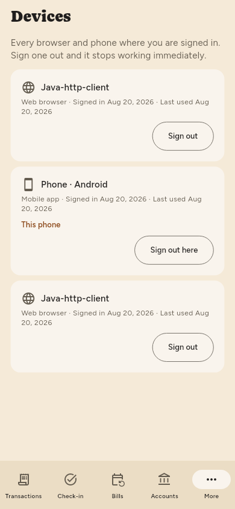

**Sign out here** signs this phone out and erases what the app keeps on it. **Sign out** on any
other row signs that device out straight away.

### If you lose your phone

1. Sign in to Budget Owl on the web, from any browser.

2. Go to **Devices**.

3. Find your phone by its name: the **Name for this phone** you gave it when you signed in.

4. Select **Sign out** on its row.

   It stops working straight away. The next time it reaches your server, the app erases everything
   it keeps on the phone and goes back to the sign-in screen.

**If the lost phone is offline, the copy on it stays until it next connects.** That copy is
encrypted, and nobody can read it without unlocking the phone. Someone who can unlock it can
read it, as they could read an open browser.

Full steps for the web: [See where you are signed in, and sign a device out](your-devices.md).

## What stays private

- **The app talks only to your household's server.** You don't need an account with us, and it sends
  nothing anywhere else: no usage tracking, no crash reports.
- **What it keeps on your phone is encrypted, and isn't copied into your phone's backups.**
- **It hides your figures in the app switcher.** When you leave the app, it covers its screen with a
  plain page that says **Budget Owl**, so the list of open apps doesn't show your balances. Your own
  screenshots still work.
- **Lock your phone.** The app has no lock of its own yet, so anyone holding your unlocked phone can
  open it.

## Where the phone differs from the web

Most of Budget Owl works the same way on your phone, and the other guides apply as written. These
are the differences.

**Five tabs along the bottom: Transactions, Check-in, Bills, Accounts and More.** Everything else is
under **More**: **Debt plan**, **Goals**, **Envelopes**, **Categories**, **Insights**, **Import**,
**Household**, **Devices** and **Preferences**, plus **Admin** for the person who runs the server.

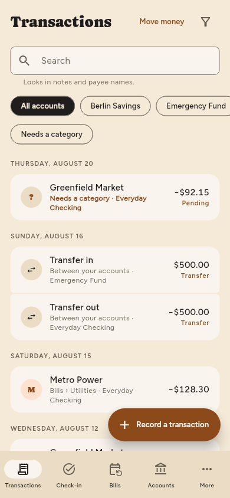

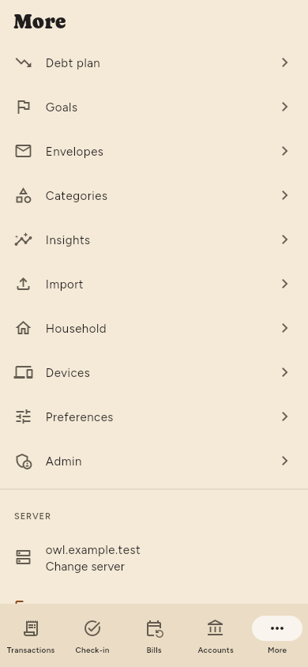

- **Record a transaction** is a round button at the bottom right of **Transactions**. **Move money**
  is at the top.
- **Screens under More have no back arrow.** Select **More** again, or use your phone's back gesture.
- **Accounts are grouped by currency, with no subtotal.** On the web each currency group has a
  **Subtotal**; the app shows each account's balance only.
- **Language and number format** is saved for you, but the app shows English, with English dates and
  numbers, for now.
- **Appearance** — **Automatic**, **Light** or **Dark** — is under **Preferences**, and is kept on
  this phone only.
- **Import** opens your phone's own file picker when you select **Choose a file**.
- **Sign-in is by email and password only** (see [Sign in](#sign-in)).

## Things that can go wrong

**"That address starts with http://…"**
The app connects only over HTTPS, because over plain `http://` your password and balances would
cross the network where anyone on it could read them. There's no way round this in the app. The
person who runs your server can fix it by following
[Give your server an HTTPS address](../give-your-server-an-https-address.md) — the page the message
names.

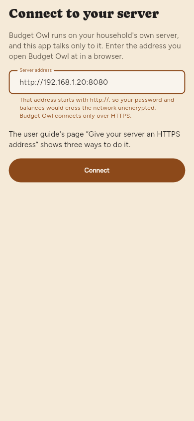

**"This phone doesn't trust the server's certificate…"**
Your server uses its own certificate authority, and it isn't installed on this phone yet. Install it
using
[Use your own certificate authority](../give-your-server-an-https-address.md#3-use-your-own-certificate-authority),
then select **Connect** again. There's no "connect anyway" button, on purpose: on a café's Wi-Fi, an
attacker's server would show you the same message, and a button would be the attacker's button.

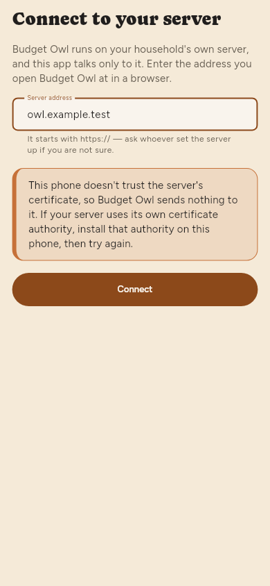

**Other messages on the connect screen**

| What you see | What to do |
| --- | --- |
| **No server answers to that name.** | Check the spelling, and that your phone is on a network that can reach your server. If your server is on Tailscale, turn Tailscale on. |
| **The server didn't answer.** | Your server may be switched off, or not reachable from where you are. Try again at home, or ask the person who runs it. |
| **The server's certificate is for a different name than the one you entered.** | Type the address exactly as the person who runs your server gave it to you. |
| **Something answered at that address, but it isn't a Budget Owl server.** | Check the address with the person who runs your server. |
| **This server's API is version …, and this app needs version …** | The app and your server are out of step. Ask the person who runs your server to update whichever is older. |
| **The server is busy. Try again in a minute.** | Wait a minute, then select **Connect** again. |

**"That invitation is for … not the server you entered."**
The link you pasted belongs to a different server from the one you connected to. If it names
`localhost`, the link was made on the server itself: ask the person who invited you for a new one,
made from the server's `https://` address. Otherwise, select **Cancel**, then **Use a different
server**, and enter the address at the start of the link.

**"Your session ended. Sign in again to continue."**
You were signed out, perhaps from the **Devices** screen on the web, and the app has erased what it
kept on this phone. Sign in again. Nothing your household recorded is lost.

## For the person who runs the server: build the app

This part is for you if you run your household's Budget Owl server. You'll need the Budget Owl
source code (the same download you installed the server from) and Flutter, the toolkit the app is
written in. Follow Flutter's own install guide for your computer, then run `flutter doctor`, which
lists anything still missing. Every command below runs in the `mobile` folder of the source code.

Before anyone can use the app, your server needs an HTTPS address:
[Give your server an HTTPS address](../give-your-server-an-https-address.md).

### Android: make the APK

You need Flutter and the Android SDK, which `flutter doctor` will help you install. Then:

```bash
cd mobile
flutter build apk --release
```

The app is `build/app/outputs/flutter-apk/app-release.apk`. Send that file to each person directly,
not through a public link, and they install it as described in [On Android](#on-android).

**Build updates on the same computer.** Android only accepts an update signed the same way as the
app already on the phone, and this build is signed with a key that lives on the computer that made
it. A file built elsewhere is refused as an update. If that happens, the person has to uninstall
Budget Owl first, which erases what it kept on their phone, then install the new file and sign in
again.

### iPhone: build it on a Mac

An iPhone app can only be built on a Mac, with Apple's Xcode. Without a Mac, there's no way to put
Budget Owl on an iPhone yet.

1. Install **Xcode** from the Mac App Store.

2. Open Xcode once.

   It finishes setting itself up, and may ask to install more components. Let it.

3. Install Flutter, and run `flutter doctor`.

   Fix anything it lists under **Xcode** before you go on.

4. In the `mobile` folder, run `flutter pub get`.

5. Connect the iPhone to the Mac with a cable, and unlock the iPhone.

6. On the iPhone, select **Trust** when it asks whether to trust this computer.

7. Open `mobile/ios/Runner.xcworkspace` in Xcode.

8. Select **Runner** in the list on the left, then the **Signing & Capabilities** tab.

9. Under **Team**, add your Apple ID and choose its **(Personal Team)**.

   A free Apple ID is enough. If Xcode says the bundle identifier is not available, change
   **Bundle Identifier** to something of your own, such as `app.budgetowl.yourname`.

10. On the iPhone, turn on **Developer Mode** if it isn't on already: **Settings › Privacy &
    Security › Developer Mode**.

    The phone restarts, then asks you to confirm.

11. Back on the Mac, in the `mobile` folder, run:

    ```bash
    flutter run --release
    ```

    Flutter builds the app, signs it with your Apple ID, puts it on the iPhone and opens it.
    (`flutter build ios` only builds the app, without putting it on a phone.)

12. When the app has opened, press `q` in the terminal.

    The app stays on the iPhone.

13. If the iPhone says the developer isn't trusted, go to **Settings › General › VPN & Device
    Management**, select your Apple ID, and select **Trust**.

**With a free Apple ID, the app stops opening after seven days.** Apple limits apps signed this way
to seven days. Connect the iPhone and run step 11 again to renew it; whatever the app keeps on the
phone is kept. A paid Apple Developer membership makes each install last a year instead.

For each other iPhone in your household, repeat steps 5, 6 and 10 to 13.

## Related

- [Give your server an HTTPS address](../give-your-server-an-https-address.md)
- [Join a household](join-a-household.md)
- [See where you are signed in, and sign a device out](your-devices.md)
- [Record a transaction](record-a-transaction.md)
- [Do your weekly check-in](do-your-weekly-check-in.md)
