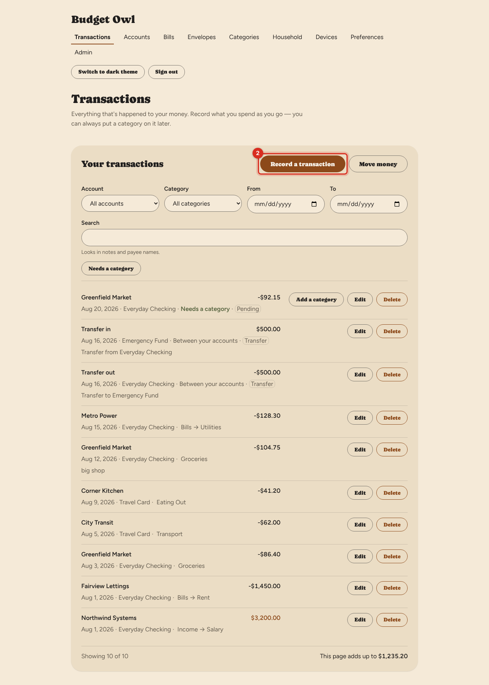
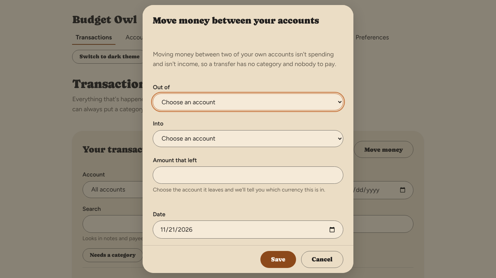
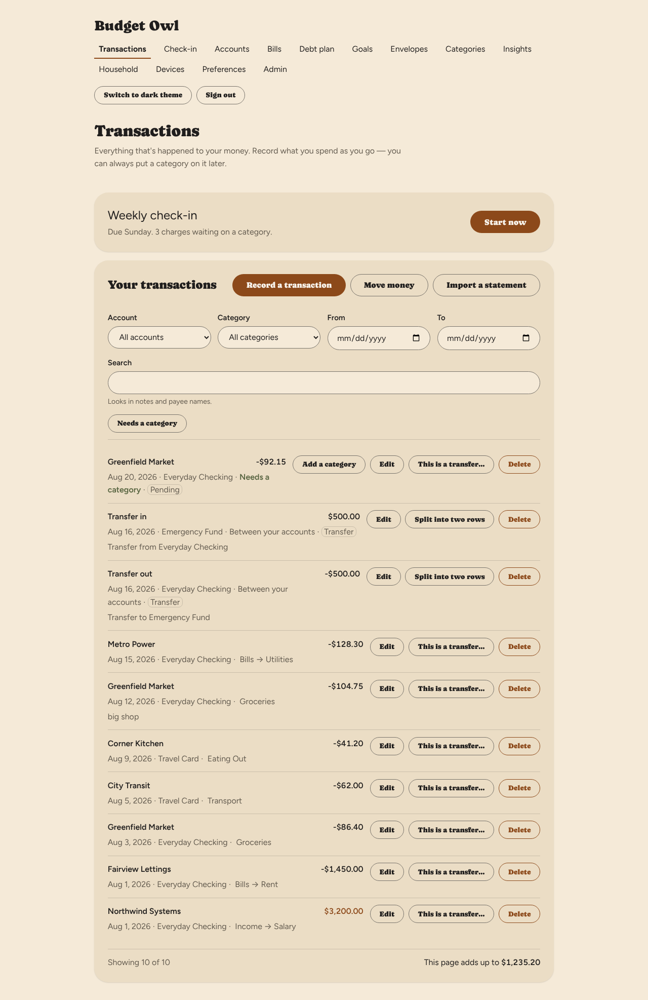

# Getting started

> **Status: partly written.** Steps 1 to 7 below are written from the running app. Steps 8, 9 and
> 10 are still outlines, and each gets written, with real screenshots, once somebody has run
> `tools/userguide-capture.sh` against the screen it describes. See `docs/roadmap.md` for the
> order.
>
> **Do not write steps here from the feature docs.** Feature docs describe what we intend to
> build; a user guide describes what shipped. Write each section only after running
> `tools/userguide-capture.sh` and looking at what is actually on screen.

Budget Owl helps you see where your money goes and plan where it should go. This walks you
through your first fifteen minutes, from creating your household to reading your first month's
budget.

**Already installed?** Good — start at step 1. If not, see
[Installing Budget Owl](installing.md) first.

## 1. Create your account and household

The first time Budget Owl starts, it asks you to create one account. That account becomes the
**owner** of a new household — the shared space everything else lives in.

1. Open Budget Owl in your web browser, at the address of your server.

   You'll see **Set up Budget Owl**.

2. Fill in **Your name**, **Email address**, **Password** and **Household name**.

   The password needs at least 12 characters. **Base currency** starts as **USD — US Dollar**;
   change it if your household uses another.

3. Select **Create account**.

   You are signed in, and you land on the **Household** screen with yourself listed as **Owner**.

**You will be able to see everything anyone in your household records.** You are the person
running this instance, so every transaction, every balance and every note in it is visible to you.
Budget Owl does not hide it, and anyone you invite is told this before they join.

Full steps, and what to do when something goes wrong:
[Create your account and household](features/create-your-account.md). Next time, you
[sign in](features/sign-in.md) instead. If your server is set up to use your own login provider,
that option is not covered here yet — email and password is.

## 1b. Invite the rest of your household

Budget Owl does not send email. You create an invitation link and send it to the person yourself.

1. Go to **Household** and select **Invite someone**.

2. Enter their email address, choose their role, and select **Create link**.

   You'll see the link, and a warning: **Treat this link like a password.**

3. Select **Copy link**, and send it to them.

   

**The link works like a password.** Anyone who has it can join your household, so send it only to the
person you mean, and revoke it if it reaches anyone else. It works once and expires on the date shown
under it.

**The roles:**

- **Owner** — everything, including inviting and removing people.
- **Member** — can see and change the household's money.
- **Viewer** — can see the household's money, but not change it.

The person who runs the server can see everything your household records, whatever anyone's role.
The person you invite is told this before they join.

Full steps: [Invite someone to your household](features/invite-someone.md). What the person you
invite goes through: [Join a household](features/join-a-household.md). Changing roles, removing
people, and leaving: [See who is in your household](features/manage-members.md).

## 2. Add your accounts

Tell Budget Owl where your money sits. Do this once for each account, and everything you record
later belongs to one of them.

1. Select **Accounts** in the menu across the top, then select **Add your first account**.

2. Fill in **Name**, choose the **Type** and the **Currency**, and scroll down inside the window
   to **Opening balance**.

   **Last four digits** is optional — it is shown beside the name, like **Travel Card •8820**, so
   you can tell two accounts at the same bank apart.

3. Select **Save account**.

   You'll see **Account added.** and the account in the list, with its balance.

   

**The opening balance is what the account held when you started tracking it** — usually the
balance your bank shows you today. **An account you owe money on starts with a minus:** a credit
card with 420.50 outstanding opens at **-420.50**, and its balance stays negative until you pay
it off. This is the step people most often get wrong, and getting it wrong leaves every later
balance out by the same amount.

Once you have accounts in more than one currency, they are grouped by currency and each group
gets its own **Subtotal**, as above. There is no total across currencies, on purpose: adding
dollars to euros needs a rate and a date, and the answer would be a guess printed as a fact.

Full steps: [Add an account](features/add-an-account.md). Closing an account later:
[Archive or delete an account](features/archive-or-delete-an-account.md).

## 3. Make the categories yours

A category is how you say what money was **for**. You already have about twenty of them — you
don't have to design a list before you start, and this step is five minutes of tidying rather than
homework.

1. Select **Categories** in the menu across the top.

   They're grouped under **Income** and **Spending**, with sub-categories indented under their
   parent.

   

2. Select **Edit** on anything whose name isn't how you'd say it, and change it.

3. Select **Archive** on the ones you'd never use.

   They drop out of the list and out of the category box when you record a transaction. Your old
   transactions still show them, so last year's spending still reads correctly.

4. Select **Add a category** for anything missing, or **Add a sub-category** on the one it belongs
   under.

**Choose the Kind carefully — it's the one thing you can't change.** **Income** for money
arriving, **Spending** for money going out. Changing it later would change the meaning of
everything already filed under it, so Budget Owl asks now rather than arguing with you later.

**Two levels, no more.** **Bills → Utilities** works. **Bills → Utilities → Water** doesn't. If
you find yourself wanting a third level, that's usually a sign the thing you want is a note on the
transaction, not another category.

Don't spend long here. You can add a category at the moment you need it, and every transaction can
sit as **Needs a category** until you decide.

Full steps: [Organise your categories](features/organise-your-categories.md).

## 4. Record your first transactions

This is the thing you'll do most. Everything else in Budget Owl is worked out from it, and there's
nothing to tidy up first.

1. Select **Transactions** in the menu across the top — it's also where Budget Owl starts when you
   sign in.

2. Select **Record a transaction**.

   

3. Check the **Account** and the **Date**.

   The date starts on today, which is right most of the time.

4. Choose **Money out** or **Money in**, then enter the **Amount**.

   Just the number — `18.40`. **You never type a minus sign**; that choice is what makes it count
   the right way.

5. Fill in **Who it was with**, choose a **Category**, and select **Save**.

   Both are optional. After a couple of letters, Budget Owl suggests names you've used before.

   Your transaction appears at the top of the list, and the balance on the **Accounts** screen has
   already changed to match.

**Your balances come from what you record.** You give an account its opening balance once, and
from then on every balance is worked out from your transactions. You never type a balance in to
correct one — you record the thing you missed.

**It's fine to leave the category blank.** Getting it written down matters more than getting it
filed. Transactions without one are marked **Needs a category**, and the button of the same name
turns the list into a to-do list for later.

Full steps: [Record a transaction](features/record-a-transaction.md) and
[Give a transaction a category](features/give-a-transaction-a-category.md).

## 5. Give your spending an envelope

An envelope is money set aside for one kind of spending this month — groceries, eating out, fuel.
It's for the spending that changes week to week; something owed on a date, like rent, is a bill
instead (step 6).

1. Select **Envelopes** in the menu across the top, then select **Add an envelope**.

2. Enter a **Name**, check the **Month**, and enter the **Amount** you're setting aside.

   A **Category** is optional — it's there so your envelopes and your transactions use the same
   words.

3. Select **Save**.

   

4. Select **Log spend** on the envelope as you spend, enter the **Amount**, and select **Log it**.

   The amount is the only thing you have to fill in, and the envelope's **left** figure changes
   straight away. On a phone the number keypad opens for you.

**The big number is what's left**, not what you've spent. That's the number you can still do
something about, so it's the one in large type — and an envelope you've gone past shows what
you're **over**, in a colour you'll notice.

**Keep envelopes narrow.** "Groceries" and "Eating out" are two envelopes, not one. A weekly shop
and a restaurant are different decisions, and lumping them together hides the thing you set the
envelope up to see.

**An envelope belongs to one month.** Next month you decide again, which is what lets you compare
the two.

**Nothing is filed into an envelope automatically.** You can attach a transaction you've already
recorded, and the log says whether each entry was **Typed** or came **From a transaction** — but
Budget Owl never guesses the match for you, however obvious it looks.

Full steps: [Set up an envelope](features/set-up-an-envelope.md) and
[Log spend in an envelope](features/log-spend-in-an-envelope.md).

## 6. Put in your bills and income

Rent, subscriptions and payday are the predictable half of your money. Put them in once and they
appear in every month they fall in — and Budget Owl can tell you what's left.

1. Select **Bills** in the menu across the top.

   You'll see **Bills & income**, opened on the month you're in.

2. Select **Add an income source**, and enter a name, what arrives **each time**, and when.

   The month's total is worked out from the schedule, so something arriving every other week is
   worth more in the months that hold three arrivals.

3. Select **Add a bill**, under **Your bills**, and enter a name, the amount you expect, and when
   it's due.

   Monthly, yearly, weekly, every other week, or irregular — for the vet, where there's no date to
   predict.

4. Select **Mark paid** on a bill's row when you pay it.

   Each date gets its own row, so a weekly bill is ticked off a week at a time.

**A bill is a plan, not a payment.** Marking one paid records what your household says happened.
It doesn't move money and doesn't create a transaction — only a transaction is ever money that
really went.

**Bills count towards the month whether or not you've paid them.** Rent that has already gone is
not money you still have, so ticking it off doesn't make **What's left this month** go up. The
**Still to pay** line is the one that drops.

Full steps: [See what's left this month](features/see-whats-left-this-month.md),
[Add your income](features/add-your-income.md), [Add a bill](features/add-a-bill.md) and
[Mark a bill paid](features/mark-a-bill-paid.md).

## 7. Move money between your own accounts

Money going from your current account into savings hasn't been spent, and money coming back out
hasn't been earned. It's the same money in a different place, and it goes in as a **transfer**.

1. Select **Transactions** in the menu across the top.

2. Select **Move money**, beside **Record a transaction**.

   A window opens, and says at the top that a transfer has no category and nobody to pay.

   

3. Choose the account the money left, in **Out of**.

   Each account is listed with its currency, because that's what the amount will be in.

4. Choose the account it arrived in, in **Into**.

5. Enter the **Amount that left** — the number on its own, with no minus sign.

6. Select **Save**.

   You'll see **Money moved.** above the list.

**A transfer shows up as two rows**, one in each account: **Transfer out** where the money left,
**Transfer in** where it landed.

Nothing is counted twice. An account's balance is worked out from the rows in that account, so
each account has to carry its own side of the move. Both rows say **Between your accounts** rather
than asking for a category — a transfer is never spending and never income, so no category could
be right for it.

**If the two accounts are in different currencies**, Budget Owl asks for a second figure: what
arrived. It doesn't convert anything, because it doesn't know what your bank charged — the fee is
usually inside the rate. Copy both figures off your statement.

Full steps, correcting one, and deleting one:
[Move money between your own accounts](features/move-money-between-accounts.md).

## 8. Make a plan for what you owe

_Awaiting slice 10._

Will cover: entering a debt's terms, choosing between paying the highest rate first or the
smallest balance first, and seeing what each one does to the date you are finally clear.

## 9. See where your money went

_Awaiting slice 13._

Will cover: reading the reports, spotting the category that surprised you, and comparing months.

## 10. Put it on your phone

_Awaiting slice 15._

Will cover: installing the mobile app, pointing it at your own server, and adding a transaction
while you are standing in the shop — which is where most budgeting actually happens.

## Where to go next

Once these exist, each section links to the full guide for that feature in
[the help index](README.md).
