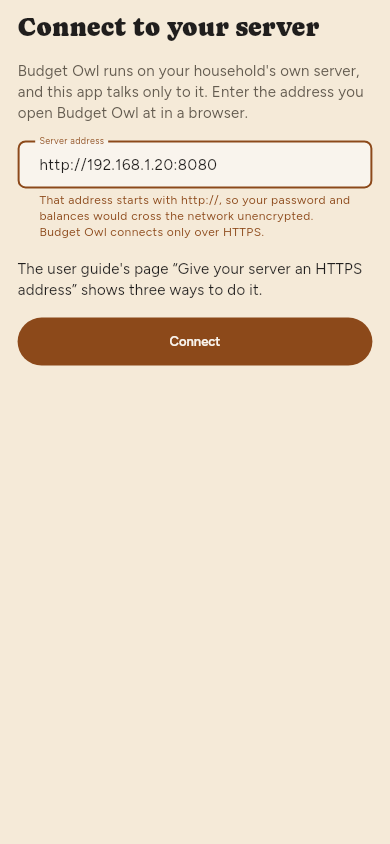
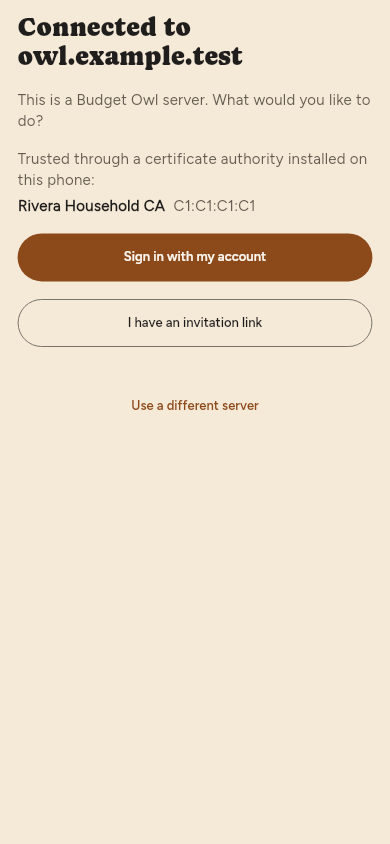

# Give your server an HTTPS address

The Budget Owl phone app connects to your server only over `https://`, and only when the phone
trusts the server's certificate. As installed, Budget Owl answers at `http://localhost:8080`, on the
server itself and nowhere else. This page puts an HTTPS address in front of it, so your household's
phones can reach it. The web app works at the new address too.

This page is for the person who runs the server. Everyone else needs only the address you end up
with, and [Use Budget Owl on your phone](features/use-budget-owl-on-your-phone.md).

If somebody sent you here from this message in the app, you're in the right place:



## Never use plain http:// from another device

Over `http://`, every password, sign-in and balance crosses the network as readable text. On your
own Wi-Fi that's anyone on the Wi-Fi; on a phone, it's also every café and hotel network it joins.
That's why the app refuses an `http://` address. Leave the server listening on `127.0.0.1:8080`, as
it was installed. Don't open port 8080 to your home network; put one of the three options below in
front of it instead.

**There is no "trust this certificate anyway" button, and there won't be one.** On someone else's
Wi-Fi, an attacker's server produces exactly the same warning as your own server with a
misconfigured certificate. A button that skips the warning is the button the attacker wants
pressed, and people press it without reading. Every option below makes the warning go away
properly instead.

## Before you start

- Budget Owl is running, and `http://localhost:8080` opens it in a browser on the server itself.
  See [Installing Budget Owl](installing.md).
- You can run commands on the server, with `sudo`.

## Choose one

| | Works on | Reachable from | What it needs |
| --- | --- | --- | --- |
| **1. Tailscale** (recommended) | Android and iPhone | Anywhere, by devices on your tailnet | A Tailscale account, and the Tailscale app on every phone |
| **2. A reverse proxy with a public certificate** | Android and iPhone | The internet, or only home (see the end of the section) | A domain name you own |
| **3. Your own certificate authority** | Android and iPhone, once installed on each | Your home network | A certificate installed on every phone, by hand |

The commands below were written from each tool's documentation, which changes. If a step here
disagrees with the tool's own current instructions, follow the tool's.

## 1. Use a Tailscale HTTPS name

Tailscale makes a private network between your own devices, called a tailnet. It can give your
server a name like `home.example.ts.net`, with a certificate every phone already trusts, and only
devices signed in to your tailnet can reach it. Nothing is opened to the internet.

The connection between a phone and your server is encrypted all the way, and the HTTPS connection
ends on your own server, so Tailscale doesn't see your household's data. Tailscale is a separate
company's service with its own account. Budget Owl doesn't need it; it's one convenient way to get a
trusted name.

1. Install Tailscale on the server, and sign in, following Tailscale's instructions for your system.

   The server appears in your Tailscale admin console.

2. In the admin console, go to the **DNS** page.

3. Check that **MagicDNS** is on.

4. Under **HTTPS Certificates**, select **Enable HTTPS**.

   Tailscale tells you that your machine names and your tailnet's name will be published in a
   public log of certificates. That's how every publicly trusted certificate works. Name your server
   something that gives nothing away.

5. On the server, run:

   ```bash
   sudo tailscale serve --bg 8080
   ```

   It prints the address your server now has, like `https://home.example.ts.net`. `--bg` keeps it
   running after you close the terminal and after the server restarts. If it prints a link asking
   you to allow this on your tailnet, open the link, allow it, and run the command again.

6. On each phone, install the **Tailscale** app from the Play Store or the App Store.

7. Sign in to Tailscale on the phone, with an account on the same tailnet.

8. In Budget Owl, enter the address from step 5, and select **Connect**.

   The first connection can take a few seconds while your server fetches its certificate.

To see what Tailscale is serving, run `tailscale serve status`. To stop, run
`sudo tailscale serve reset`.

**Use `tailscale serve`, not `tailscale funnel`.** Funnel puts the address on the public internet.

**Tailscale has to be on.** A phone with Tailscale switched off can't reach the server, and the app
says no server answers to that name.

## 2. Use a reverse proxy with a public certificate

A reverse proxy answers on `https://` and passes requests to Budget Owl on `localhost:8080`. The
example here is Caddy, because it gets and renews a publicly trusted certificate on its own. Any
reverse proxy works.

You need a domain name you own. The steps below make Budget Owl reachable from the internet: its
sign-in page, not your data, is what the world can reach. If you'd rather it weren't, read
[Only from home](#only-from-home) first.

1. Point a name at your home: in your domain's DNS settings, add a record for a name like
   `owl.example.test` with your home's public IP address.

2. On your router, forward ports 80 and 443 to the server.

   Caddy needs both: 80 to prove to the certificate authority that you own the name, and 443 for
   Budget Owl.

3. Install Caddy on the server, following Caddy's instructions for your system.

4. Replace the contents of the Caddyfile (usually `/etc/caddy/Caddyfile`) with this, using your own
   name:

   ```
   owl.example.test {
   	reverse_proxy localhost:8080
   }
   ```

5. Reload Caddy:

   ```bash
   sudo systemctl reload caddy
   ```

   Caddy gets a certificate for the name and renews it before it runs out.

6. Open `https://owl.example.test` in a browser.

   You'll see Budget Owl, with no certificate warning.

7. In Budget Owl on the phone, enter that address, and select **Connect**.

### Only from home

Caddy can prove you own the name through your DNS provider instead of over port 80, so nothing has
to be forwarded and the server stays off the internet. You need a version of Caddy that includes
your DNS provider's plugin, and an access key from the provider. For Cloudflare, for example, the
site block becomes:

```
owl.example.test {
	tls {
		dns cloudflare {env.CF_API_TOKEN}
	}
	reverse_proxy localhost:8080
}
```

Keep the access key in Caddy's environment, not in the Caddyfile. Then point the name at the
server's address on your home network, such as `192.168.1.20`. Phones reach it only while they're
on your home Wi-Fi. The plugin for your provider documents its own lines.

## 3. Use your own certificate authority

A certificate authority is what vouches for a certificate. You can run your own, and have it vouch
for your server. Phones don't know your authority, so you install it on every phone, once. Use this
when you don't want Tailscale and don't own a domain name.

### Make the certificate

Caddy can be its own certificate authority. Use the Caddyfile from option 2, with one more line:

```
owl.example.test {
	tls internal
	reverse_proxy localhost:8080
}
```

Reload Caddy (`sudo systemctl reload caddy`). It creates its own authority and gives your server a
certificate from it.

The name, here `owl.example.test`, has to lead to the server on your home network. Most routers let
you add a name for a device on the network. The address you type in the app must be exactly that
name.

The authority's certificate is a file called `root.crt`, in Caddy's data folder under
`pki/authorities/local/`. With Caddy installed from its Linux package, that's usually
`/var/lib/caddy/.local/share/caddy/pki/authorities/local/root.crt`.

**Copy only `root.crt` to phones. Never `root.key`.** Anyone with the key can make certificates
that every phone trusting your authority will accept, for any website at all, not only yours. It
stays on the server.

If you already run a certificate authority of your own, the steps for the phones are the same, with
its certificate instead of `root.crt`.

### Install it on an iPhone

1. Send `root.crt` to the iPhone by AirDrop, or by email to yourself, and open it there.

   The iPhone says the profile was downloaded.

2. Open **Settings**, and select **Profile Downloaded** near the top.

3. Select **Install**, and enter the iPhone's passcode.

4. Select **Install** again to confirm.

5. Go to **Settings › General › About › Certificate Trust Settings**.

6. Turn on full trust for your authority, and select **Continue**.

   Without this step, the profile is installed but the iPhone still doesn't trust your server.

### Install it on Android

1. Copy `root.crt` onto the phone, into **Downloads**.

2. Open **Settings › Security › Encryption & credentials › Install a certificate › CA
   certificate**.

   On some phones it's under **Security & privacy › More security settings**. Searching Settings
   for **CA certificate** finds it.

3. Android warns that your data won't be private. Select **Install anyway**.

4. Choose `root.crt`.

   If Android asks you to confirm with your screen lock, do so. The phone says the certificate is
   installed.

### Connect

Install the authority before you connect. Then, in Budget Owl, enter `https://owl.example.test`
and select **Connect**. On Android, you'll see your authority's name under **Trusted through a
certificate authority installed on this phone**:



**On Android, the app remembers that authority for this server**, and from then on trusts your
server through it and through no other authority on the phone. Tell your household what your
authority is called (Caddy's starts with **Caddy Local Authority**), so they can check the name they
see. If it's ever removed from the phone's settings, the app stops reaching your server and says
so.

On iPhone there's no note: the app trusts your server whenever the iPhone does, through any
authority with full trust turned on.

## After you have an address

- **Make invitations from the new address.** An invitation link starts with the address you were
  using when you made it. One made at `http://localhost:8080` is a `localhost` link, and the app
  refuses it because it isn't for the server the phone connected to. Open Budget Owl at the `https://`
  address before you select **Invite someone**.
- **Give your household the address** with `https://` at the start.

## Things that can go wrong

**The app says "This phone doesn't trust the server's certificate…"**
With option 3, the authority isn't installed, or isn't fully trusted. On an iPhone, check step 6 of
[Install it on an iPhone](#install-it-on-an-iphone). On Android, check that you chose **CA
certificate**, not a different kind of certificate. With options 1 and 2, open the address in a
browser on the phone; if the browser warns too, the certificate is wrong on the server.

**The app says "The server's certificate is for a different name than the one you entered."**
The address in the app must be exactly the name in your Caddyfile, or the name `tailscale serve`
printed.

**The app says "No server answers to that name."**
The phone can't look the name up. With Tailscale, check that Tailscale is on and signed in to the
same tailnet. With option 3, check that the phone is on your home Wi-Fi and that your router knows
the name.

**Caddy can't get a certificate (option 2).**
Check that the DNS record points at your current public address and that ports 80 and 443 reach the
server. `sudo journalctl -u caddy` shows what Caddy tried.

**Someone's invitation link is refused: "That invitation is for localhost:8080, not the server you
entered."**
The invitation was made at `http://localhost:8080`. Revoke it, open Budget Owl at the `https://`
address, and make a new one.

## Related

- [Use Budget Owl on your phone](features/use-budget-owl-on-your-phone.md)
- [Installing Budget Owl](installing.md)
- [Invite someone to your household](features/invite-someone.md)
