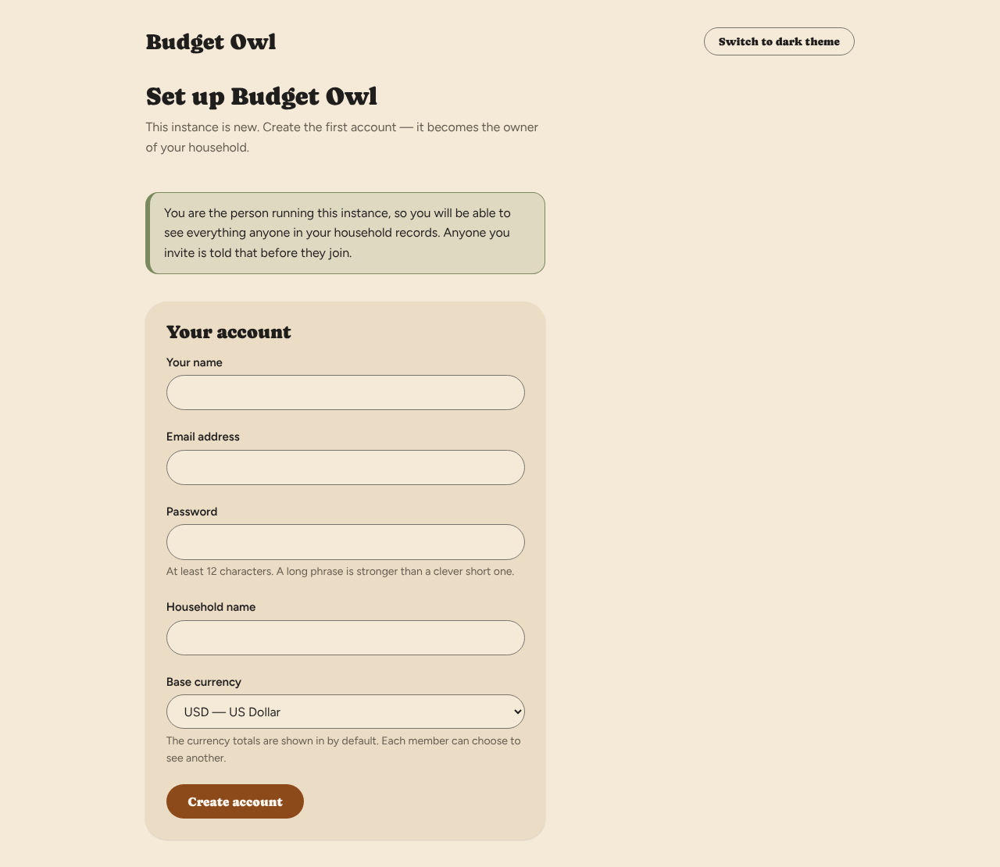

# Installing Budget Owl

> **Status: outline.** Budget Owl is not released yet and these steps do not exist to follow. This
> file is the planned shape of the install guide; it gets written, with real commands and real
> output, when slice 1 ships the Compose file.
>
> **Do not write steps here from the architecture docs.** Write them after actually installing on
> a clean machine and recording what happened — including what went wrong.

Budget Owl runs on your own hardware. You will need a machine that stays on — a home server, a
NAS, a mini PC, a VPS — with Docker installed.

You do not need to be an expert. If you have run anything with Docker Compose before, this will
be familiar; if you have not, the steps below are meant to be followable anyway.

## 1. What you need

_Awaiting slice 1._

Will cover: Docker and Docker Compose, roughly how much disk and memory, and what to decide
before starting (where data lives, whether it will be reachable outside your network).

## 2. Get it running

_Awaiting slice 1._

Will cover: the `docker-compose.yml`, the handful of environment variables that matter, setting a
database password, and starting it for the first time.

## 3. Create the first account

Open Budget Owl in a web browser at the address of your server. A new instance shows **Set up
Budget Owl**.

1. Fill in **Your name**, **Email address**, **Password** (at least 12 characters) and **Household
   name**.

2. Select **Create account**.

   You are signed in and land on the **Household** screen. Your account is the **owner** of a new
   household.



**You are now the person who runs this instance, and you can see everything.** Every transaction,
every balance and every note anyone in your household records is stored on your server, and you
can see all of it. Budget Owl does not hide it from you. Anyone you invite is told this before
they join; it is worth telling them yourself too.

This screen only appears on a new instance. After the first account exists, everyone else joins
by invitation: see [Invite someone to your household](features/invite-someone.md). The full
walkthrough is in [Create your account and household](features/create-your-account.md).

## 4. Reach it from your phone

_Awaiting slice 15._

Will cover: pointing the mobile app at your server, what to do about certificates on a local
network, and reaching it from outside your house safely.

## 5. Back it up

_Awaiting slice 1._

Will cover: what to back up, how to restore, and testing the restore — because a backup nobody
has restored is a hope, not a backup. This matters more here than in most apps: nobody else has a
copy of your data.

## 5b. Run the instance

Budget Owl keeps one screen for the person who runs the server: **Admin**, at the end of the row
of links across the top. It appears only for the account that completed **Set up Budget Owl**, and
it covers three things:

- **This instance** — the version running, when the server was set up, who looks after it, and how
  many accounts exist.
- **Signing in** — whether anyone may create an account, whether people sign in with an email
  address and a password, and whether they can sign in through a provider you already run.
- **Accounts** — everybody who can sign in. Read-only: suspending or removing an account is not
  something this screen does.

Nothing else an operator does lives in the app. Backups, upgrades, logs and the database are all
done on the machine, because the machine is yours.

Full steps: [See who can sign in to your server](features/see-who-can-sign-in.md) and
[Choose how people sign in](features/choose-how-people-sign-in.md).

**Two things on that screen surprise people, so they are worth knowing before you meet them.**
Email and password sign-in cannot be switched off until somebody has actually signed in through
your own provider — proving the new way in before hiding the old one is what stops you being
locked out. And replacing the client secret for that provider switches email and password sign-in
back on, because a credential nobody has used yet is a credential nobody has proved.

## 6. Keep it up to date

_Awaiting slice 1._

Will cover: pulling a new version, what happens to the database, and what to do if an upgrade
goes wrong.

## Things that commonly go wrong

### Nobody can sign in

If you switched Budget Owl over to your own login provider and that provider has since stopped
working, the sign-in page has nothing left to offer you. The way back in doesn't need a browser.

On the machine running Budget Owl, from the folder holding your `docker-compose.yml`:

```bash
deploy/restore-password-login.sh --dry-run   # see what it would change
deploy/restore-password-login.sh             # turn email and password sign-in back on
```

Then sign in with your email address and password as you did before. Your login provider is left
exactly as it was, so you can fix it and hide password sign-in again afterwards, from **Admin** in
the app.

It's safe to run when you aren't sure that's the problem: if password sign-in is already on, it
says so and changes nothing.

### Everything else

_To be written from real installs, not imagined._
